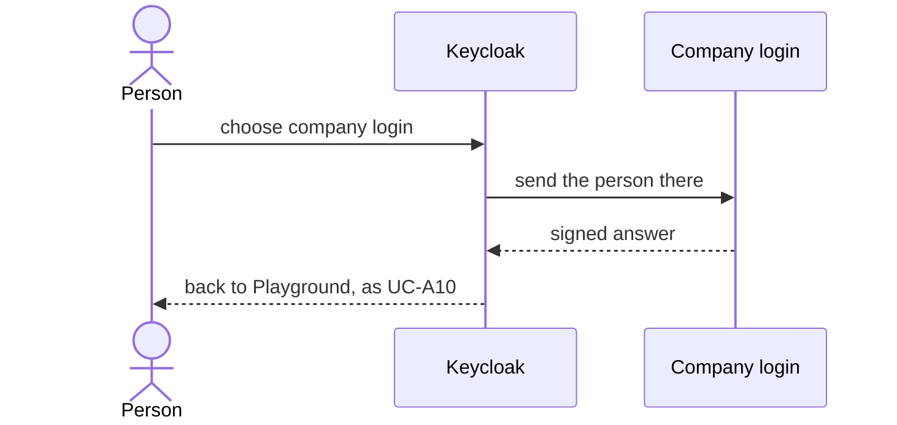

```yaml
id: UC-A15
type: use-case
name: Sign in through company single sign-on
status: draft
actor: person (not yet signed in)
context: BC-ACCESS
satisfies: [FR-24]
criteria: []
parameters: []
objects: [OBJ-A1]
rules: []
effects:
  - the person is linked to a Keycloak user from the company login
  - the first time, a pending account is made (UC-A12)
evolved_from: [MK3 UC-A6]
```

# Sign in through company single sign-on

> Study copy. Rewritten from MK3's UC-A6 (SSO login) for Keycloak. It is a Release 2 item (FR-24).
> **FR-24 has no acceptance criterion yet.** Hand this to vbench-req.

## What this serves

**FR-24**: The system shall let a person sign in through single sign-on.

## Description

The person signs in with their company login, not a password kept in Keycloak. Keycloak does the work: it is set up to trust the company's identity provider (an identity brokering setting). Playground's code does not change. From the web server's side it is still the same flow as UC-A10, and Keycloak still hands back its own token.

## What changed from MK3

| MK3 UC-A6 | Playground UC-A15 |
|---|---|
| Planned, not built. Would have needed our own OIDC client code and a way to link external users to our user table | Keycloak configuration: add an identity provider to the realm, and map its claims |
| Each provider means more code | Each provider is a setting, and the realm export carries it |

This is the clearest example of why a realm file belongs in its own repo (phase 2 of the project): switching on single sign-on is a change to configuration, not to code.

## Preconditions

- The realm has the company's identity provider configured.
- The person has a company login.

## Main flow

1. The person asks to sign in. The system sends them to Keycloak, as in UC-A10. (FR-24)
2. Keycloak's login page offers the company login. The person chooses it. (FR-24)
3. Keycloak sends the person to the company's login. They sign in there. (FR-24)
4. The company login sends the person back to Keycloak. Keycloak creates or finds a Keycloak user for them. (FR-24)
5. Keycloak sends the person back to Playground with a code, and the flow goes on as in UC-A10, steps 5 to 9. (FR-24)
6. On the first request, the API makes a pending account if there is none (UC-A12). (FR-24)

## Other flows

- The company login refuses the person: Keycloak shows an error and no token is issued.
- The person has no Playground account: they are pending, and signing in proves only who they are. The account request page is offered. Single sign-on does not approve anyone.
- The company login gives an email that already belongs to another Keycloak user: Keycloak decides whether to link them. Open: this matters, because the account is linked by the Keycloak id. Linking by email in Keycloak should happen only for a verified email.
- Open: roles from the company. Playground keeps roles in its own database, so a company group must not make someone an administrator.

## Postconditions

- As UC-A10, and a Keycloak user exists that is linked to the company login.

## Overview

The high level picture. The detailed sequence, with step numbers that match the main flow, is in [UC-A15-sign-in-through-company-single-sign-on-sequence.puml](diagrams/UC-A15-sign-in-through-company-single-sign-on-sequence.puml).



## Slices

1. Configure the identity provider in the realm (no code).
2. Check the account and linking rules on the first request.
