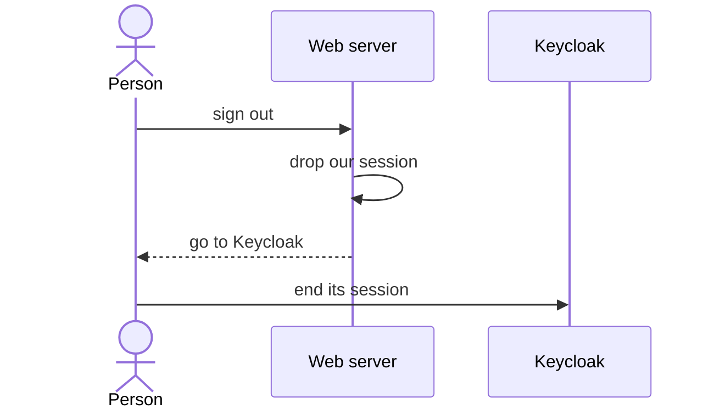

```yaml
id: UC-A2
type: use-case
name: Sign out
status: draft
actor: signed-in person
context: BC-ACCESS
satisfies:
  - id: FR-2
criteria:
  - id: AC-2
parameters: []
objects: []
rules: []
effects:
  - the web server forgets the session and its tokens
  - Keycloak ends its own session
  - the session cookie is removed
evolved_from: [MK3 UC-A2]
```

# Sign out

<!-- vbench-uc:begin mirror (generated from the requirements files, do not edit here: change the row, then run sync) -->

<details>
<summary>The requirements and criteria it runs, copied from docs/requirements (1 requirement, 1 criterion). Do not edit.</summary>

## What this serves

**FR-2**: The system shall let a person sign out.

## Acceptance criteria it runs

**AC-2** (acceptance, proves FR-2)

- Given a signed-in person
- When they sign out
- Then their session stops working, and starting a sign in shows the identity provider's login page

## How it is verified

- acceptance: AC-2

Each criterion is run by a test tagged `Verifies AC-<n>`.

</details>

<!-- vbench-uc:end mirror -->

> Study copy. Rewritten from MK3's UC-A2 (logout) for Keycloak.


## Description

Signing out has to end two sessions, not one: the product's own session and Keycloak's. If only ours ended, the next click on "Sign in" would log the person straight back in, because Keycloak still remembers them.

## What changed from MK3

| MK3 UC-A2 | Playground UC-A2 |
|---|---|
| Revoke the refresh token's `jti` in the Redis whitelist | Nothing to revoke: we keep no whitelist |
| Clear two cookies | Clear one session cookie, and drop the session on the server |
| One session to end | Two to end: ours, and Keycloak's, through its end-session address |
| `POST /auth/session/logout` | `POST /auth/logout` only. A link or an image on another site cannot sign a person out |

New in the design language: **the ID token is kept so it can be handed back to Keycloak as a hint** when ending its session. That is why the session holds an ID token and not just an access token.

## Preconditions

- The person is signed in.

## Main flow

1. The person asks to sign out, by a button that posts. (FR-2)
2. The system finds the session from the cookie and removes it, with its tokens, from the server. (FR-2)
3. The system sends the person to Keycloak's end-session address with the ID token as a hint and the home page as the place to return. (FR-2)
4. Keycloak ends its session and sends the person to the home page. (FR-2)
5. The system removes the session cookie. (FR-2)
6. The product asks the person to sign in again, and starting a sign in shows the identity provider's login page, because Keycloak's session has ended too. (FR-2, AC-2)

## Other flows

- The person has no session, or the session has already gone: the system still removes the cookie and sends the person to the home page. (AC-2)
- Sign out is reused by UC-A1's beta step 10 (R2, decision 13), to end both sessions of a deactivated person who gets through. Nothing changes here for it.
- Keycloak cannot be reached for its end-session address: our session is still removed and the person lands on the home page. Their Keycloak session ends by itself when it times out. Open: say so on screen.
- The request is a GET, for example from a link or an image on another site: it does nothing.
- Someone keeps a copy of the access token from before: it still passes the API's checks until it expires, which is short. The API reads the account on every request, but a signed-out person's account is still active. Open: to cut this to zero, the API would need to ask Keycloak whether the token is still live.

## Postconditions

- The server holds no tokens for this session.
- Keycloak has no session for the person in this browser.
- The browser holds no session cookie.

## Overview

The high level picture. The analysis sequence is in [UC-A2-sign-out-analysis-sequence.puml](diagrams/UC-A2-sign-out-analysis-sequence.puml) and the design sequence, with the route, ports and adapters, in [UC-A2-sign-out-design-sequence.puml](diagrams/UC-A2-sign-out-design-sequence.puml). Both use the step numbers of the main flow.



## Analysis

### Revision 1

Split into two diagrams (decision 9) because two systems take part (Playground and Keycloak) and a security rule
shapes the steps (only a post signs out). What the person and Playground say to each other, with no route, store,
port or token. The diagram is [UC-A2-sign-out-analysis-sequence.puml](diagrams/UC-A2-sign-out-analysis-sequence.puml).
Not frozen.

- A1 (step): The person asks to sign out
- A2 (step): Playground ends the person's sign in with Playground
- A3 (step): Playground sends the person to Keycloak to end the sign in there
- A4 (step): Keycloak ends its own sign in and sends the person back to the home page
- A5 (step): The person is left signed out of Playground
- A6 (step): The next request asks the person to sign in again
- A7 (rule): Signing out ends two sign ins, ours and Keycloak's
- A8 (rule): A request from a link or an image on another site does nothing
- A9 (refusal): The person has no sign in, or it has already gone: they still land on the home page
- A10 (refusal): Keycloak cannot be reached: our sign in still ends, the person lands on the home page
- A11 (outside system): Keycloak

## Design

The parts that do the work, drawn in [UC-A2-sign-out-design-sequence.puml](diagrams/UC-A2-sign-out-design-sequence.puml).
The class diagram of the web server side is [bff-design.puml](../domain/diagrams/bff-design.puml).

- D1 (route): The logout route, which answers a post only
- D2 (use case): The sign out use case of the web server
- D3 (port): SessionStore
- D4 (port): IdentityProvider, which gives the end-session address
- D5 (adapter): In-memory session store, ElastiCache on AWS
- D6 (adapter): Keycloak through openid-client, behind IdentityProvider
- D7 (domain rule): The ID token is kept in the session so it can be given back as a hint

## Changes from analysis to design

```
A1 became -> D1
A2 became -> D2, D3, D5
A3 became -> D2, D4, D6
A4 dropped: Keycloak's own end-session page, nothing of ours is built for it
A5 became -> D1
A6 became -> D1, D3
A7 became -> D2, D7
A8 became -> D1
A9 became -> D1, D2, D3
A10 became -> D2, D4
A11 became -> D4, D6
```

## Slices

1. TSK-A2.1: Drop the session and clear the cookie, so the session stops working (AC-2)
2. TSK-A2.2: End the Keycloak session too, so that starting a sign in afterwards shows the identity provider's login page (AC-2)
