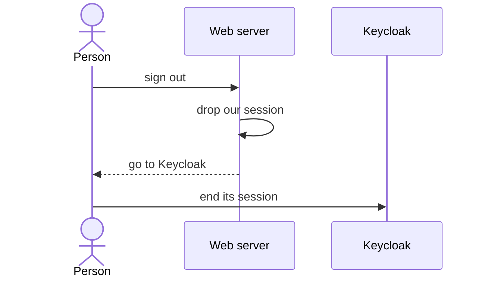

```yaml
id: UC-A2
type: use-case
name: Sign out
status: draft
actor: signed-in person
context: BC-ACCESS
satisfies:
  - id: FR-2
criteria:
  - id: AC-2
  - id: AC-71
  - id: AC-72
parameters: []
objects: []
rules: []
effects:
  - the web server forgets the session and its tokens
  - Keycloak ends its own session
  - the session cookie is removed
evolved_from: [MK3 UC-A2]
```

# Sign out

<!-- vbench-uc:begin mirror (generated from the requirements files, do not edit here: change the row, then run sync) -->

<details>
<summary>The requirements and criteria it runs, copied from docs/requirements (1 requirement, 3 criteria). Do not edit.</summary>

## What this serves

**FR-2**: The system shall let a person sign out.

## Acceptance criteria it runs

**AC-2** (acceptance, proves FR-2)

- Given a signed-in person
- When they sign out
- Then their session stops working, and starting a sign in shows the identity provider's login page

**AC-71** (acceptance, proves FR-2)

- Given a signed-in person
- When a page on another site sends a GET to the sign out address
- Then nothing happens, and their session still works

**AC-72** (acceptance, proves FR-2)

- Given a signed-in person
- When they sign out
- Then they end on our home page, not on an error page of the identity provider

## How it is verified

- acceptance: AC-2, AC-71, AC-72

Each criterion is run by a test tagged `Verifies AC-<n>`.

</details>

<!-- vbench-uc:end mirror -->

> Study copy. Rewritten from MK3's UC-A2 (logout) for Keycloak.


## Description

Signing out has to end two sessions, not one: the product's own session and Keycloak's. If only ours ended, the next click on "Sign in" would log the person straight back in, because Keycloak still remembers them.

## What changed from MK3

| MK3 UC-A2 | Playground UC-A2 |
|---|---|
| Revoke the refresh token's `jti` in the Redis whitelist | Nothing to revoke: we keep no whitelist |
| Clear two cookies | Clear one session cookie, and drop the session on the server |
| One session to end | Two to end: ours, and Keycloak's, through its end-session address |
| `POST /auth/session/logout` | `POST /auth/logout` only. A link or an image on another site cannot sign a person out |

New in the design language: **the ID token is kept so it can be handed back to Keycloak as a hint** when ending its session. That is why the session holds an ID token and not just an access token.

## Preconditions

- The person is signed in.

## Main flow

1. The person asks to sign out, by a button that posts. Sign out is a POST. (FR-2)
2. The system takes the session from the server in one step (so it can be taken once only) and removes it, with its tokens. (FR-2)
3. The system sends the person to Keycloak's end-session address, with the ID token as the hint and exactly our home page as the return address, and removes the session cookie in that same answer. (FR-2)
4. Keycloak ends its session and sends the person to our home page, not to an error page of Keycloak. (FR-2, AC-72)
5. The product asks the person to sign in again, and starting a sign in shows the identity provider's login page, because Keycloak's session has ended too. (FR-2, AC-2)

## Other flows

- The person has no session of ours (no cookie, a second sign out from a double click or a second tab, an expired session, an unknown id), or the session store fails: the system removes the cookie and sends the person home, and Keycloak is not asked. This avoids a "do you want to log out?" page of Keycloak. The cost: if only our session expired, Keycloak's own session stays until its own timeout. Sign out never throws, so the cookie is cleared on every path. (AC-2, decision 15)
- Sign out is reused by UC-A1's beta step 10 (R2, decision 13), to end both sessions of a deactivated person who gets through. See the note under Design.
- Keycloak cannot be reached, in two cases. If the end-session address cannot be built (Keycloak was never reached since the web server started), the person goes home. If Keycloak goes down later, the address is built locally and the person may see the browser's own error page when it is followed. In both cases our side is signed out (fail closed). Keycloak's session ends by itself when it times out. Not built: saying so on screen. Listed under Before beta.
- The request is a GET, for example from a link or an image on another site: the route answers 405, nothing happens and the session still works. (AC-71)
- A POST from another site: today it clears only our cookie. The browser does not send the cookie with it (SameSite=Lax), so no server session is removed and the person's session on the server stays. The cross site check that refuses it is deferred (see Before beta).
- Someone keeps a copy of the access token from before: it still passes the API's checks until it expires, which is short. Accepted for the alpha (decision 13), revisit at beta. To cut this to zero, the API would need to ask Keycloak whether the token is still live.

## Postconditions

Signed out normally:
- The server holds no tokens for this session.
- Keycloak has no session for the person in this browser.
- The browser holds no session cookie, and ends on our home page.

No session of ours (or the store failed):
- The browser holds no session cookie and ends on our home page.
- Keycloak was not asked, so its session, if any, stays until it times out.

Keycloak unreachable:
- The server holds no tokens and the browser holds no cookie: our side is signed out.
- The person is on our home page, or on the browser's own error page if Keycloak went down after the first call.

## Before beta

Deferred, accepted for the alpha because it is one process inside a corporate network (decision 15). Revisit at beta: (1) sign out during a token refresh can write the session back, so the store needs a "replace only if present" write; (2) server sessions have no lifetime of their own, so the store needs a TTL (native in ElastiCache); (3) a cross site POST to the sign out address clears only the cookie, until the CSRF check. Also: Keycloak down after the first call leaves a browser error page on sign out.

## Overview

The high level picture. The analysis sequence is in [UC-A2-sign-out-analysis-sequence.puml](diagrams/UC-A2-sign-out-analysis-sequence.puml) and the design sequence, with the route, ports and adapters, in [UC-A2-sign-out-design-sequence.puml](diagrams/UC-A2-sign-out-design-sequence.puml). Both use the step numbers of the main flow.



## Analysis

### Revision 1

Split into two diagrams (decision 9) because two systems take part (Playground and Keycloak) and a security rule
shapes the steps (only a post signs out). What the person and Playground say to each other, with no route, store,
port or token. The diagram is [UC-A2-sign-out-analysis-sequence.puml](diagrams/UC-A2-sign-out-analysis-sequence.puml).
Not frozen.

- A1 (step): The person asks to sign out
- A2 (step): Playground ends the person's sign in with Playground
- A3 (step): Playground sends the person to Keycloak to end the sign in there
- A4 (step): Keycloak ends its own sign in and sends the person back to the home page
- A5 (step): The person is left signed out of Playground
- A6 (step): The next request asks the person to sign in again
- A7 (rule): Signing out ends two sign ins, ours and Keycloak's
- A8 (rule): A request from a link or an image on another site does nothing
- A9 (refusal): The person has no sign in, or it has already gone, or the store fails: they land on the home page and Keycloak is not asked
- A10 (refusal): Keycloak cannot be reached: our sign in still ends, and the person lands on the home page or on the browser's own error page
- A11 (outside system): Keycloak

## Design

The parts that do the work, drawn in [UC-A2-sign-out-design-sequence.puml](diagrams/UC-A2-sign-out-design-sequence.puml).
The class diagram of the web server side is [bff-design.puml](../domain/diagrams/bff-design.puml).

- D1 (route): The logout route, which answers a post only
- D2 (use case): The sign out use case of the web server
- D3 (port): SessionStore
- D4 (port): IdentityProvider, which gives the end-session address
- D5 (adapter): In-memory session store, ElastiCache on AWS
- D6 (adapter): Keycloak through openid-client, behind IdentityProvider
- D7 (value object): The Session holds the ID token, so it can be given back as a hint

Note for UC-A1's beta step 10 (R2): it reuses sign out and will need `endSessionUrl(idToken, returnTo)` with a fixed
set of return addresses, and the cookie removal then needs a caller on a page path, not only the logout route.
Planned, not built.

## Changes from analysis to design

```
A1 became -> D1
A2 became -> D2, D3, D5
A3 became -> D2, D4, D6
A4 dropped: Keycloak's own end-session page, nothing of ours is built for it
A5 became -> D1
A6 became -> D1, D3
A7 became -> D2, D7
A8 became -> D1
A9 became -> D1, D2, D3
A10 became -> D2, D4
A11 became -> D4, D6
```

## Slices

1. TSK-A2.1: Drop the session and clear the cookie, so the session stops working (AC-2)
2. TSK-A2.2: End the Keycloak session too, so that starting a sign in afterwards shows the identity provider's login page (AC-2)
3. TSK-A2.3: A GET to the sign out address does nothing and the session still works. Rules: none (AC-71)
4. TSK-A2.4: Sign out ends on our home page, with the ID token as the hint and exactly our home page as the return address. Rules: none (AC-72)
