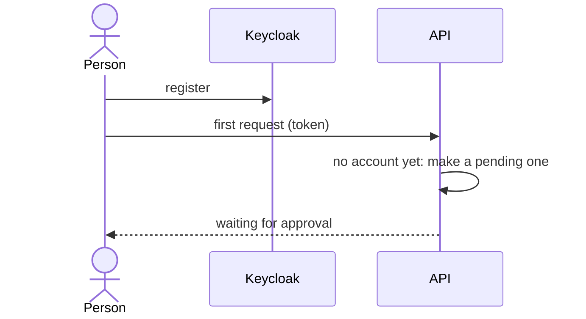

```yaml
id: UC-A3
type: use-case
name: Register and wait for approval
status: draft
actor: new person
context: BC-ACCESS
satisfies:
  - id: FR-3
criteria:
  - id: AC-3
  - id: AC-4
parameters:
  - name, email and password (given to Keycloak, not to us)
objects: [OBJ-A1]
rules: [RULE-A1]
effects:
  - a user exists in Keycloak
  - a pending account exists in the API database, made on the person's first request
  - an audit entry records the registration
evolved_from: [MK3 UC-A5]
```

# Register and wait for approval

<!-- vbench-uc:begin mirror (generated from the requirements files, do not edit here: change the row, then run sync) -->

<details>
<summary>The requirements and criteria it runs, copied from docs/requirements (1 requirement, 2 criteria). Do not edit.</summary>

## What this serves

**FR-3**: The system shall hold a person it does not know as a pending account, who can see only that it is waiting for approval, until an administrator approves it.

## Acceptance criteria it runs

**AC-3** (acceptance, proves FR-3)

- Given a person the system does not know
- When they make a request, then another
- Then one pending account exists for them

**AC-4** (acceptance, proves FR-3)

- Given a pending account
- When its owner asks for their status, then for anything else
- Then the status says it is waiting, and everything else is refused

## How it is verified

- acceptance: AC-3, AC-4

Each criterion is run by a test tagged `Verifies AC-<n>`.

</details>

<!-- vbench-uc:end mirror -->

> Study copy. Rewritten from MK3's UC-A5 (sign up) for Keycloak.

## Description

This is MK3's sign-up, split in two. **Registering** (a name, an email, a password) is Keycloak's. **Becoming known to Playground** is ours, and it is not a sign-up form at all: the account is made quietly the first time the API sees a new person's token. The person lands as **pending** and can do one thing, ask for their own status. An administrator approves them in UC-A4.

## What changed from MK3

| MK3 UC-A5 | Playground UC-A3 |
|---|---|
| Our signup form, password rules, bcrypt, duplicate email check | Keycloak's registration page, its password policy and its duplicate check |
| Signup creates the user and signs the person in at once | Registration creates a Keycloak user. Signing in is separate |
| The user row holds the password hash | Our account holds no password: only the Keycloak id (`identity`), name, email, role, status |
| An email that is already used gives an error | Keycloak handles it. We link by the Keycloak id, never by email |
| Status starts as pending, and an administrator approves | The same. The account is made on first sight, not at signup |
| First administrator: a command on the server | Email in `BOOTSTRAP_ADMIN_EMAILS` and verified at Keycloak |

New in the design language: **lazy provisioning**. The person exists in two places, and the second record is made when first needed, not when the person registers. So there is no moment that has to create both, which is exactly the "what if only one succeeds" worry in the Access notes. The cost: a person who registers and never comes back has a Keycloak user and no account, which is harmless.

## Preconditions

- The person has no Keycloak user (registration), or has one and no account (first request).

## Main flow

1. The person asks to create an account. The system sends them to Keycloak's registration page. (FR-3)
2. The person gives a name, an email and a password to Keycloak. Keycloak creates the user and signs them in. (FR-3)
3. The person comes back and the system makes a session, as in UC-A1. (FR-3)
4. The person's first request reaches the API with a valid token. (FR-3)
5. The API looks for an account with the token's Keycloak id and finds none. (AC-3)
6. The API creates an account with role user and status pending, with the name and email from the token. (FR-3, AC-3)
7. The API records an audit entry "register" with no administrator. (FR-3)
8. The API refuses everything except "show me my own status". (FR-3)
9. The person sees "Waiting for approval". (FR-3, AC-4)

## Other flows

- The person already has an account: nothing is created, and the name and email are refreshed from the token. (AC-3)
- The person's email is in `BOOTSTRAP_ADMIN_EMAILS` and Keycloak says it is verified: the account is created active, with role administrator, and the audit entry says it came from setup. (RULE-A1)
- The email is in `BOOTSTRAP_ADMIN_EMAILS` but not verified: the account is created pending, as for anyone else, so someone cannot claim the first administrator by registering with an unverified address.
- A pending person asks for anything other than their own status: the API answers 403 "waiting for approval". (AC-4)
- The person's name or email changed in Keycloak: the account is updated on the next request. The link stays the Keycloak id.
- Two first requests arrive at the same moment: only one account may exist. Open: the account table needs a unique identity, and the second insert must be treated as "found". (AC-3)

## Postconditions

- A Keycloak user exists, and one account exists for its id, pending (or active for the first administrator).
- No password is held by Playground.

## Open questions

For the product owner to decide.

1. Keycloak's registration page does not check the email by default. Whether to require it, and whether to limit how fast registrations can come from one place, is still undecided.

## Overview

The high level picture. The detailed sequence, with step numbers that match the main flow, is in [UC-A3-register-and-wait-for-approval-sequence.puml](diagrams/UC-A3-register-and-wait-for-approval-sequence.puml).



## Slices

1. TSK-A3.1: Create the account on first sight, rules RULE-A1 (AC-3)
2. TSK-A3.2: Refuse everything but the person's own status while pending (AC-4)
