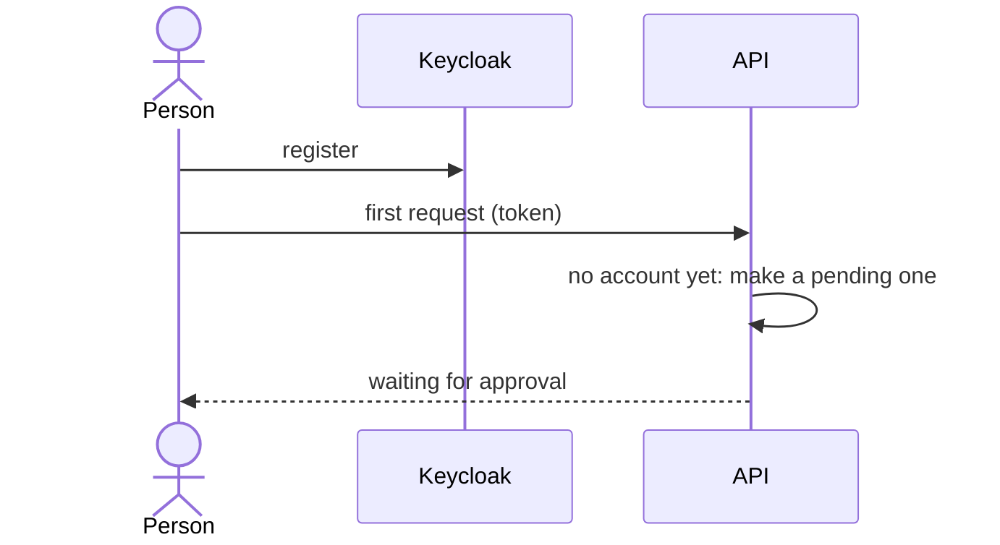

```yaml
id: UC-A3
type: use-case
name: Register and wait for approval
status: draft
actor: new person
context: BC-ACCESS
satisfies:
  - id: FR-3
criteria:
  - id: AC-3
  - id: AC-4
  - id: AC-47
  - id: AC-61
  - id: AC-73
  - id: AC-74
  - id: AC-75
parameters:
  - name, email and password (given to Keycloak, not to us)
objects: [OBJ-A1]
rules: []
effects:
  - a user exists in Keycloak
  - a pending account exists in the API database, made on the person's first request
  - an audit entry records the registration
evolved_from: [MK3 UC-A5]
```

# Register and wait for approval

<!-- vbench-uc:begin mirror (generated from the requirements files, do not edit here: change the row, then run sync) -->

<details>
<summary>The requirements and criteria it runs, copied from docs/requirements (1 requirement, 7 criteria). Do not edit.</summary>

## What this serves

**FR-3**: The system shall hold a person it does not know as a pending account, who can see only that it is waiting for approval, until an administrator approves it.

## Acceptance criteria it runs

**AC-3** (acceptance, proves FR-3)

- Given a person the system does not know
- When they make a request, then another
- Then one pending account exists for them

**AC-4** (acceptance, proves FR-3)

- Given a pending account
- When its owner asks for their status, then makes any other request
- Then the status says it is waiting, and every other route is refused

**AC-47** (acceptance, proves FR-3)

- Given a pending account
- When its person signs in
- Then they land on the waiting page

**AC-61** (acceptance, proves FR-3)

- Given an active administrator exists, and a new person whose email is the setup email, verified
- When they make their first request
- Then they get a pending account, not an administrator account

**AC-73** (acceptance, proves FR-3)

- Given a pending account whose email another account already has
- When an administrator lists the accounts
- Then it is marked with a warning that shows the other account, and approving it is still the administrator's decision

**AC-74** (acceptance, proves FR-3)

- Given no active administrator exists, and a new person whose email is the setup email, verified
- When they make their first request
- Then they get an active administrator account

**AC-75** (acceptance, proves FR-3)

- Given a new person whose email is the setup email, not verified
- When they make their first request
- Then they get a pending account, like anyone else

## How it is verified

- acceptance: AC-3, AC-4, AC-47, AC-61, AC-73, AC-74, AC-75

Each criterion is run by a test tagged `Verifies AC-<n>`.

</details>

<!-- vbench-uc:end mirror -->

> Study copy. Rewritten from MK3's UC-A5 (sign up) for Keycloak.

## Description

This is MK3's sign-up, split in two. **Registering** (a name, an email, a password) is Keycloak's. **Becoming known to Playground** is ours, and it is not a sign-up form at all: the account is made quietly the first time the API sees a new person's token. The person lands as **pending** and can do one thing, ask for their own status. An administrator approves them in UC-A4.

## What changed from MK3

| MK3 UC-A5 | Playground UC-A3 |
|---|---|
| Our signup form, password rules, bcrypt, duplicate email check | Keycloak's registration page, its password policy and its duplicate check |
| Signup creates the user and signs the person in at once | Registration creates a Keycloak user. Signing in is separate |
| The user row holds the password hash | Our account holds no password: only the Keycloak id (`identity`), name, email, role, status |
| An email that is already used gives an error | Keycloak handles it. We link by the Keycloak id, never by email |
| Status starts as pending, and an administrator approves | The same. The account is made on first sight, not at signup |
| First administrator: a command on the server | Email in `BOOTSTRAP_ADMIN_EMAILS` and verified at Keycloak |

New in the design language: **lazy provisioning**. The person exists in two places, and the second record is made when first needed, not when the person registers. So there is no moment that has to create both, which is exactly the "what if only one succeeds" worry in the Access notes. The cost: a person who registers and never comes back has a Keycloak user and no account, which is harmless.

## Preconditions

- The person has no Keycloak user (registration), or has one and no account (first request).

## Main flow

1. The person asks to create an account. The system sends them to Keycloak's registration page. (FR-3)
2. The person gives a name, an email and a password to Keycloak. Keycloak creates the user and signs them in. (FR-3)
3. The person comes back and the system makes a session, as in UC-A1. (FR-3)
4. The person's first request reaches the API with a valid token. (FR-3)
5. The API looks for an account with the token's Keycloak id and finds none. (AC-3)
6. The API creates an account with role user and status pending, with the name and email from the token. (FR-3, AC-3)
7. The API records an audit entry "register" with no administrator. (FR-3)
8. The API refuses everything except "show me my own status". (FR-3, AC-4)
9. The person sees "Waiting for approval", on the waiting page, which is where a pending person lands when they sign in. (FR-3, AC-47)

## Other flows

- The person already has an account: nothing is created, and the name and email are refreshed from the token. (AC-3)
- The person's email is in `BOOTSTRAP_ADMIN_EMAILS`, Keycloak says it is verified, and no active administrator exists: the account is created active, with role administrator, and the audit entry says it came from setup. This is the setup rule (decision 14). It is not RULE-A1, which protects the last administrator. (FR-3, AC-61)
- The email is in `BOOTSTRAP_ADMIN_EMAILS`, and verified, but an active administrator already exists: the account is created pending, like anyone else's. The setup rule applies only while no active administrator exists. (AC-61)
- The email is in `BOOTSTRAP_ADMIN_EMAILS` but not verified: the account is created pending, as for anyone else, so someone cannot claim the first administrator by registering with an unverified address.
- A pending person asks for anything other than their own status: the API answers 403 "waiting for approval". (AC-4)
- A person who signs in and whose account is pending lands on the waiting page, built from their own status. (AC-47)
- An administrator creates the account in Keycloak (a temporary password and the update password action) instead of the person signing up: the person changes the password at first sign in, and the account lands pending, exactly like a signup, at their first request. It is approved in UC-A4. Keycloak never decides what a person may do (decisions 8 and 14). (AC-3)
- The person's name or email changed in Keycloak: the account is updated on the next request. The link stays the Keycloak id.
- Two first requests arrive at the same moment: only one account may exist (AC-3). Accepted risk for the alpha, not an open question: the race itself is not handled in code, and a unique identity in the database is what keeps it to one account. It is listed under "Accepted for now" in `docs/standards/security-checklist.md`.

## Postconditions

- A Keycloak user exists, and one account exists for its id, pending (or active for the first administrator).
- No password is held by Playground.

## Open questions

For the product owner to decide.

1. Decided (decision 10): email verification is off for now, because the product is deployed inside the corporate network. A role is never given from an unverified email. Whether to limit how fast registrations can come from one place is still undecided.

## Overview

The high level picture. The analysis sequence is in [UC-A3-register-and-wait-for-approval-analysis-sequence.puml](diagrams/UC-A3-register-and-wait-for-approval-analysis-sequence.puml) and the design sequence, with the routes, use cases, ports and adapters, in [UC-A3-register-and-wait-for-approval-design-sequence.puml](diagrams/UC-A3-register-and-wait-for-approval-design-sequence.puml). Both use the step numbers of the main flow.



## Analysis

### Revision 1

What the person and Playground say to each other, with no route, store, port or token. The diagram is
[UC-A3-register-and-wait-for-approval-analysis-sequence.puml](diagrams/UC-A3-register-and-wait-for-approval-analysis-sequence.puml). Not frozen yet. Decision 14 note, no element changed: A12 applies only while no active administrator exists (AC-61), and an account an administrator creates in Keycloak reaches A4 to A9 like a signup.

- A1 (step): The person asks to create an account and is sent to Keycloak to register
- A2 (step): The person gives a name, an email and a password to Keycloak, which registers and signs them in
- A3 (step): The person comes back and Playground signs them in, as in UC-A1
- A4 (step): The person's first request reaches Playground
- A5 (step): Playground looks for the person's account
- A6 (step): Playground makes an account that is waiting for approval
- A7 (step): Playground records the registration in the audit
- A8 (step): Playground refuses everything except the person's own status
- A9 (step): The person sees "Waiting for approval"
- A10 (rule): Playground never holds the password
- A11 (rule): The person is known to Playground by the Keycloak id, never by email
- A12 (rule): An email on the setup list that Keycloak says is verified gets an active administrator account
- A13 (refusal): A person waiting for approval asks for anything but their own status
- A14 (outside system): Keycloak
- A15 (object): Account

## Design

The parts that do the work, drawn in [UC-A3-register-and-wait-for-approval-design-sequence.puml](diagrams/UC-A3-register-and-wait-for-approval-design-sequence.puml). The class diagram of the API side is [access-design.puml](../domain/diagrams/access-design.puml). The class diagram of the web server side is [bff-design.puml](../domain/diagrams/bff-design.puml).

- D1 (route): The web login route with prompt=create, and the callback, kept thin
- D2 (route): The API route that verifies the token and refuses a pending account anything but /me
- D3 (use case): AccessService.account_for, which finds or makes the account
- D4 (port): AccountRepository
- D5 (port): AuditLog
- D6 (port): IdentityProvider, on the web server, towards Keycloak
- D7 (adapter): Keycloak through openid-client, behind IdentityProvider
- D8 (adapter): SQLAlchemy over PostgreSQL, behind AccountRepository and AuditLog
- D9 (domain rule): Account starts as user and pending, and the setup administrator rule (decision 14, AC-61): active administrator only while no active administrator exists. RULE-A1 (the last administrator) is a different rule, in UC-A4
- D10 (aggregate): Account

## Changes from analysis to design

```
A1 became -> D1, D6
A2 dropped: Keycloak's own registration page, nothing of ours is built for it
A3 became -> D1, D6
A4 became -> D2
A5 became -> D3, D4, D8
A6 became -> D3, D9, D10
A7 became -> D3, D5, D8
A8 became -> D2
A9 became -> D2
A10 became -> D10
A11 became -> D4, D10
A12 became -> D3, D9
A13 became -> D2
A14 became -> D6, D7
A15 became -> D10
```

## Slices

1. TSK-A3.1: Create the account on first sight, as pending; an account an administrator creates in Keycloak lands the same way. The setup rule is not RULE-A1 and is proven in TSK-A3.4 (AC-3)
2. TSK-A3.2: Refuse everything but the person's own status while pending (AC-4)
3. TSK-A3.3: A pending person who signs in lands on the waiting page (AC-47)
4. TSK-A3.4: The setup rule applies only while no active administrator exists: the setup email, verified, gets an active administrator only then, and a pending account otherwise (AC-61)
