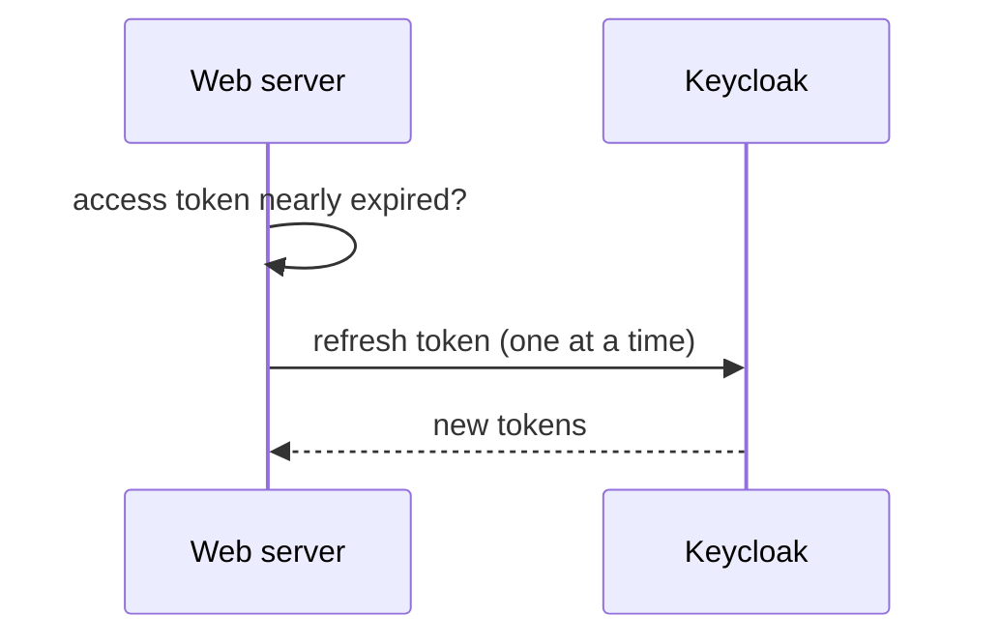

```yaml
id: UC-A6
type: use-case
name: Keep the session alive
status: draft
actor: signed-in person (the system acts for them)
context: BC-ACCESS
satisfies:
  - id: FR-15
criteria:
  - id: AC-52
  - id: AC-53
  - id: AC-54
parameters: []
objects: []
rules: []
effects:
  - the session holds a fresh access token, and a new refresh token if Keycloak rotated it
evolved_from: [MK3 UC-A3]
```

# Keep the session alive

<!-- vbench-uc:begin mirror (generated from the requirements files, do not edit here: change the row, then run sync) -->

<details>
<summary>The requirements and criteria it runs, copied from docs/requirements (1 requirement, 3 criteria). Do not edit.</summary>

## What this serves

**FR-15**: The system shall keep a signed-in person signed in until the session limits.

## Acceptance criteria it runs

**AC-52** (acceptance, proves FR-15)

- Given a signed-in person whose access token is about to expire
- When they make a request
- Then the token is refreshed and the request succeeds

**AC-53** (acceptance, proves FR-15)

- Given a signed-in person whose access token is about to expire
- When two requests arrive at the same moment
- Then only one refresh is sent to the identity provider

**AC-54** (acceptance, proves FR-15)

- Given a signed-in person whose refresh is refused by the identity provider
- When they make a request
- Then their session ends and they must sign in again

## How it is verified

- acceptance: AC-52, AC-53, AC-54

Each criterion is run by a test tagged `Verifies AC-<n>`.

</details>

<!-- vbench-uc:end mirror -->

> Study copy. Rewritten from MK3's UC-A3 (refresh) for Keycloak.
> Served by FR-15 (decision 14), with three criteria: a refresh before expiry (AC-52), two requests at once send one refresh (AC-53), and a refused refresh ends the session (AC-54). Built in `apps/web/src/application/access-token.ts`, with its tests in `access-token.test.ts`.

## Description

Access tokens are short, a few minutes. So that the person is not asked to sign in again, the web server swaps the refresh token for a new access token shortly before the old one expires. The person never sees it.

## What changed from MK3

| MK3 UC-A3 | Playground UC-A6 |
|---|---|
| `POST /auth/session/refresh`, called by the browser, with a refresh cookie | No endpoint. The web server does it inside a request, before calling the API |
| We check the old refresh token against the Redis whitelist, rotate it, and whitelist the new one | Keycloak checks it and rotates it. We hold the latest one in the session |
| Two stages of validation, written by us | None of ours |
| A real bug: a race when the refresh token was replaced logged people out when they switched windows | Handled by **one refresh at a time for each session**. Two requests at once wait for the same answer |

This is the one with the clearest lesson. Refresh tokens rotate, so using the old one a second time looks like theft and Keycloak ends the session. The answer is not a whitelist, it is a lock: if a refresh is already running for this session, the next request waits for it.

## Preconditions

- The person is signed in, and the session holds a refresh token.

## Main flow

1. A request arrives from a signed-in person. The system finds their session. (FR-15)
2. The system sees that the access token expires in less than 30 seconds. (FR-15, AC-52)
3. The system checks whether a refresh is already running for this session. If one is, it waits for that one and uses its result. (FR-15, AC-53)
4. Otherwise the system sends the refresh token to Keycloak. (FR-15, AC-52)
5. Keycloak answers with a new access token, and usually a new refresh token. (FR-15, AC-52)
6. The system stores them in the session, and the request goes on with the new access token. (FR-15, AC-52)

## Other flows

- Two requests arrive at once: only one refresh is sent, and both use its result. No log-out. (AC-53)
- Keycloak refuses the refresh token, because the session ended, the person was disabled or the token was already used: the system drops the session, and the person is asked to sign in again. (AC-54)
- Keycloak cannot be reached: built as the same as a refusal, the session ends (AC-54). Open: should the session be kept for a retry?
- The access token is still good for more than 30 seconds: nothing is refreshed. (AC-52)
- A deactivated person (UC-A4) has their sessions ended in Keycloak: the next refresh is refused, so the web session ends within one access token's life at most. The API also refuses them at once, on every request.

## Postconditions

- The session holds a token that is valid for several minutes.

## Open questions

For the product owner to decide.

1. The sessions are kept in the web server's memory. A restart ends them all. A shared store such as Redis would fix that.

## Overview

The high level picture. The analysis sequence is in [UC-A6-keep-the-session-alive-analysis-sequence.puml](diagrams/UC-A6-keep-the-session-alive-analysis-sequence.puml) and the design sequence, with the routes, ports and adapters, in [UC-A6-keep-the-session-alive-design-sequence.puml](diagrams/UC-A6-keep-the-session-alive-design-sequence.puml). Both use the step numbers of the main flow.



## Analysis

### Revision 1

What the person and Playground say to each other, with no route, store, port or token. The diagram is
[UC-A6-keep-the-session-alive-analysis-sequence.puml](diagrams/UC-A6-keep-the-session-alive-analysis-sequence.puml). Not frozen yet.

- A1 (step): A signed-in person asks for something
- A2 (step): Playground sees that the person's sign in is about to run out
- A3 (step): If a renewal is already running for this person, Playground waits for it and uses its result
- A4 (step): Otherwise Playground asks Keycloak to renew the sign in
- A5 (step): Keycloak renews it
- A6 (step): Playground keeps the renewed sign in and goes on with the request
- A7 (rule): Only one renewal runs at a time for a person, so two requests at once do not log the person out
- A8 (refusal): Keycloak refuses the renewal, so the person is asked to sign in again
- A9 (outside system): Keycloak

## Design

The parts that do the work, drawn in [UC-A6-keep-the-session-alive-design-sequence.puml](diagrams/UC-A6-keep-the-session-alive-design-sequence.puml). The class diagram of the web server side is [bff-design.puml](../domain/diagrams/bff-design.puml), where AccessToken is built. What is built: `makeAccessToken` in `apps/web/src/application/access-token.ts` (the 30 second rule through `needsRefresh` in the domain, one refresh at a time for each session in a map of pending refreshes, and the session taken when Keycloak refuses), and the in-memory session store. Its tests: no session gives no token, a good token is not refreshed, a token about to expire is refreshed and kept, two requests share one refresh, and a refusal ends the session.

- D1 (domain rule): the access token ends in less than 30 seconds
- D2 (use case): The web server's accessToken(), which finds the session and refreshes when needed
- D3 (port): SessionStore, with the one-at-a-time refresh lock
- D4 (port): IdentityProvider, the refresh token grant
- D5 (port): BackendApi, called with the access token
- D6 (adapter): Keycloak through openid-client, behind IdentityProvider
- D7 (adapter): In-memory session store and lock, ElastiCache on AWS

## Changes from analysis to design

```
A1 became -> D2, D3
A2 became -> D1, D2
A3 became -> D2, D3, D7
A4 became -> D2, D4
A5 became -> D4, D6
A6 became -> D2, D3, D5
A7 became -> D3, D7
A8 became -> D2, D3, D4
A9 became -> D4, D6
```

## Slices

1. TSK-A6.1: Refresh the access token before it expires and keep the new one in the session (AC-52)
2. TSK-A6.2: Two requests at once send one refresh and share its result (AC-53)
3. TSK-A6.3: A refused refresh ends the session, so the person must sign in again (AC-54)
