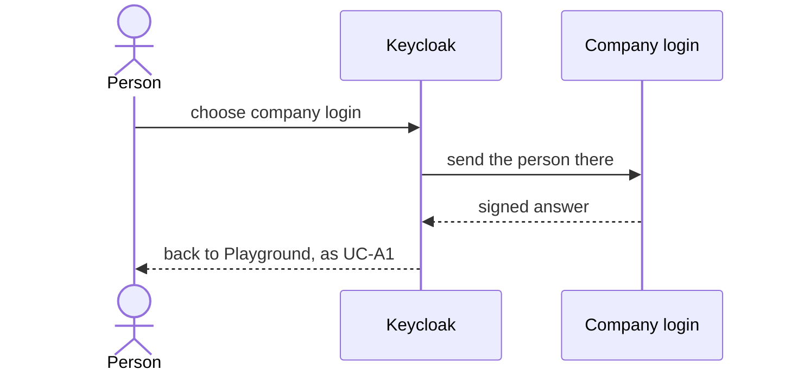

```yaml
id: UC-A7
type: use-case
name: Sign in through company single sign-on
status: draft
actor: person (not yet signed in)
context: BC-ACCESS
satisfies:
  - id: FR-6
criteria: []
parameters: []
objects: [OBJ-A1]
rules: []
effects:
  - the person is linked to a Keycloak user from the company login
  - the first time, a pending account is made (UC-A3)
evolved_from: [MK3 UC-A6]
```

# Sign in through company single sign-on

<!-- vbench-uc:begin mirror (generated from the requirements files, do not edit here: change the row, then run sync) -->

<details>
<summary>The requirements and criteria it runs, copied from docs/requirements (1 requirement, 0 criteria). Do not edit.</summary>

## What this serves

**FR-6**: The system shall let a person sign in through single sign-on.

## Acceptance criteria it runs

None listed yet. A requirement without criteria cannot be confirmed.

## How it is verified

Nothing verifies it yet: it lists no criteria.

Each criterion is run by a test tagged `Verifies AC-<n>`.

</details>

<!-- vbench-uc:end mirror -->

> Study copy. Rewritten from MK3's UC-A6 (SSO login) for Keycloak. It is a Release 2 item (FR-6).
> **FR-6 has no acceptance criterion yet.** Hand this to vbench-req.

## Description

The person signs in with their company login, not a password kept in Keycloak. Keycloak does the work: it is set up to trust the company's identity provider (an identity brokering setting). Playground's code does not change. From the web server's side it is still the same flow as UC-A1, and Keycloak still hands back its own token.

## What changed from MK3

| MK3 UC-A6 | Playground UC-A7 |
|---|---|
| Planned, not built. Would have needed our own OIDC client code and a way to link external users to our user table | Keycloak configuration: add an identity provider to the realm, and map its claims |
| Each provider means more code | Each provider is a setting, and the realm export carries it |

This is the clearest example of why a realm file belongs in its own repo (phase 2 of the project): switching on single sign-on is a change to configuration, not to code.

## Preconditions

- The realm has the company's identity provider configured.
- The person has a company login.

## Main flow

1. The person asks to sign in. The system sends them to Keycloak, as in UC-A1. (FR-6)
2. Keycloak's login page offers the company login. The person chooses it. (FR-6)
3. Keycloak sends the person to the company's login. They sign in there. (FR-6)
4. The company login sends the person back to Keycloak. Keycloak creates or finds a Keycloak user for them. (FR-6)
5. Keycloak sends the person back to Playground with a code, and the flow goes on as in UC-A1, steps 5 to 9. (FR-6)
6. On the first request, the API makes a pending account if there is none (UC-A3). (FR-6)

## Other flows

- The company login refuses the person: Keycloak shows an error and no token is issued.
- The person has no Playground account: they are pending, and signing in proves only who they are. The account request page is offered. Single sign-on does not approve anyone.
- The company login gives an email that already belongs to another Keycloak user: Keycloak decides whether to link them. Open: this matters, because the account is linked by the Keycloak id. Linking by email in Keycloak should happen only for a verified email.

## Postconditions

- As UC-A1, and a Keycloak user exists that is linked to the company login.

## Open questions

For the product owner to decide.

1. Roles from the company. Playground keeps roles in its own database, so a company group must not make someone an administrator.

## Overview

The high level picture. The analysis sequence is in [UC-A7-sign-in-through-company-single-sign-on-analysis-sequence.puml](diagrams/UC-A7-sign-in-through-company-single-sign-on-analysis-sequence.puml) and the design sequence, with the routes, ports and adapters, in [UC-A7-sign-in-through-company-single-sign-on-design-sequence.puml](diagrams/UC-A7-sign-in-through-company-single-sign-on-design-sequence.puml). Both use the step numbers of the main flow.



## Analysis

### Revision 1

What the person and Playground say to each other, with no route, store, port or token. The diagram is
[UC-A7-sign-in-through-company-single-sign-on-analysis-sequence.puml](diagrams/UC-A7-sign-in-through-company-single-sign-on-analysis-sequence.puml). Not frozen yet.

- A1 (step): The person asks to sign in, as in UC-A1
- A2 (step): The person chooses the company login at Keycloak
- A3 (step): Keycloak sends the person to the company login, and they sign in there
- A4 (step): The company login sends the person back to Keycloak, which creates or finds a Keycloak user for them
- A5 (step): Keycloak sends the person back to Playground with proof, and the sign in goes on as in UC-A1
- A6 (step): On the first request, Playground makes a pending account if there is none (UC-A3)
- A7 (rule): Single sign-on proves who the person is, it does not approve anyone
- A8 (refusal): The company login refuses the person, so they are not signed in
- A9 (outside system): Keycloak
- A10 (outside system): The company login (identity provider)
- A11 (object): Account

## Design

The parts that do the work, drawn in [UC-A7-sign-in-through-company-single-sign-on-design-sequence.puml](diagrams/UC-A7-sign-in-through-company-single-sign-on-design-sequence.puml). The web server side has no class diagram yet (decision 9, still open).

- D1 (configuration): An identity provider in the realm, with its claim mappings, carried by the realm export
- D2 (route): The login and callback routes of UC-A1, unchanged
- D3 (use case): The sign in use case of the web server (UC-A1), unchanged
- D4 (port): IdentityProvider, unchanged
- D5 (service): The API TokenVerifier, unchanged
- D6 (aggregate): Account, made pending on the first request (UC-A3)

## Changes from analysis to design

```
A1 became -> D2, D3
A2 dropped: Keycloak's own login page, set up by configuration (D1), nothing of ours is built
A3 became -> D1
A4 became -> D1
A5 became -> D2, D3, D4
A6 became -> D5, D6
A7 became -> D6
A8 dropped: shown by Keycloak, nothing of ours is built
A9 became -> D1, D4
A10 became -> D1
A11 became -> D6
```

## Slices

1. TSK-A7.1: Configure the identity provider in the realm (no code)
2. TSK-A7.2: Check the account and linking rules on the first request
