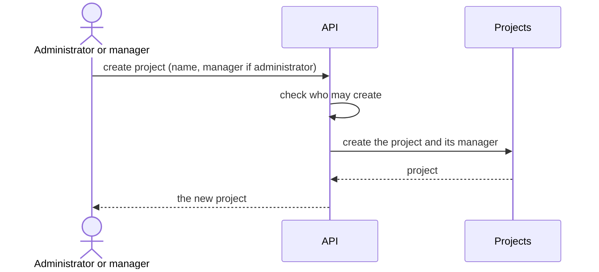

```yaml
id: UC-P1
type: use-case
name: Create a project
status: draft
actor: administrator or project manager
context: BC-PROJECTS
satisfies:
  - id: FR-129
  - id: FR-130
  - id: FR-131
  - id: FR-132
  - id: FR-143
criteria:
  - id: AC-87
  - id: AC-88
  - id: AC-89
  - id: AC-90
  - id: AC-91
  - id: AC-92
  - id: AC-93
  - id: AC-109
parameters:
  - name (of the project)
  - manager (only when an administrator creates it)
objects: [OBJ-P1, OBJ-P2]
rules: [RULE-P1, RULE-P2]
effects:
  - a project exists, empty of files, endpoints and evaluations
  - the project has one manager from the start
  - an audit entry records who created it
evolved_from: []
```

# Create a project

<!-- vbench-uc:begin mirror (generated from the requirements files, do not edit here: change the row, then run sync) -->

## What this serves

**FR-129**: The system shall let an administrator or a project manager create a project.

**FR-130**: The system shall require an administrator who creates a project to name its manager, who must have an active account.

**FR-131**: The system shall not make an administrator who creates a project a member of it.

**FR-132**: The system shall make a project manager who creates a project its manager.

**FR-143**: The system shall record an audit entry for every project creation and every change to a project's members.

## Acceptance criteria it runs

**AC-87** (acceptance, proves FR-129; FR-130)

- Given an administrator and an account that is active
- When they create a project with a name and name that account as manager
- Then the project exists and that person is its manager

**AC-88** (acceptance, proves FR-129; FR-132)

- Given a person who manages one project
- When they create a project
- Then the new project exists and they are its manager

**AC-89** (acceptance, proves FR-129)

- Given an engineer who manages no project
- When they try to create a project
- Then it is refused and no project exists

**AC-90** (acceptance, proves FR-129)

- Given an administrator
- When they create a project with an empty name
- Then it is refused and no project exists

**AC-91** (acceptance, proves FR-130)

- Given an administrator
- When they create a project and name no manager
- Then it is refused and no project exists

**AC-92** (acceptance, proves FR-130)

- Given an administrator and an account that is pending or deactivated
- When they name that account as the manager
- Then it is refused and no project exists

**AC-93** (acceptance, proves FR-131)

- Given a project created by an administrator
- When that administrator asks for its contents
- Then it is refused, because they are not a member

**AC-109** (acceptance, proves FR-143)

- Given a project
- When it is created and later a member is added
- Then an audit entry exists for each, saying who did it and what it was

## How it is verified

- acceptance: AC-87, AC-88, AC-89, AC-90, AC-91, AC-92, AC-93, AC-109

Each criterion is run by a test tagged `Verifies AC-<n>`.

<!-- vbench-uc:end mirror -->

> Draft for the first cut of projects. **No requirement row exists for this yet** (see "Proposed requirements").
> Roles are names only for now: a project manager and an engineer do the same things, except that only a manager adds people.

## Description

A project is where files, endpoints and evaluations live. Only the members of a project can see inside it. An administrator or a project manager can create one. An administrator **does not join** the project they create, so they never see inside it unless a manager later adds them (and a manager is the only one who can). Because of that, an administrator must name the person who will manage it.

## Preconditions

- The person asking is signed in and their account is active.
- They are an administrator, or they manage at least one project.

## Main flow

1. The person asks to create a project and gives it a name.
2. The system checks that the person is an administrator, or manages at least one project.
3. The system checks that the name is not empty.
4. If the person is an administrator, they also name a manager. The system checks that this person has an active account.
5. The system creates the project. A project manager who creates it becomes its manager. When an administrator creates it, the person they named becomes its manager and the administrator is not a member.
6. The system records an audit entry with who created it, and who the manager is.
7. The person sees the new project. A project manager can open it. An administrator sees its name and members only.

## Other flows

- The person is neither an administrator nor a manager of any project: refused. The project is not created.
- The name is empty: refused.
- An administrator names no manager: refused, because a project must have a manager from the start.
- The named manager's account is pending, deactivated or unknown: refused.
- The person asking is a project manager who tries to name someone else as manager: Open, see below.
- Open: must a project name be unique, and within what (the whole system, or one manager's projects)?
- Open: can a project manager name a second manager at creation?

## Postconditions

- A project exists with exactly one manager and no other members.
- Its files, endpoints and evaluations are empty.
- An administrator who created it is not a member and cannot open its contents.

## Proposed requirements (for vbench-req, no ids yet)

- The system shall let an administrator or a project manager create a project.
- The system shall require an administrator who creates a project to name its manager, who must have an active account.
- The system shall not make the administrator who creates a project a member of it.
- The system shall make the project manager who creates a project its manager.

## Overview

The high level picture. The detailed sequence is in [UC-P1-create-a-project-sequence.puml](diagrams/UC-P1-create-a-project-sequence.puml).



## Slices

1. TSK-P1.1: A project manager creates a project and becomes its manager, rules RULE-P1 (AC-88, AC-89, AC-90)
2. TSK-P1.2: An administrator creates a project and names its manager, rules RULE-P2 (AC-87, AC-91, AC-92, AC-93)
3. TSK-P1.3: Creating a project is audited (AC-109)
