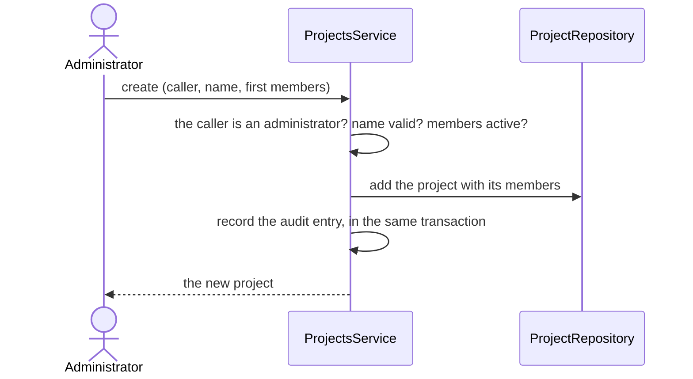

```yaml
id: UC-P1
type: use-case
name: Create a project
status: draft
actor: administrator
context: BC-PROJECTS
satisfies:
  - id: FR-7
  - id: FR-13
criteria:
  - id: AC-9
  - id: AC-10
  - id: AC-11
  - id: AC-12
  - id: AC-13
  - id: AC-29
  - id: AC-32
parameters:
  - name (of the project)
  - first members (active accounts, possibly none, possibly the administrator)
objects: [OBJ-P1, OBJ-P2]
rules: []
effects:
  - a project exists, empty of files, endpoints and evaluations
  - the named people are its members
  - an audit entry records who created it and who its first members are
evolved_from: []
```

# Create a project

<!-- vbench-uc:begin mirror (generated from the requirements files, do not edit here: change the row, then run sync) -->

<details>
<summary>The requirements and criteria it runs, copied from docs/requirements (2 requirements, 7 criteria). Do not edit.</summary>

## What this serves

**FR-7**: The system shall let an administrator create a project and name its first members.

**FR-13**: The system shall record an audit entry for every project creation and every change to a project's members.

## Acceptance criteria it runs

**AC-9** (acceptance, proves FR-7)

- Given an administrator and an active account
- When they create a project naming that account as a first member
- Then the project exists and that person is a member

**AC-10** (acceptance, proves FR-7)

- Given an administrator
- When they create a project naming themselves as a first member
- Then it exists and they are a member

**AC-11** (acceptance, proves FR-7)

- Given a user who is not an administrator
- When they try to create a project
- Then it is refused

**AC-12** (acceptance, proves FR-7)

- Given a project name that is empty, only spaces, or over 100 characters
- When a project is created with it
- Then it is refused

**AC-13** (acceptance, proves FR-7)

- Given an administrator
- When they create a project naming a first member who is not active or does not exist
- Then it is refused, with one answer for an account that cannot be a member

**AC-29** (acceptance, proves FR-13)

- Given a project
- When it is created
- Then an audit entry says who created it and who its first members are

**AC-32** (acceptance, proves NFR-1)

- Given any role, and a person who is not a member
- When each makes a command or read it may not, even if the screen hides it
- Then the server refuses it

## How it is verified

- acceptance: AC-9, AC-10, AC-11, AC-12, AC-13, AC-29, AC-32

Each criterion is run by a test tagged `Verifies AC-<n>`.

</details>

<!-- vbench-uc:end mirror -->

> Draft for the alpha (decision 13). It serves FR-7 and FR-13 (for creation), and runs the criteria listed above (decisions 3, 6 and 13).
> There are two account roles, user and administrator, and no project roles. FR-8 and the manager rules are parked.

## Description

A project is where files, endpoints and evaluations live. Only an administrator creates one. The administrator is a superuser (decision 13): they give the project a name and name its first members, who must be active accounts, and they may name themselves. A project may start with no member at all. Once it exists, only its members and administrators see inside it, and every member has the same rights in it.

## Preconditions

- The person asking is signed in, and the same full check as for the account routes passes: the token is valid, the account is found, and it is not deactivated and not pending (decision 14).
- They are an administrator.

## Main flow

1. The administrator asks to create a project, gives it a name and names its first members. (FR-7)
2. The system checks, as for every request, the person's token and account, and then that they are an administrator. This is checked before the input is. (FR-7, AC-11)
3. The system removes the spaces at both ends of the name and checks that it has 1 to 100 characters. (FR-7, AC-12)
4. The system checks that each named first member has an active account. The administrator may be one of them, and there may be none. (FR-7, AC-9, AC-10, AC-13)
5. The system creates the project, and the named people are its members. (FR-7, AC-9, AC-10)
6. The system records an audit entry with who created it and who its first members are. (FR-13, AC-29)
7. The administrator sees the new project. (FR-7)

## Other flows

- The person is not an administrator: refused with a 403. The project is not created, and the name and the members are not looked at. (AC-11)
- The name is empty, only spaces, or longer than 100 characters: refused with a 422. (AC-12)
- A named first member has an account that is pending, deactivated or unknown: refused with a 422, with the same answer for each, and the project is not created. (AC-13)
- Any role, and a person who is not a member, makes a command or read it may not, even if the screen hides it: the server refuses it. (AC-32) AC-32 moved here from UC-A1 (decision 10). UC-P1 proves it for creating a project and UC-P2 for managing members. The rest of "every command and read" is proven by later use cases.

## Postconditions

- A project exists, and its members are exactly the people named, who may be none.
- An audit entry exists.

## Open questions

For the product owner to decide.

1. Are refused creations audited? Not in the plan for the alpha. (The order of the checks is settled: administrator, then name, then first members, by decision 14. The audit entry and the project are one transaction.)
2. Must a project name be unique, and within what? (Still open from decision 3.)

## Overview

The high level picture. The analysis sequence is in [UC-P1-create-a-project-analysis-sequence.puml](diagrams/UC-P1-create-a-project-analysis-sequence.puml) and the design sequence, with the contexts and ports, in [UC-P1-create-a-project-design-sequence.puml](diagrams/UC-P1-create-a-project-design-sequence.puml). The class diagram is [projects-design.puml](../domain/diagrams/projects-design.puml). All use the step numbers of the main flow.



## Analysis

### Revision 1

Rewritten for the alpha scope (decision 13): the administrator is the only actor, and there are no project roles. Only Playground takes part. What the person and Playground say to each other, with no route, store, port or token. The diagram is
[UC-P1-create-a-project-analysis-sequence.puml](diagrams/UC-P1-create-a-project-analysis-sequence.puml). Not frozen.

- A1 (step): The administrator asks to create a project, with a name and its first members
- A2 (step): Playground checks the person is an administrator
- A3 (step): Playground trims the name and checks its length
- A4 (step): Playground checks that each named first member has an active account
- A5 (step): Playground creates the project, and the named people are its members
- A6 (step): Playground records who created it and who its first members are
- A7 (step): The administrator sees the new project
- A8 (rule): Only an administrator creates a project
- A9 (rule): First members must be active accounts, the administrator may be one, and a project may have none
- A10 (refusal): The person is not an administrator
- A11 (refusal): The name is empty, only spaces, or too long
- A12 (refusal): A named first member is not an active account, with one answer
- A13 (object): Project
- A14 (object): Membership

## Design

A plan, not built yet. The class diagram is [projects-design.puml](../domain/diagrams/projects-design.puml) and the design sequence is [UC-P1-create-a-project-design-sequence.puml](diagrams/UC-P1-create-a-project-design-sequence.puml), both marked planned (decisions 13 and 14). Every step lands on a class of that diagram: `Caller`, `ProjectsService`, `ProjectName`, `Project`, `AccountStatus`, `ProjectRepository` and `AuditLog`. There is no "API" or "Access" box: the composition root runs the full check (token, account found, not deactivated, not pending) before any of it and builds the `Caller`, and Access and Audit answer through adapters it wires to the ports.

Decided here, within decisions 13 and 14: an administrator may name themselves as a first member, a project may have none, and `added by` of every first member is the creator. Creating the project and writing its audit entry are one transaction (`SqlProjects` and the `AuditLog` adapter share one database session).

What each refusal answers (decision 14). Authorisation is checked before the input is validated.

| Case | Error | Answer |
|---|---|---|
| A bad token, or an account that is deactivated or pending | the account routes' own | 401 or 403, before the role is looked at |
| A user who is not an administrator creates a project (AC-11, AC-32) | `NotAnAdministrator` | 403 |
| A name that is empty, only spaces, or over 100 characters (AC-12) | `InvalidProjectName` | 422 |
| A first member who is pending, deactivated or unknown (AC-13) | `MemberNotEligible` | 422, one answer for every reason |

There is no 404 on this route: no project exists yet.

- D1 (route): The create project route, kept thin
- D2 (value object): Caller, built by the composition root after the full check
- D3 (use case): ProjectsService.create(caller, name, first_members), which checks the caller is an administrator, then the name, then the members, then saves and audits
- D4 (aggregate): Project, which holds its Memberships
- D5 (value object): ProjectName, trimmed and 1 to 100 characters
- D6 (port): ProjectRepository
- D7 (port): AccountStatus, which answers for the set of first members at once
- D8 (port): AuditLog
- D9 (adapter): SqlProjects, over the API database (Amazon RDS on AWS)
- D10 (adapter): AccountStatusAdapter and AuditLogAdapter, wired in the composition root to Access and to Audit (BC-AUDIT)
- D11 (domain error): NotAnAdministrator, InvalidProjectName and MemberNotEligible
- D12 (domain rule): First members: the administrator may name themselves, there may be none, and `added by` is the creator

## Changes from analysis to design

```
A1 became -> D1, D3
A2 became -> D2, D3
A3 became -> D3, D5
A4 became -> D3, D7, D10
A5 became -> D3, D4, D6, D9
A6 became -> D3, D8, D10
A7 became -> D1
A8 became -> D2, D3, D11
A9 became -> D4, D7, D12
A10 became -> D3, D11
A11 became -> D5, D11
A12 became -> D7, D11
A13 became -> D4
A14 became -> D4
```

## Slices

1. TSK-P1.1: An administrator creates a project, naming active first members, themselves or none (AC-9, AC-10)
2. TSK-P1.2: Only an administrator creates a project, and the server refuses what a role may not do (AC-11, AC-32)
3. TSK-P1.3: A project name is trimmed and checked (AC-12)
4. TSK-P1.4: A first member must have an active account (AC-13)
5. TSK-P1.5: Creating a project is audited (AC-29)
