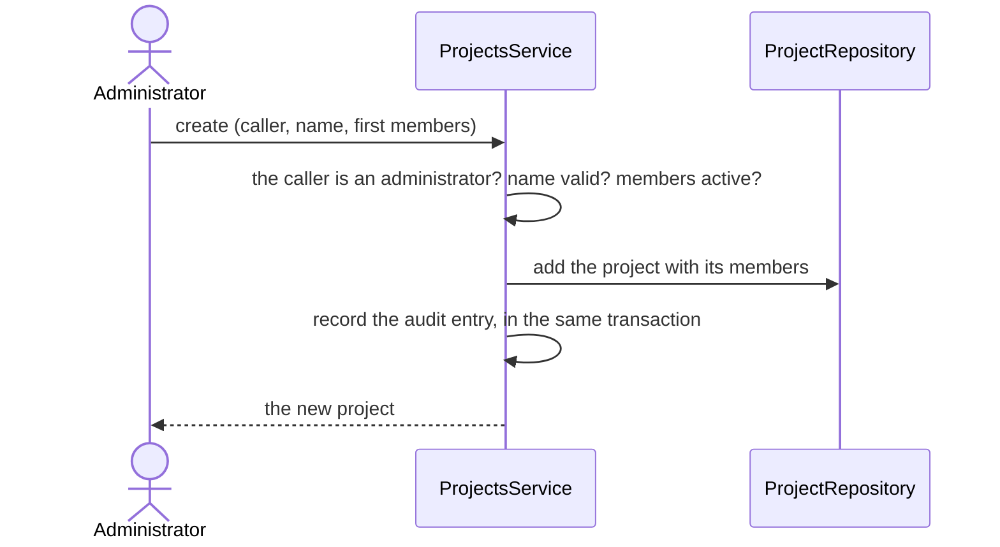

```yaml
id: UC-P1
type: use-case
name: Create a project
status: draft
actor: administrator
context: BC-PROJECTS
satisfies:
  - id: FR-7
  - id: FR-13
criteria:
  - id: AC-9
  - id: AC-10
  - id: AC-11
  - id: AC-12
  - id: AC-13
  - id: AC-29
  - id: AC-32
  - id: AC-48
  - id: AC-89
  - id: AC-91
  - id: AC-92
  - id: AC-93
  - id: AC-94
  - id: AC-95
parameters:
  - name (of the project)
  - first members (active accounts, at most 50, each counted once, possibly none, possibly the administrator)
objects: [OBJ-P1, OBJ-P2]
rules: []
effects:
  - a project exists, with empty placeholder lists of files, endpoints and evaluations (decision 23)
  - the named people are its members
  - an audit entry records who created it, the project (id and name) and who its first members are, with the names at the time
  - a refusal writes one line to the security log and nothing else
evolved_from: []
```

# Create a project

<!-- vbench-uc:begin mirror (generated from the requirements files, do not edit here: change the row, then run sync) -->

<details>
<summary>The requirements and criteria it runs, copied from docs/requirements (2 requirements, 14 criteria). Do not edit.</summary>

## What this serves

**FR-7**: The system shall let an administrator create a project and name its first members.

**FR-13**: The system shall record an audit entry for every project creation and every change to a project's members.

## Acceptance criteria it runs

**AC-9** (acceptance, proves FR-7)

- Given an administrator and an active account
- When they create a project naming that account as a first member
- Then the project exists and that person is a member

**AC-10** (acceptance, proves FR-7)

- Given an administrator
- When they create a project naming themselves as a first member
- Then it exists and they are a member

**AC-11** (acceptance, proves FR-7)

- Given a user who is not an administrator
- When they try to create a project
- Then it is refused

**AC-12** (acceptance, proves FR-7)

- Given a project name that is empty, only spaces, or over 100 characters
- When a project is created with it
- Then it is refused

**AC-13** (acceptance, proves FR-7)

- Given an administrator
- When they create a project naming a first member who is not active or does not exist
- Then it is refused, with one answer for an account that cannot be a member

**AC-29** (acceptance, proves FR-13)

- Given an administrator and active accounts
- When the administrator creates a project naming them as first members
- Then one audit entry says who created it, which project (its id and its name) and who the first members are, each with the name and email they had at that time

**AC-32** (acceptance, proves NFR-1)

- Given the commands of the project routes (create a project, add a member, remove a member), and a caller who may not make them: a user who is not an administrator, or a member who is not an administrator
- When each makes a command it may not, even if the screen hides the button
- Then the server refuses it, and nothing is created or changed

**AC-48** (acceptance, proves NFR-5)

- Given a refused sign in, a refused request, and a session that starts and ends
- When each happens
- Then each writes one log line, and none holds a token or a code

**AC-89** (acceptance, proves FR-7)

- Given an administrator and an active account
- When they create a project naming that account twice as a first member
- Then the project has that person once, and one audit entry names them once

**AC-91** (acceptance, proves FR-7)

- Given a project name with a control character or a bidirectional override character in it
- When a project is created with it
- Then it is refused with InvalidProjectName (422) and no project exists

**AC-92** (acceptance, proves FR-7)

- Given an administrator and more than 50 first members
- When they create a project naming them
- Then it is refused with a 422 and no project exists

**AC-93** (acceptance, proves FR-7; FR-9)

- Given an administrator and a request body with a field the route does not define
- When they create a project or add a member with it
- Then it is refused with a 422 and nothing is created or changed

**AC-94** (acceptance, proves NFR-1)

- Given a request with no token, a pending account, and a deactivated account
- When each makes a request to every /projects route (list, open, create, add a member, remove a member), with the id of a project that exists
- Then each is refused (401 with no token or a bad one, 403 for the others) before the project is looked at, and the answer shows nothing about the project

**AC-95** (integration, proves FR-7; FR-9)

- Given the database role the API connects with (not the owner role that runs the migrations)
- When it tries to update or delete a project, update a membership, or truncate, alter or drop either table
- Then the database refuses each one (42501), while adding and reading projects and memberships, and deleting a membership, still work

## How it is verified

- acceptance: AC-9, AC-10, AC-11, AC-12, AC-13, AC-29, AC-32, AC-48, AC-89, AC-91, AC-92, AC-93, AC-94
- integration: AC-95

Each criterion is run by a test tagged `Verifies AC-<n>`.

</details>

<!-- vbench-uc:end mirror -->

> Draft for the alpha (decision 13). It serves FR-7 and FR-13 (for creation), and runs the criteria listed above (decisions 3, 6, 13, 14 and 23).
> There are two account roles, user and administrator, and no project roles. The parked requirements FR-8, FR-10 and FR-11 and the manager rules are beta, not current.
> Build order (ADR 0015): UC-P1 first, then UC-P3 (the reads), then UC-P2 (the changes). The first two slices of UC-P1 prove no criterion of their own: they make the ground the others stand on (the Access question, then the tables).

## Description

A project is where files, endpoints and evaluations live. Only an administrator creates one. The administrator is a superuser (decision 13): they give the project a name and name its first members, who must be active accounts, and they may name themselves. A project may start with no member at all. Once it exists, only its members and administrators see inside it, and every member has the same rights in it. The project starts with empty placeholder lists of files, endpoints and evaluations (decision 23).

## Preconditions

- The person asking is signed in, and the same full check as for the account routes passes: the token is valid, the account is found, and it is not deactivated and not pending (decision 14).
- They are an administrator.

## Main flow

1. The administrator asks to create a project, gives it a name and names its first members. (FR-7)
2. The system checks, as for every request, the person's token and account, and then that they are an administrator. This is checked before the input is. (FR-7, AC-11, AC-94)
3. The system checks the body (no field it does not know, at most 50 first members), removes the spaces at both ends of the name and checks that it has 1 to 100 characters and no control or direction override character. (FR-7, AC-12, AC-91, AC-92, AC-93)
4. The system counts each named first member once, and checks that each has an active account. The administrator may be one of them, and there may be none. (FR-7, AC-9, AC-10, AC-13, AC-89)
5. The system creates the project, and the named people are its members. (FR-7, AC-9, AC-10)
6. The system records an audit entry with who created it, the project (its id and name) and who its first members are, with their names at that time. (FR-13, AC-29)
7. The administrator sees the new project, with its empty lists of files, endpoints and evaluations. (FR-7)

A refusal at any step writes one line to the security log and nothing else. (AC-48)

## Other flows

- The person is not an administrator: refused with a 403. The project is not created, and the name and the members are not looked at. (AC-11)
- A pending or deactivated person, or a request with no token: refused by the guard chain with the answers of the account routes (403 or 401), before the role is looked at. (AC-94)
- The name is empty, only spaces, longer than 100 characters, or holds a control or direction override character: refused with a 422. (AC-12, AC-91)
- More than 50 first members, or a field in the body that the route does not know: refused with a 422. (AC-92, AC-93)
- A named first member has an account that is pending, deactivated or unknown: refused with a 422, with the same answer for each, and the project is not created. (AC-13)
- The same person is named twice: they are a member once, and the entry names them once. (AC-89)
- Any role, and a person who is not a member, makes a command it may not, even if the screen hides it: the server refuses it. (AC-32) AC-32 moved here from UC-A1 (decision 10). It covers the commands of UC-P1 and UC-P2 (create, add a member, remove a member). The reads are proven by UC-P3 (AC-26, AC-27, AC-55) and the audit read by UC-L1 (AC-68).

## Postconditions

- A project exists, and its members are exactly the people named, each once, who may be none.
- An audit entry exists.
- The database role of the API can add this project and never change or delete it (AC-95).

## Open questions

For the product owner to decide.

1. Must a project name be unique, and within what? (Still open from decision 3.)

Decided: a refused creation is not an audit entry. It writes a line to the security log (decision 22, AC-48). The order of the checks is administrator, then body and name, then first members (decision 14). The audit entry and the project are one transaction.

## Overview

The high level picture. The analysis sequence is in [UC-P1-create-a-project-analysis-sequence.puml](diagrams/UC-P1-create-a-project-analysis-sequence.puml) and the design sequence, with the contexts and ports, in [UC-P1-create-a-project-design-sequence.puml](diagrams/UC-P1-create-a-project-design-sequence.puml). The class diagram is [projects-design.puml](../domain/diagrams/projects-design.puml). All use the step numbers of the main flow.



## Analysis

### Revision 1

Rewritten for the alpha scope (decision 13): the administrator is the only actor, and there are no project roles. Only Playground takes part. What the person and Playground say to each other, with no route, store, port or token. The diagram is
[UC-P1-create-a-project-analysis-sequence.puml](diagrams/UC-P1-create-a-project-analysis-sequence.puml). Not frozen.

- A1 (step): The administrator asks to create a project, with a name and its first members
- A2 (step): Playground checks the person is an administrator
- A3 (step): Playground trims the name and checks its length and its characters
- A4 (step): Playground checks that each named first member has an active account
- A5 (step): Playground creates the project, and the named people are its members
- A6 (step): Playground records who created it and who its first members are
- A7 (step): The administrator sees the new project
- A8 (rule): Only an administrator creates a project
- A9 (rule): First members must be active accounts, each counts once, there are at most 50, the administrator may be one, and a project may have none
- A10 (refusal): The person is not an administrator
- A11 (refusal): The name is empty, only spaces, too long or holds a forbidden character, or there are too many first members, or the request holds an unknown field
- A12 (refusal): A named first member is not an active account, with one answer
- A13 (object): Project
- A14 (object): Membership

## Design

A plan, not built yet. The class diagram is [projects-design.puml](../domain/diagrams/projects-design.puml) and the design sequence is [UC-P1-create-a-project-design-sequence.puml](diagrams/UC-P1-create-a-project-design-sequence.puml), both marked planned (decisions 13, 14 and 23, ADR 0015). The files follow ADR 0010 (there is no `main.py` or `ports.py` of Projects at the root):

- `apps/api/app/projects/domain/`: `project.py` (`Project` with its `Membership`, an entity inside the aggregate), `name.py` (`ProjectName`), `caller.py` (the `Caller` of Projects) and `errors.py`.
- `apps/api/app/projects/application/`: `ports.py` (`ProjectRepository`, `AccountStatus`, `People`, `AuditLog`, `SecurityLog`) and `service.py` (`ProjectsService`).
- `apps/api/app/projects/adapters/inbound/`: `http.py` (the routes and the guard chain), `schemas.py` and `errors.py` (rule to HTTP status).
- `apps/api/app/projects/adapters/outbound/`: `sql.py` (`SqlProjects`).
- `apps/api/app/composition/`: `bridges.py` holds `projects_caller(account)` beside `audit_caller`, the bridge that answers `AccountStatus` with the new Access use case `active_among`, the one that answers `People`, and `ProjectsAuditBridge`, all on the request's one session.

Every step lands on a class of the diagram: `Caller`, `ProjectsService`, `ProjectName`, `Project`, `AccountStatus`, `People`, `ProjectRepository`, `AuditLog` and `SecurityLog`. There is no "API" or "Access" box: the guard chain runs the full check (token, account found, not deactivated, not pending) before any of it, `composition/` builds the `Caller`, and Access and Audit answer through bridges.

Decided here, within decisions 13, 14 and 23: an administrator may name themselves as a first member, a project may have none, the first members are de-duplicated and capped at 50, and `added by` of every first member is the creator. The project id is a random UUID made in the domain. Creating the project and writing its audit entry are one transaction (`SqlProjects` and the audit bridge share one database session). The answer carries the empty lists `files`, `endpoints` and `evaluations` (placeholders, decision 23). The tables, their grants and the grant test are slice TSK-P1.2.

What each refusal answers (decision 14). Authorisation is checked before the input is validated.

| Case | Error | Answer |
|---|---|---|
| No token, a bad token, or an account that is deactivated or pending (AC-94) | the account routes' own | 401 or 403, before the role is looked at |
| A user who is not an administrator creates a project (AC-11, AC-32) | `NotAnAdministrator` | 403 |
| A name that is empty, only spaces, over 100 characters or with a forbidden character (AC-12, AC-91) | `InvalidProjectName` | 422 |
| More than 50 first members, or an unknown field (AC-92, AC-93) | `InvalidRequest` | 422 |
| A first member who is pending, deactivated or unknown (AC-13) | `MemberNotEligible` | 422, one answer for every reason |

There is no 404 on this route: no project exists yet. Every refusal writes one line to the security log through `SecurityLog` (AC-48), and no audit entry.

- D1 (route): The create project route, kept thin, in `adapters/inbound/http.py` with its body in `schemas.py`, which refuses unknown fields
- D2 (value object): Caller of Projects, built by `projects_caller(account)` in composition/ after the full check
- D3 (use case): ProjectsService.create(caller, name, first_members), which checks the caller is an administrator, then the name and the members, then saves, audits and logs
- D4 (aggregate): Project, which holds its Memberships, with a random UUID id
- D5 (value object): ProjectName, trimmed, 1 to 100 Unicode characters, no control or direction override character
- D6 (port): ProjectRepository
- D7 (port): AccountStatus, `active_among(ids)`, which answers for the set of first members at once
- D8 (port): AuditLog, whose entry carries the project id and name, the actor and the members, with names from People
- D9 (adapter): SqlProjects, over the API database (Amazon RDS on AWS), in `adapters/outbound/sql.py`
- D10 (adapter): The bridges in composition/ that answer AccountStatus (from Access's `active_among`), People (from Access) and AuditLog (to Audit)
- D11 (domain error): NotAnAdministrator, InvalidProjectName, InvalidRequest and MemberNotEligible
- D12 (domain rule): First members: the administrator may name themselves, there may be none, each counts once, at most 50, and `added by` is the creator
- D13 (port): People, `names_of(ids)`, for the names and emails at the time
- D14 (port): SecurityLog, one line for each refusal

## Changes from analysis to design

```
A1 became -> D1, D3
A2 became -> D2, D3
A3 became -> D3, D5
A4 became -> D3, D7, D10
A5 became -> D3, D4, D6, D9
A6 became -> D3, D8, D10, D13
A7 became -> D1
A8 became -> D2, D3, D11
A9 became -> D4, D7, D12
A10 became -> D3, D11, D14
A11 became -> D1, D5, D11, D14
A12 became -> D7, D11, D14
A13 became -> D4
A14 became -> D4
```

## Slices

1. TSK-P1.1: Access answers which accounts are active among some ids, test first, before Projects (BC-ACCESS, built through AC-13 and AC-18 afterwards)
2. TSK-P1.2: A migration makes `projects` and `memberships` with random UUID ids, per table and column grants, no UPDATE and no DELETE on `projects`, DELETE on `memberships` only, and the grant test (AC-95)
3. TSK-P1.3: An administrator creates a project, naming active first members, themselves or none (AC-9, AC-10)
4. TSK-P1.4: Only an administrator creates a project, the server refuses what a role may not do, and every project route passes the guard chain (AC-11, AC-32, AC-94)
5. TSK-P1.5: A project name is trimmed and checked, the first members are capped at 50, and the body refuses unknown fields (AC-12, AC-91, AC-92, AC-93)
6. TSK-P1.6: A first member must have an active account, and each is counted once (AC-13, AC-89)
7. TSK-P1.7: Creating a project is audited, with the names at the time, and every refusal is logged (AC-29, AC-48)
