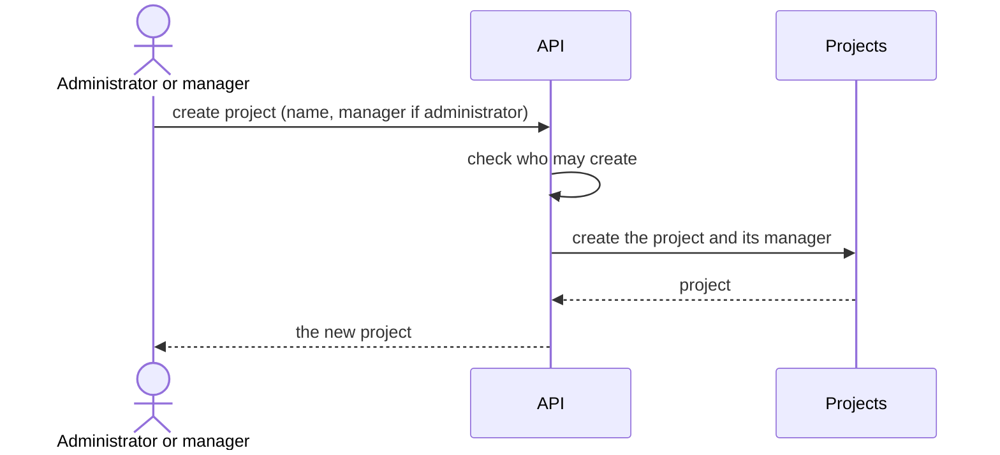

```yaml
id: UC-P1
type: use-case
name: Create a project
status: draft
actor: administrator or project manager
context: BC-PROJECTS
satisfies:
  - id: FR-7
  - id: FR-8
  - id: FR-13
criteria:
  - id: AC-9
  - id: AC-10
  - id: AC-11
  - id: AC-12
  - id: AC-13
  - id: AC-14
  - id: AC-15
  - id: AC-29
parameters:
  - name (of the project)
  - manager (only when an administrator creates it)
objects: [OBJ-P1, OBJ-P2]
rules: [RULE-P1, RULE-P2, RULE-P4]
effects:
  - a project exists, empty of files, endpoints and evaluations
  - the project has one manager from the start
  - an audit entry records who created it
evolved_from: []
```

# Create a project

<!-- vbench-uc:begin mirror (generated from the requirements files, do not edit here: change the row, then run sync) -->

<details>
<summary>The requirements and criteria it runs, copied from docs/requirements (3 requirements, 8 criteria). Do not edit.</summary>

## What this serves

**FR-7**: The system shall let an administrator or a project manager create a project, which has a manager from the start.

**FR-8**: The system shall not give an administrator access to a project's contents by their role.

**FR-13**: The system shall record an audit entry for every project creation, every change to a project's members, and every refused attempt by an administrator to change them.

## Acceptance criteria it runs

**AC-9** (acceptance, proves FR-7)

- Given an administrator and an active account
- When they create a project naming that account as manager
- Then the project exists and that person is its manager

**AC-10** (acceptance, proves FR-7)

- Given a person who manages a project
- When they create a project
- Then it exists and they are its manager

**AC-11** (acceptance, proves FR-7)

- Given a person who manages no project and is not an administrator
- When they try to create a project
- Then it is refused

**AC-12** (acceptance, proves FR-7)

- Given a project name that is empty, only spaces, or over 100 characters
- When a project is created with it
- Then it is refused

**AC-13** (acceptance, proves FR-7)

- Given an administrator
- When they create a project naming no manager, or one who is not active or does not exist
- Then it is refused, with one answer for an account that cannot be a manager

**AC-14** (acceptance, proves FR-8)

- Given a project an administrator created for someone else
- When that administrator asks for its contents
- Then it is refused

**AC-15** (acceptance, proves FR-8)

- Given an administrator
- When they add themselves to a project, or name themselves its manager
- Then it is refused and they are not a member

**AC-29** (acceptance, proves FR-13)

- Given a project
- When it is created
- Then an audit entry says who created it and who its manager is

## How it is verified

- acceptance: AC-9, AC-10, AC-11, AC-12, AC-13, AC-14, AC-15, AC-29

Each criterion is run by a test tagged `Verifies AC-<n>`.

</details>

<!-- vbench-uc:end mirror -->

> Draft for the first cut of projects. It serves FR-7, FR-8 and FR-13 (for creation), and runs the criteria listed above (decisions 3 and 6).
> Roles are names only for now: a project manager and an engineer do the same things, except that only a manager adds people.

## Description

A project is where files, endpoints and evaluations live. Only the members of a project can see inside it. An administrator or a project manager can create one. An administrator **does not join** the project they create, so they never see inside it unless a manager later adds them (an administrator may only restore a manager to a project that has no active manager, never another administrator, and never themselves: see UC-P2). Because of that, an administrator must name the person who will manage it.

## Preconditions

- The person asking is signed in and their account is active.
- They are an administrator, or they manage at least one project.

## Main flow

1. The person asks to create a project and gives it a name. (FR-7)
2. The system checks that the person's account is active, and that they are an administrator or manage at least one project. (FR-7)
3. The system removes the spaces at both ends of the name and checks that it has 1 to 100 characters. (FR-7)
4. If the person is an administrator who manages no project, they also name a manager. The system checks that this person has an active account and is not the person asking. (FR-7, FR-8)
5. The system creates the project. A person who manages a project becomes its manager, even if they are also an administrator. When an administrator who manages no project creates it, the person they named becomes its manager and the administrator is not a member. (FR-7, FR-8, AC-9, AC-10)
6. The system records an audit entry with who created it, and who the manager is. (FR-13, AC-29)
7. The person sees the new project. (FR-7)

## Other flows

- The person is neither an administrator nor a manager of any project: refused. The project is not created. (AC-11)
- The name is empty, only spaces, or longer than 100 characters: refused. (AC-12)
- An administrator names no manager: refused, because a project must have a manager from the start. (AC-13)
- The named manager's account is pending, deactivated or unknown: refused, with the same answer for each. (AC-13)
- An administrator names themselves as the manager: refused. (FR-8, AC-15)
- An administrator who created a project asks for its contents: refused, because they are not a member. (AC-14)

## Postconditions

- A project exists with exactly one manager and no other members.
- An administrator who created it for someone else is not a member and cannot open its contents.

## Open questions

For the product owner to decide.

1. A manager who supplies a manager when creating: is the name ignored (they become the manager), or refused? Can a manager name a second manager?
2. AC-14 needs a concrete request ("asks for its contents") while contents are empty containers.
3. Must each refusal at creation be distinguishable, and in which order do the checks apply?
4. Is the audit entry made together with the project (all or nothing), and are refused creations audited? What is `added by` for the first manager?

## Overview

The high level picture. The detailed sequence is in [UC-P1-create-a-project-sequence.puml](diagrams/UC-P1-create-a-project-sequence.puml).



## Slices

1. TSK-P1.1: A project manager creates a project and becomes its manager, rules RULE-P1 (AC-10, AC-11)
2. TSK-P1.2: An administrator creates a project and names its manager, rules RULE-P2, RULE-P4 (AC-9, AC-13, AC-14, AC-15)
3. TSK-P1.3: A project name is trimmed and checked (AC-12)
4. TSK-P1.4: Creating a project is audited (AC-29)
