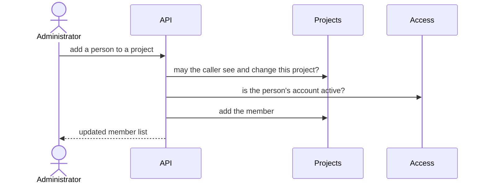

```yaml
id: UC-P2
type: use-case
name: Manage project members
status: draft
actor: administrator (members and administrators view)
context: BC-PROJECTS
satisfies:
  - id: FR-4
  - id: FR-9
  - id: FR-12
  - id: FR-13
criteria:
  - id: AC-17
  - id: AC-18
  - id: AC-20
  - id: AC-26
  - id: AC-27
  - id: AC-28
  - id: AC-30
  - id: AC-32
parameters:
  - project
  - person (an active account)
  - action (add or remove)
objects: [OBJ-P1, OBJ-P2]
rules: [RULE-P4]
effects:
  - the person is, or is no longer, a member of the project
  - an audit entry records who changed what
evolved_from: [MK3 UC-A3]
```

# Manage project members

<!-- vbench-uc:begin mirror (generated from the requirements files, do not edit here: change the row, then run sync) -->

<details>
<summary>The requirements and criteria it runs, copied from docs/requirements (4 requirements, 8 criteria). Do not edit.</summary>

## What this serves

**FR-4**: The system shall let an administrator decide who can use the product: approve a pending account, deactivate an active one with a reason, and reinstate a deactivated one with a reason.

**FR-9**: The system shall let an administrator add and remove members of a project, adding only people with an active account.

**FR-12**: The system shall show a project's contents and member list only to its members and to administrators, and answer anyone else as for a project that does not exist.

**FR-13**: The system shall record an audit entry for every project creation and every change to a project's members.

## Acceptance criteria it runs

**AC-17** (acceptance, proves FR-9)

- Given an administrator and an active account
- When the administrator adds that person to a project
- Then they are a member

**AC-18** (acceptance, proves FR-9)

- Given an administrator and an account that is pending, deactivated or unknown
- When the administrator adds it
- Then it is refused, with one answer for all three

**AC-20** (acceptance, proves FR-9)

- Given a member of a project
- When an administrator removes them
- Then they are out, and their next request gets the same answer as for a missing project

**AC-26** (acceptance, proves FR-12)

- Given a project, a member, an administrator and a user who is neither
- When each asks for its contents
- Then the member and the administrator see them and the other is refused

**AC-27** (acceptance, proves FR-12)

- Given a project and an id that does not exist
- When a person who is neither a member nor an administrator asks about, or changes the members of, either
- Then the answer is the same for both

**AC-28** (acceptance, proves FR-12)

- Given a member of a project
- When they open the member list
- Then they see its members

**AC-30** (acceptance, proves FR-13)

- Given a project
- When a member is added or removed
- Then each has an entry saying who, what and whom

**AC-32** (acceptance, proves NFR-1)

- Given any role, and a person who is not a member
- When each makes a command or read it may not, even if the screen hides it
- Then the server refuses it

## How it is verified

- acceptance: AC-17, AC-18, AC-20, AC-26, AC-27, AC-28, AC-30, AC-32

Each criterion is run by a test tagged `Verifies AC-<n>`.

</details>

<!-- vbench-uc:end mirror -->

> Draft for the alpha (decision 13). It serves FR-9, FR-12 and FR-13, and FR-4 where it touches members, and runs the criteria listed above (decisions 3, 6 and 13).
> Replaces an earlier membership use case that lived in Access. Projects owns membership (decision 2). Access is asked for the person's account status.

## Description

An administrator decides who is in a project: they add people with an active account and remove members. There are no project roles, so every member has the same rights, which include running evaluations (out of scope here). Only members and administrators see inside a project and its member list. A person who is neither gets the same answer as for a project that does not exist. A project may be empty, so the administrator can remove anyone.

## Preconditions

- The person asking is signed in with an active account.
- To change members, they are an administrator.

## Main flow

1. An administrator opens a project and its member list. (FR-12, AC-26, AC-28)
2. They choose an action: add a person or remove a person. (FR-9)
3. For an addition, they choose a person. (FR-9)
4. The system checks that the person asking may see this project (a member or an administrator) and is an administrator. A person who is neither gets the same answer as for a project that does not exist. (FR-9, FR-12, AC-27)
5. The system checks that the person being added has an **active** account, and gives one answer if not. (FR-9, AC-18)
6. The system applies the change. Adding a person who is already a member changes nothing. A removed member is out, and the project may end up empty. (FR-9, AC-17, AC-20)
7. The system records an audit entry with who, what and who it affected. (FR-13, AC-30)
8. The change takes effect at the affected person's next request, because membership is read on every request. (FR-9, AC-20)

## Other flows

- A member who is not an administrator opens the member list: they see its members. An administrator who is not a member sees them too. (FR-12, AC-26, AC-28)
- A member who is not an administrator tries to add or remove a member: refused. (FR-9, AC-32)
- Any role, and a person who is not a member, makes a command or read it may not, even if the screen hides it: the server refuses it. (AC-32) AC-32 moved here from UC-A1 (decision 10). UC-P1 proves it for creating a project and UC-P2 for managing members. The rest of "every command and read" is proven by later use cases.
- A person who is neither a member nor an administrator asks about, or tries to change, the members of a project: the same answer as for a project that does not exist. (FR-12, AC-27)
- The person to add has a pending, deactivated or unknown account: refused, with one answer whichever it is. (FR-9, AC-18)
- The person is already a member: nothing changes. (FR-9)
- A person who is not a member is the target of a removal: refused, and nothing changes. (FR-9)
- The last member is removed: allowed, and the project is empty. (FR-9, AC-20)
- A member's account is deactivated: they stay on the project (nothing is deleted), but every request of theirs is refused at the account check. When the account is reinstated they are a member again. (FR-4)

## Postconditions

- The project has the member list the administrator asked for, which may be empty.
- Nothing the person did earlier in the project is deleted.
- An audit entry exists.

## Open questions

For the product owner to decide.

1. Does removing a member need a reason? For now no, only an audit entry.
2. What a removed member's earlier work in the project shows as (their name or "removed member").
3. AC-26 asks for a project's contents, which are empty containers for now. Is a member list enough to prove it here?

## Overview

The high level picture. The analysis sequence is in [UC-P2-manage-project-members-analysis-sequence.puml](diagrams/UC-P2-manage-project-members-analysis-sequence.puml) and the design sequence, with the contexts and ports, in [UC-P2-manage-project-members-design-sequence.puml](diagrams/UC-P2-manage-project-members-design-sequence.puml). Both use the step numbers of the main flow.



## Analysis

### Revision 1

Rewritten for the alpha scope (decision 13): the administrator changes members, members and administrators see the list, and there are no project roles. Only Playground takes part. What the person and Playground say to each other, with no route, store, port or token. The diagram is
[UC-P2-manage-project-members-analysis-sequence.puml](diagrams/UC-P2-manage-project-members-analysis-sequence.puml).
Not frozen.

- A1 (step): The person opens a project and its member list
- A2 (step): The administrator chooses to add or remove
- A3 (step): For an addition, the administrator gives the person to add
- A4 (step): Playground checks the person asking may see this project, as a member or an administrator
- A5 (step): Playground checks the person asking is an administrator
- A6 (step): Playground checks the person to add has an active account
- A7 (step): Playground applies the change
- A8 (step): Playground records who, what and who it affected
- A9 (step): The change takes effect at the affected person's next request
- A10 (rule): Only an administrator adds or removes members
- A11 (rule): Only members and administrators see inside a project, and anyone else gets the same answer as for a project that does not exist
- A12 (rule): Every member has the same rights, and a project may be empty
- A13 (refusal): A person who is neither a member nor an administrator gets the same answer as for a project that does not exist
- A14 (refusal): A member who is not an administrator tries to change members
- A15 (refusal): The person to add is not an active account, with one answer
- A16 (refusal): The person to remove is not a member
- A17 (object): Project
- A18 (object): Membership

## Design

A plan, not built yet: the diagram is [UC-P2-manage-project-members-design-sequence.puml](diagrams/UC-P2-manage-project-members-design-sequence.puml),
marked planned. It keeps to the ports of decision 3 and BC-PROJECTS (`AccountStatus`, `AuditLog`). There is no
class diagram of the Projects context yet.

- D1 (route): The member routes (list, add, remove), kept thin
- D2 (use case): The manage members use case of the API
- D3 (aggregate): Project with its memberships
- D4 (domain rule): Who may see a project, and that only an administrator changes members (RULE-P4)
- D5 (port): AccountStatus, answered by Access
- D6 (port): AuditLog
- D7 (port): A project repository for Projects (name to be settled when it is built)
- D8 (domain rule): Membership is read on every request, so a change takes effect at once

## Changes from analysis to design

```
A1 became -> D1, D2, D7
A2 became -> D1
A3 became -> D1
A4 became -> D2, D3, D4, D7
A5 became -> D2, D4
A6 became -> D2, D5
A7 became -> D2, D3, D7
A8 became -> D2, D6
A9 became -> D8
A10 became -> D4
A11 became -> D4
A12 became -> D3, D4
A13 became -> D2, D4
A14 became -> D2, D4
A15 became -> D2, D5
A16 became -> D3, D4
A17 became -> D3
A18 became -> D3
```

## Slices

1. TSK-P2.1: An administrator adds a person, only with an active account (AC-17, AC-18)
2. TSK-P2.2: An administrator removes a member, and a project may end up empty (AC-20)
3. TSK-P2.3: Only members and administrators see inside, and anyone else gets the same answer as for a missing project, rules RULE-P4 (AC-26, AC-27, AC-28)
4. TSK-P2.4: Changes to members are audited (AC-30)
5. TSK-P2.5: The server refuses what a role may not do (AC-32)
