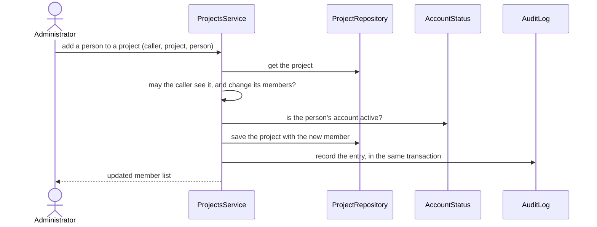

```yaml
id: UC-P2
type: use-case
name: Manage project members
status: draft
actor: administrator (members and administrators view)
context: BC-PROJECTS
satisfies:
  - id: FR-9
  - id: FR-12
  - id: FR-13
criteria:
  - id: AC-17
  - id: AC-18
  - id: AC-20
  - id: AC-84
  - id: AC-30
  - id: AC-32
  - id: AC-60
  - id: AC-48
  - id: AC-87
  - id: AC-88
  - id: AC-90
  - id: AC-93
  - id: AC-94
parameters:
  - project
  - person (an active account)
  - action (add or remove)
objects: [OBJ-P1, OBJ-P2]
rules: [RULE-P4]
effects:
  - the person is, or is no longer, a member of the project
  - an audit entry records who changed what, for a change that happened (an addition of an existing member, and a removal of a non-member, write nothing)
  - a refusal writes one line to the security log and nothing else
evolved_from: [MK3 UC-A3]
```

# Manage project members

<!-- vbench-uc:begin mirror (generated from the requirements files, do not edit here: change the row, then run sync) -->

<details>
<summary>The requirements and criteria it runs, copied from docs/requirements (3 requirements, 13 criteria). Do not edit.</summary>

## What this serves

**FR-9**: The system shall let an administrator add and remove members of a project, adding only people with an active account.

**FR-12**: The system shall show a project's contents and member list only to its members and to administrators, and answer anyone else as for a project that does not exist.

**FR-13**: The system shall record an audit entry for every project creation and every change to a project's members.

## Acceptance criteria it runs

**AC-17** (acceptance, proves FR-9)

- Given an administrator and an active account
- When the administrator adds that person to a project
- Then they are a member

**AC-18** (acceptance, proves FR-9)

- Given an administrator and an account that is pending, deactivated or unknown
- When the administrator adds it
- Then it is refused, with one answer for all three

**AC-20** (acceptance, proves FR-9)

- Given a member of a project
- When an administrator removes them
- Then they are out, and their next request gets the same answer as for a missing project

**AC-84** (acceptance, proves FR-12)

- Given a project, an id that does not exist, and an id that is not well formed
- When a person who is neither a member nor an administrator tries to add a member to, or remove a member from, each of them
- Then the three answers have the same status, body and code (404), and no membership changes

**AC-30** (acceptance, proves FR-13)

- Given a project
- When a member is added or removed
- Then one audit entry for each change says who did it, what was done (member added or member removed), which project (its id and its name) and which member, each with the name and email they had at that time

**AC-32** (acceptance, proves NFR-1)

- Given the commands of the project routes (create a project, add a member, remove a member), and a caller who may not make them: a user who is not an administrator, or a member who is not an administrator
- When each makes a command it may not, even if the screen hides the button
- Then the server refuses it, and nothing is created or changed

**AC-60** (acceptance, proves FR-9)

- Given a member of a project who is not an administrator
- When they try to add or remove a member
- Then it is refused

**AC-48** (acceptance, proves NFR-5)

- Given a refused sign in, a refused request, and a session that starts and ends
- When each happens
- Then each writes one log line, and none holds a token or a code

**AC-87** (acceptance, proves FR-9)

- Given an administrator and a project, and a person who is not a member
- When the administrator tries to remove that person
- Then it is refused with MemberNotEligible (422), no membership changes and no audit entry is written

**AC-88** (acceptance, proves FR-9)

- Given an administrator and a project, and a person who is already a member
- When the administrator adds that person again
- Then nothing changes, no audit entry is written, and the answer shows the same member list

**AC-90** (integration, proves FR-9)

- Given two administrators and a project, and an active account that is not a member
- When both add that person at the same moment
- Then the project has one membership for that person, neither call fails with a server error, and one audit entry is written

**AC-93** (acceptance, proves FR-7; FR-9)

- Given an administrator and a request body with a field the route does not define
- When they create a project or add a member with it
- Then it is refused with a 422 and nothing is created or changed

**AC-94** (acceptance, proves NFR-1)

- Given a request with no token, a pending account, and a deactivated account
- When each makes a request to every /projects route (list, open, create, add a member, remove a member), with the id of a project that exists
- Then each is refused (401 with no token or a bad one, 403 for the others) before the project is looked at, and the answer shows nothing about the project

## How it is verified

- acceptance: AC-17, AC-18, AC-20, AC-84, AC-30, AC-32, AC-60, AC-48, AC-87, AC-88, AC-93, AC-94
- integration: AC-90

Each criterion is run by a test tagged `Verifies AC-<n>`.

</details>

<!-- vbench-uc:end mirror -->

> Draft for the alpha (decision 13). It serves FR-9, FR-12 and FR-13, and runs the criteria listed above (decisions 3, 6, 13, 14 and 23).
> Replaces an earlier membership use case that lived in Access. Projects owns membership (decision 2). Access is asked, through the AccountStatus port, which accounts are active.
> Listing and opening a project, and showing its member list, are [UC-P3](UC-P3-list-and-open-a-project.md) (decision 14), with AC-26, AC-27 and AC-28. The same 404 on the change routes is AC-84 here.
> FR-4 (decide who can use the product) is a note, not a requirement of this use case: a deactivated member stays on the project (see the last other flow), and UC-A4 owns FR-4.
> Build order: after UC-P1 and UC-P3 (ADR 0015).

## Description

An administrator decides who is in a project: they add people with an active account and remove members. There are no project roles, so every member has the same rights, which include running evaluations (out of scope here). Only members and administrators see inside a project and its member list (UC-P3). A person who is neither gets the same answer as for a project that does not exist, on the change routes as well. A project may be empty, so the administrator can remove anyone.

## Preconditions

- The person asking is signed in, and the same full check as for the account routes passes: the token is valid, the account is found, and it is not deactivated and not pending (decision 14).
- To change members, they are an administrator.

## Main flow

1. An administrator opens a project and its member list (the read is UC-P3). (FR-12)
2. They choose an action: add a person or remove a person. (FR-9)
3. For an addition, they choose a person. (FR-9)
4. The system checks that the person asking may see this project (a member or an administrator), and then that they are an administrator. A person who is neither a member nor an administrator, or who asks about a project that does not exist or whose id is not well formed, gets the same answer. A member who is not an administrator is refused. This is checked before the input is. (FR-9, FR-12, AC-84, AC-60, AC-94)
5. The system checks the body (no field it does not know). For an addition it checks that the person being added has an **active** account, and gives one answer if not. (FR-9, AC-18, AC-93)
6. The system applies the change. Adding a person who is already a member changes nothing and writes no entry. Removing a person who is not a member is refused and writes nothing. A removed member is out, and the project may end up empty. Two administrators adding the same person at the same moment leave one membership. (FR-9, AC-17, AC-20, AC-87, AC-88, AC-90)
7. The system records an audit entry with who, what and who it affected, for the project (id and name) and the member, with the names at that time, in the same transaction as the change. (FR-13, AC-30)
8. The change takes effect at the affected person's next request, because membership is read on every request. (FR-9, AC-20)

A refusal at any step writes one line to the security log and nothing else. (AC-48)

## Other flows

- A member who is not an administrator tries to add or remove a member: refused with a 403, and nothing changes. (FR-9, AC-60)
- Any role, and a person who is not a member, makes a command it may not, even if the screen hides it: the server refuses it. (AC-32) AC-32 moved here from UC-A1 (decision 10). It covers the commands of UC-P1 and UC-P2 (create, add a member, remove a member). The reads are proven by UC-P3 and the audit read by UC-L1.
- A person who is neither a member nor an administrator asks about, or tries to change, the members of a project: the same 404 as for a project that does not exist or whose id is not well formed, with the same status, body and code. (FR-12, AC-84)
- A pending or deactivated person, or a request with no token: refused by the guard chain (403 or 401) before the project is looked at. (AC-94)
- The person to add has a pending, deactivated or unknown account: refused with a 422, with one answer whichever it is. (FR-9, AC-18)
- The person is already a member: nothing changes and no entry is written. (FR-9, AC-88)
- A person who is not a member is the target of a removal: refused with `MemberNotEligible` (422), a Projects refusal that does not ask Access, and nothing changes and nothing is written (decision 23). (FR-9, AC-87)
- The body holds a field the route does not know: refused with a 422. (AC-93)
- The last member is removed: allowed, and the project is empty. (FR-9, AC-20)
- A member's account is deactivated: they stay on the project (nothing is deleted), but every request of theirs is refused at the account check. When the account is reinstated they are a member again. (UC-A4 owns FR-4)

## Postconditions

- The project has the member list the administrator asked for, which may be empty.
- Nothing the person did earlier in the project is deleted.
- An audit entry exists for each change that happened, and none for a change that did not.

## Open questions

For the product owner to decide.

1. Does removing a member need a reason? For now no, only an audit entry.
2. What a removed member's earlier work in the project shows as (their name or "removed member").

Decided (decision 23): removing a person who is not a member is refused with `MemberNotEligible` (422) and writes nothing. The member lists have no paging in the alpha.

## Overview

The high level picture. The analysis sequence is in [UC-P2-manage-project-members-analysis-sequence.puml](diagrams/UC-P2-manage-project-members-analysis-sequence.puml) and the design sequence, with the contexts and ports, in [UC-P2-manage-project-members-design-sequence.puml](diagrams/UC-P2-manage-project-members-design-sequence.puml). The class diagram is [projects-design.puml](../domain/diagrams/projects-design.puml). All use the step numbers of the main flow.



## Analysis

### Revision 1

Rewritten for the alpha scope (decision 13): the administrator changes members, members and administrators see the list, and there are no project roles. Only Playground takes part. What the person and Playground say to each other, with no route, store, port or token. The diagram is
[UC-P2-manage-project-members-analysis-sequence.puml](diagrams/UC-P2-manage-project-members-analysis-sequence.puml).
Not frozen.

- A1 (step): The person opens a project and its member list
- A2 (step): The administrator chooses to add or remove
- A3 (step): For an addition, the administrator gives the person to add
- A4 (step): Playground checks the person asking may see this project, as a member or an administrator
- A5 (step): Playground checks the person asking is an administrator
- A6 (step): Playground checks the person to add has an active account
- A7 (step): Playground applies the change
- A8 (step): Playground records who, what and who it affected
- A9 (step): The change takes effect at the affected person's next request
- A10 (rule): Only an administrator adds or removes members
- A11 (rule): Only members and administrators see inside a project, and anyone else gets the same answer as for a project that does not exist
- A12 (rule): Every member has the same rights, and a project may be empty
- A13 (refusal): A person who is neither a member nor an administrator gets the same answer as for a project that does not exist
- A14 (refusal): A member who is not an administrator tries to change members
- A15 (refusal): The person to add is not an active account, with one answer
- A16 (refusal): The person to remove is not a member
- A17 (object): Project
- A18 (object): Membership
- A19 (rule): Adding a person who is already a member changes nothing and writes no record

## Design

A plan, not built yet. The class diagram is [projects-design.puml](../domain/diagrams/projects-design.puml) and the design sequence is [UC-P2-manage-project-members-design-sequence.puml](diagrams/UC-P2-manage-project-members-design-sequence.puml), both marked planned (decisions 13, 14 and 23, ADR 0015). The files are those of [UC-P1](UC-P1-create-a-project.md): `projects/domain/`, `projects/application/` (`ports.py`, `service.py`), `projects/adapters/inbound/` (`http.py`, `schemas.py`, `errors.py`), `projects/adapters/outbound/sql.py`, and the bridges in `composition/bridges.py`. Every step lands on a class of that diagram: `ProjectsService`, `ProjectRepository`, `ProjectRules`, `Project`, `AccountStatus`, `People`, `AuditLog` and `SecurityLog`, with the `Caller` passed in. There is no "API", "Access" or "DB" box: the guard chain runs the full check (token, account found, not deactivated, not pending) and `projects_caller(account)` in `composition/` builds the `Caller` first.

The order of the checks is: the project is read and the caller may see it (404), then the caller may change members (403), then the input (422). Authorisation is checked before the input is validated. A project id that is not well formed is answered as a missing project (404), never as a 422. The diagram draws both paths. The **remove path**: a person who is not a member is a Projects refusal, found on the `Project` itself, and `AccountStatus` is not asked (an administrator may remove anyone, including a deactivated account). The **add path** asks `AccountStatus` for the person, and a refusal there is a different one. Adding an existing member, or removing a non-member, is the row difference: nothing is written and no entry is made. The unique key on (project, account) keeps two simultaneous additions to one row (AC-90). The change and its audit entry are one transaction: `SqlProjects` and the audit bridge share one database session. The entry carries the project id and name and the member, with their names and emails from `People` at that moment.

What each refusal answers (decision 14, decision 23):

| Case | Error | Answer |
|---|---|---|
| No token, a bad token, or an account that is deactivated or pending (AC-94) | the account routes' own | 401 or 403, before the role is looked at |
| A project that does not exist, an id that is not well formed, or a person who is neither a member nor an administrator, on a change route (AC-84) | `ProjectNotFound` | 404, the same status, body and code for all three |
| A member who is not an administrator adds or removes a member (AC-60, AC-32) | `NotAnAdministrator` | 403 |
| A person to add who is pending, deactivated or unknown (AC-18) | `MemberNotEligible` | 422, one answer for every reason |
| A person to remove who is not a member (AC-87) | `MemberNotEligible` | 422, decided by decision 23 |
| A field in the body that the route does not know (AC-93) | `InvalidRequest` | 422 |

Every refusal writes one line to the security log through `SecurityLog` (AC-48), and no audit entry.

- D1 (route): The member routes (add, remove), kept thin. The member list is read by the open route of UC-P3
- D2 (value object): Caller of Projects, built by `projects_caller(account)` in composition/ after the full check
- D3 (use case): ProjectsService.add_member and remove_member (caller, project_id, account_id), which read the project, check may see and may change, then validate, apply, save, audit and log. It reuses `open` of UC-P3 for the member list
- D4 (aggregate): Project with its Memberships, whose add_member and remove_member apply the change and refuse a removal of a non-member
- D5 (domain rule): `may_see(caller, project)` (RULE-P4) and `may_change_members(caller)` in ProjectRules
- D6 (port): ProjectRepository, with `get` and `save`
- D7 (port): AccountStatus, with `active_among`
- D8 (port): AuditLog
- D9 (adapter): SqlProjects, over the API database (Amazon RDS on AWS), with the unique key on (project, account)
- D10 (adapter): The bridges in composition/ that answer AccountStatus (from Access), People (from Access) and AuditLog (to Audit)
- D11 (domain error): ProjectNotFound, NotAnAdministrator, MemberNotEligible and InvalidRequest
- D12 (domain rule): Membership is read on every request, so a change takes effect at once
- D13 (port): People, `names_of(ids)`
- D14 (port): SecurityLog
- D15 (domain rule): A change that changes no row (an existing member added, a non-member removed) writes no entry

## Changes from analysis to design

```
A1 became -> D1, D3
A2 became -> D1
A3 became -> D1
A4 became -> D2, D3, D4, D5, D6, D9
A5 became -> D2, D3, D5
A6 became -> D3, D7, D10
A7 became -> D3, D4, D6, D9
A8 became -> D3, D8, D10, D13
A9 became -> D12
A10 became -> D5
A11 became -> D5, D11
A12 became -> D4, D5
A13 became -> D3, D5, D11, D14
A14 became -> D3, D5, D11, D14
A15 became -> D3, D7, D11, D14
A16 became -> D4, D11, D14
A17 became -> D4
A18 became -> D4
A19 became -> D4, D15
```

## Slices

1. TSK-P2.1: An administrator adds a person, only with an active account, and an existing member is added with no change and no entry (AC-17, AC-18, AC-88)
2. TSK-P2.2: An administrator removes a member, a project may end up empty, and a person who is not a member is refused (AC-20, AC-87)
3. TSK-P2.3: Anyone who is neither a member nor an administrator gets the same answer as for a missing project or a malformed id on the change routes, rules RULE-P4 (AC-84)
4. TSK-P2.4: Changes to members are audited with the project and the names at the time, and every refusal is logged (AC-30, AC-48)
5. TSK-P2.5: A member who is not an administrator is refused, the server refuses what a role may not do, and the body refuses unknown fields (AC-60, AC-32, AC-93, AC-94)
6. TSK-P2.6: Two administrators adding the same person at the same moment leave one membership, on PostgreSQL (AC-90)
