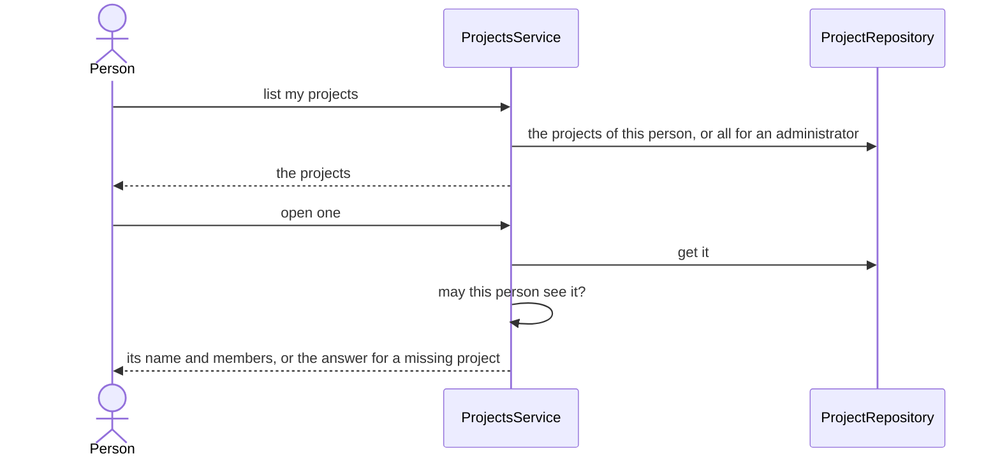

```yaml
id: UC-P3
type: use-case
name: List and open a project
status: draft
actor: person
context: BC-PROJECTS
satisfies:
  - id: FR-16
    reviewed: 4fbceb2
  - id: FR-12
    reviewed: a99f29f
criteria:
  - id: AC-55
    reviewed: df2f92d
  - id: AC-26
    reviewed: 77c34c3
  - id: AC-27
    reviewed: e89a7ac
  - id: AC-28
    reviewed: 9f15427
parameters:
  - project (to open)
objects: [OBJ-P1, OBJ-P2]
rules: [RULE-P4]
effects:
  - nothing changes: both are reads
  - no audit entry is written
evolved_from: []
flow_reviewed: 5bd7bab
```

# List and open a project

<!-- vbench-uc:begin mirror (generated from the requirements files, do not edit here: change the row, then run sync) -->

<details>
<summary>The requirements and criteria it runs, copied from docs/requirements (2 requirements, 4 criteria). Do not edit.</summary>

## What this serves

**FR-16**: The system shall let a person list the projects they belong to, let an administrator list all projects, and let either open a project they may see.

**FR-12**: The system shall show a project's contents and member list only to its members and to administrators, and answer anyone else as for a project that does not exist.

## Acceptance criteria it runs

**AC-55** (acceptance, proves FR-16)

- Given an administrator, a user who is a member of one project, and several projects
- When each lists projects
- Then the user sees only their own project and the administrator sees all

**AC-26** (acceptance, proves FR-12)

- Given a project, a member, an administrator and a user who is neither
- When each asks for its contents
- Then the member and the administrator see them and the other is refused

**AC-27** (acceptance, proves FR-12)

- Given a project and an id that does not exist
- When a person who is neither a member nor an administrator asks about, or changes the members of, either
- Then the answer is the same for both

**AC-28** (acceptance, proves FR-12)

- Given a member of a project
- When they open the member list
- Then they see its members

## How it is verified

- acceptance: AC-55, AC-26, AC-27, AC-28

Each criterion is run by a test tagged `Verifies AC-<n>`.

</details>

<!-- vbench-uc:end mirror -->

## Description

A person lists the projects they may see and opens one. A user lists only the projects they are a member of, and an administrator lists all of them (decision 14). Opening a project follows RULE-P4: its members and the administrators see it, and anyone else gets the same answer as for a project that does not exist. For the alpha, a project's contents are its detail read: its name, its members, and empty lists for files, endpoints and evaluations, which other contexts will fill. Changing the members is UC-P2.

## Preconditions

- The person is signed in. The same full check as for the account routes passes: the token is valid, the account is found, and it is not deactivated and not pending.

## Main flow

1. The person asks for their projects. (FR-16)
2. The system checks the person's account and who they are, as for every request. (FR-16)
3. The system shows the projects: a user sees only the ones they are a member of, an administrator sees all of them. (FR-16, AC-55)
4. The person chooses a project to open. (FR-16)
5. The system checks that the person may see it: they are a member or an administrator. (FR-12, AC-26)
6. The system shows the project: its name, its members, and empty lists of files, endpoints and evaluations. (FR-12, AC-26, AC-28)

## Other flows

- A user lists projects: they see only the projects they are a member of, even if there are others. (AC-55)
- An administrator who is not a member opens a project: they see it, with its members. (AC-26, AC-28)
- A member who is not an administrator opens the member list: they see its members. (AC-26, AC-28)
- A person who is neither a member nor an administrator opens a project: refused, with the same answer as for a project that does not exist. (AC-26, AC-27)
- A person asks for an id that does not exist: the same answer as the line above. (AC-27)

## Postconditions

- Nothing has changed: no project, no membership and no audit entry.

## Slices

- TSK-P3.1: A user lists the projects they belong to, and an administrator lists all (AC-55)
- TSK-P3.2: A member or an administrator opens a project and sees its name and members, rules RULE-P4 (AC-26, AC-28)
- TSK-P3.3: Anyone else gets the same answer as for a missing project (AC-27)

## Overview

The high level picture. The analysis sequence is in [UC-P3-list-and-open-a-project-analysis-sequence.puml](diagrams/UC-P3-list-and-open-a-project-analysis-sequence.puml) and the design sequence, with the class diagram of the context, in [UC-P3-list-and-open-a-project-design-sequence.puml](diagrams/UC-P3-list-and-open-a-project-design-sequence.puml). Both use the step numbers of the main flow.



## Analysis

### Revision 1

What the person and Playground say to each other, with no route, store, port or token. Only Playground takes part. The diagram is
[UC-P3-list-and-open-a-project-analysis-sequence.puml](diagrams/UC-P3-list-and-open-a-project-analysis-sequence.puml). Not frozen.

- A1 (step): The person asks for their projects
- A2 (step): Playground checks the person's account
- A3 (step): Playground shows the projects: a user's own, or all of them for an administrator
- A4 (step): The person chooses a project to open
- A5 (step): Playground checks the person may see it, as a member or an administrator
- A6 (step): Playground shows the project: its name, its members, and empty lists of files, endpoints and evaluations
- A7 (rule): A user lists only the projects they are a member of, and an administrator lists all
- A8 (rule): Only members and administrators see inside a project, and anyone else gets the same answer as for a project that does not exist
- A9 (refusal): A person who is neither a member nor an administrator, or an id that does not exist, gets the same answer
- A10 (object): Project
- A11 (object): Membership

## Design

A plan, not built yet. The class diagram is [projects-design.puml](../domain/diagrams/projects-design.puml) and the design sequence is [UC-P3-list-and-open-a-project-design-sequence.puml](diagrams/UC-P3-list-and-open-a-project-design-sequence.puml), both marked planned (decisions 13 and 14). Every step lands on a class of that diagram. UC-P1 and UC-P2 use the same classes.

Before step 1 the composition root runs the full check (token, account found, not deactivated, not pending) with the answers of the account routes, and only then builds the `Caller`. Neither read changes anything, so neither writes an audit entry.

What each refusal answers (decision 14):

| Case | Error | Answer |
|---|---|---|
| A bad token, or an account that is deactivated or pending | the account routes' own | 401 or 403, before the role is looked at |
| A person who is neither a member nor an administrator opens a project (AC-26) | `ProjectNotFound` | 404 |
| An id that does not exist (AC-27) | `ProjectNotFound` | 404, the same as the line above |

Listing never refuses a person who passed the check: it returns the projects they may see, which may be none.

- D1 (route): The list projects and open a project routes, kept thin, which add the three empty lists (files, endpoints, evaluations) to the detail read
- D2 (value object): Caller, built by the composition root after the full check
- D3 (use case): ProjectsService, with `list_for(caller)` and `open(caller, project_id)`
- D4 (domain rule): `may_see(caller, project)` in ProjectRules (RULE-P4)
- D5 (aggregate): Project, with its Memberships
- D6 (port): ProjectRepository, with `get`, `list_all` and `list_for_member`
- D7 (adapter): SqlProjects, over the API database (Amazon RDS on AWS)
- D8 (domain error): ProjectNotFound, the one answer for a missing project and for a person who may not see it

## Changes from analysis to design

```
A1 became -> D1, D3
A2 became -> D1, D2
A3 became -> D1, D2, D3, D6, D7
A4 became -> D1
A5 became -> D3, D4, D5, D6
A6 became -> D1, D3, D5
A7 became -> D3, D6, D7
A8 became -> D4, D8
A9 became -> D3, D4, D8
A10 became -> D5
A11 became -> D5
```
