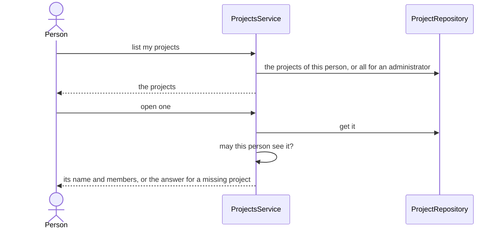
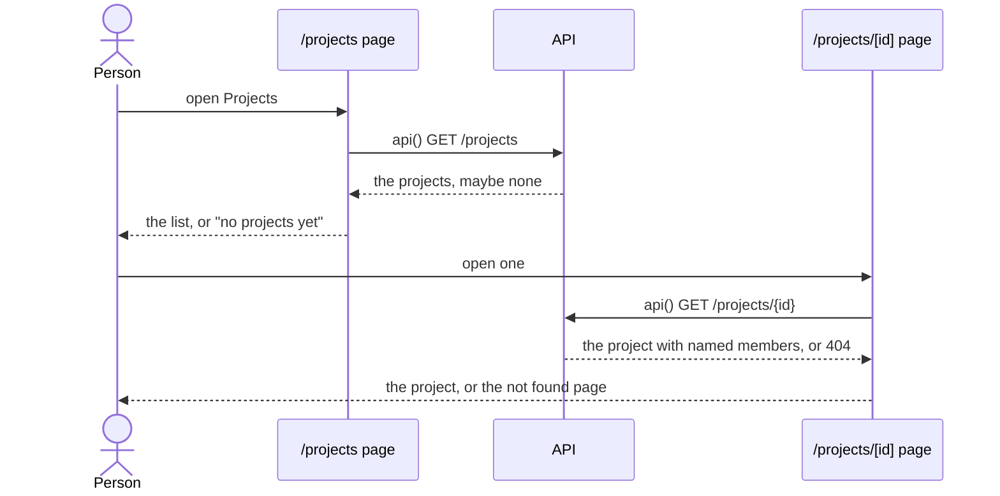

```yaml
id: UC-P3
type: use-case
name: List and open a project
status: draft
actor: person
context: BC-PROJECTS
satisfies:
  - id: FR-16
    reviewed: 4fbceb2
  - id: FR-12
    reviewed: a99f29f
criteria:
  - id: AC-55
    reviewed: df2f92d
  - id: AC-26
    reviewed: 77c34c3
  - id: AC-27
    reviewed: e89a7ac
  - id: AC-28
    reviewed: 9f15427
  - id: AC-86
  - id: AC-48
  - id: AC-94
parameters:
  - project (to open)
objects: [OBJ-P1, OBJ-P2]
rules: [RULE-P4]
effects:
  - nothing changes: both are reads
  - no audit entry is written, and every refusal writes a line to the security log; a read that succeeds writes none (AC-48, ADR 0013)
evolved_from: []
flow_reviewed: 5bd7bab
```

# List and open a project

<!-- vbench-uc:begin mirror (generated from the requirements files, do not edit here: change the row, then run sync) -->

<details>
<summary>The requirements and criteria it runs, copied from docs/requirements (2 requirements, 7 criteria). Do not edit.</summary>

## What this serves

**FR-16**: The system shall let a person list the projects they belong to, let an administrator list all projects, and let either open a project they may see.

**FR-12**: The system shall show a project's contents and member list only to its members and to administrators, and answer anyone else as for a project that does not exist.

## Acceptance criteria it runs

**AC-55** (acceptance, proves FR-16)

- Given an administrator, a user who is a member of one project, and several projects
- When each lists projects
- Then the user sees only their own project and the administrator sees all

**AC-26** (acceptance, proves FR-12)

- Given a project, a member, an administrator and a user who is neither
- When each asks for its contents
- Then the member and the administrator see them and the other is refused

**AC-27** (acceptance, proves FR-12)

- Given a project, an id that does not exist, and an id that is not well formed
- When a person who is neither a member nor an administrator opens the project, or its member list, and then the other two ids
- Then the three answers have the same status, body and code (404), so the person cannot tell a project they may not see from one that is not there

**AC-28** (acceptance, proves FR-12)

- Given a member of a project
- When they open the member list
- Then they see its members

**AC-86** (acceptance, proves FR-16)

- Given a user who is not a member of any project, and projects that exist
- When they list projects
- Then they get an empty list, with a success status and not an error

**AC-48** (acceptance, proves NFR-5)

- Given a refused sign in, a refused request, and a session that starts and ends
- When each happens
- Then each writes one log line, and none holds a token or a code

**AC-94** (acceptance, proves NFR-1)

- Given a request with no token, a pending account, and a deactivated account
- When each makes a request to every /projects route (list, open, create, add a member, remove a member), with the id of a project that exists
- Then each is refused (401 with no token or a bad one, 403 for the others) before the project is looked at, and the answer shows nothing about the project

## How it is verified

- acceptance: AC-55, AC-26, AC-27, AC-28, AC-86, AC-48, AC-94

Each criterion is run by a test tagged `Verifies AC-<n>`.

</details>

<!-- vbench-uc:end mirror -->

> Build order: after UC-P1 and before UC-P2 (ADR 0015). The change routes' 404 is AC-84 in [UC-P2](UC-P2-manage-project-members.md).

## Description

A person lists the projects they may see and opens one. A user lists only the projects they are a member of, and an administrator lists all of them (decision 14). Opening a project follows RULE-P4: its members and the administrators see it, and anyone else gets the same answer as for a project that does not exist. For the alpha, a project's contents are its detail read: its name, its members, and empty placeholder lists for files, endpoints and evaluations, which other contexts will fill (decision 23). There is no paging in the alpha (decision 23): the list and the member list return everything the person may see. Changing the members is UC-P2.

## Preconditions

- The person is signed in. The same full check as for the account routes passes: the token is valid, the account is found, and it is not deactivated and not pending.

## Main flow

1. The person asks for their projects. (FR-16)
2. The system checks the person's account and who they are, as for every request. (FR-16, AC-94)
3. The system shows the projects: a user sees only the ones they are a member of, an administrator sees all of them. A user with no project gets an empty list. (FR-16, AC-55, AC-86)
4. The person chooses a project to open. (FR-16)
5. The system checks that the person may see it: they are a member or an administrator. (FR-12, AC-26)
6. The system shows the project: its name, its members, and empty lists of files, endpoints and evaluations. (FR-12, AC-26, AC-28)

Every refusal writes one line to the security log, with the same reason code for a hidden and a missing project. A read that succeeds writes none. (AC-48, ADR 0013)

## Other flows

- A user lists projects: they see only the projects they are a member of, even if there are others. (AC-55)
- A user who is in no project lists projects: an empty list with a success status, not an error. (AC-86)
- An administrator who is not a member opens a project: they see it, with its members. (AC-26, AC-28)
- A member who is not an administrator opens the member list: they see its members. (AC-26, AC-28)
- A person who is neither a member nor an administrator opens a project: refused, with the same answer as for a project that does not exist. (AC-26, AC-27)
- A person asks for an id that does not exist, or one that is not well formed: the same answer as the line above, with the same status, body and code. (AC-27)
- A pending or deactivated person, or a request with no token: refused by the guard chain (403 or 401) before any project is looked at. (AC-94)

- Changed (ADR 0016): the list and the open answers show a project's members as `{id, name}` (the name through the People port), the same shape as the create, add and remove answers. An id People does not know keeps its id with `name: null`. Before, they showed account ids only.

## Postconditions

- Nothing has changed: no project, no membership and no audit entry. Each refusal and each read has a line in the security log (AC-48).

## Slices

- TSK-P3.1: A user lists the projects they belong to, an administrator lists all, and a user with none gets an empty list (AC-55, AC-86)
- TSK-P3.2: A member or an administrator opens a project and sees its name, members and the empty placeholder lists, rules RULE-P4 (AC-26, AC-28)
- TSK-P3.3: Anyone else gets the same answer as for a missing project or a malformed id (AC-27)
- TSK-P3.4: Every read and every refusal is logged, and every project route passes the guard chain (AC-48, AC-94)
- TSK-P3.5: Web slice W1: the proxy allows DELETE (and not PUT or PATCH), `lib/api.ts` gets the project types, and the pure functions `project-messages`, `member-candidates` and `project-summary` with unit tests (AC-27, AC-28, AC-86). The API answers members with names first (D10)
- TSK-P3.6: Web slice W2: the page `/projects` and the "Projects" item of the navigation, with the empty state (AC-55, AC-86, AC-94)
- TSK-P3.7: Web slice W3 (the read part): the page `/projects/[id]` with the members by name and one not found page for a hidden and a missing project (AC-26, AC-27, AC-28)

## Overview

The high level picture. The analysis sequence is in [UC-P3-list-and-open-a-project-analysis-sequence.puml](diagrams/UC-P3-list-and-open-a-project-analysis-sequence.puml) and the design sequence, with the class diagram of the context, in [UC-P3-list-and-open-a-project-design-sequence.puml](diagrams/UC-P3-list-and-open-a-project-design-sequence.puml). Both use the step numbers of the main flow.



## Analysis

### Revision 1

What the person and Playground say to each other, with no route, store, port or token. Only Playground takes part. The diagram is
[UC-P3-list-and-open-a-project-analysis-sequence.puml](diagrams/UC-P3-list-and-open-a-project-analysis-sequence.puml). Not frozen.

- A1 (step): The person asks for their projects
- A2 (step): Playground checks the person's account
- A3 (step): Playground shows the projects: a user's own, which may be none, or all of them for an administrator
- A4 (step): The person chooses a project to open
- A5 (step): Playground checks the person may see it, as a member or an administrator
- A6 (step): Playground shows the project: its name, its members, and empty lists of files, endpoints and evaluations
- A7 (rule): A user lists only the projects they are a member of, and an administrator lists all
- A8 (rule): Only members and administrators see inside a project, and anyone else gets the same answer as for a project that does not exist
- A9 (refusal): A person who is neither a member nor an administrator, or an id that does not exist or is not well formed, gets the same answer
- A10 (object): Project
- A11 (object): Membership

## Design

A plan, not built yet. The class diagram is [projects-design.puml](../domain/diagrams/projects-design.puml) and the design sequence is [UC-P3-list-and-open-a-project-design-sequence.puml](diagrams/UC-P3-list-and-open-a-project-design-sequence.puml), both marked planned (decisions 13, 14 and 23, ADR 0015). Every step lands on a class of that diagram. UC-P1 and UC-P2 use the same classes and the same files (ADR 0010 layout, see [UC-P1](UC-P1-create-a-project.md)): the routes are in `projects/adapters/inbound/http.py`, the use cases in `projects/application/service.py`, the reads in `projects/adapters/outbound/sql.py`.

Before step 1 the guard chain runs the full check (token, account found, not deactivated, not pending) with the answers of the account routes, and only then `projects_caller(account)` in `composition/` builds the `Caller`. Neither read changes anything, so neither writes an audit entry. Both write a line to the security log through Projects' own `SecurityLog` port (AC-48): the read (`project_list`, `project_open`) and every refusal.

What each refusal answers (decision 14):

| Case | Error | Answer |
|---|---|---|
| No token, a bad token, or an account that is deactivated or pending (AC-94) | the account routes' own | 401 or 403, before the role is looked at |
| A person who is neither a member nor an administrator opens a project (AC-26) | `ProjectNotFound` | 404 |
| An id that does not exist, or is not well formed (AC-27) | `ProjectNotFound` | 404, with the same status, body and code as the line above |

Listing never refuses a person who passed the check: it returns the projects they may see, which may be none (AC-86). There is no paging (decision 23).

- D1 (route): The list projects and open a project routes, kept thin, in `adapters/inbound/http.py`, with the answer built in `schemas.py`, which adds the three empty placeholder lists (files, endpoints, evaluations) to the detail read
- D2 (value object): Caller of Projects, built by `projects_caller(account)` in composition/ after the full check
- D3 (use case): ProjectsService, with `list_for(caller)` and `open(caller, project_id)`
- D4 (domain rule): `may_see(caller, project)` in ProjectRules (RULE-P4)
- D5 (aggregate): Project, with its Memberships
- D6 (port): ProjectRepository, with `get`, `list_all` and `list_for_member`
- D7 (adapter): SqlProjects, over the API database (Amazon RDS on AWS)
- D8 (domain error): ProjectNotFound, the one answer for a missing project, a malformed id and a person who may not see it
- D9 (port): SecurityLog, one line for each read and each refusal

### The web side (ADR 0016)

The navigation shows "Projects" to every signed in, active person. `/projects` lists what the API returns (a user's projects, or all for an administrator), with the empty state when there are none, and `/projects/[id]` shows the name and the members by name. Both are thin server pages that read through `api()` (server side, GET). A 404 from the API shows the one not found page, the same for a hidden and a missing project, with no hint. The placeholders (files, endpoints, evaluations) are not shown yet.



- D10 (API answer): The list and the open answers show `members` as `{id, name}`, names through People, an unknown id keeping its id with `name: null` (ADR 0016)
- D11 (web route): `/projects` in `apps/web/src/app/(app)/projects/page.tsx`, a thin server page with the list, `projectSummary` for each line and the empty state, and "Create a project" for an administrator
- D12 (web route): `/projects/[id]` in `apps/web/src/app/(app)/projects/[id]/page.tsx`, a thin server page that shows the name and the members (`memberLabel`), and calls `notFound()` on a 404
- D13 (web pure functions): `project-summary.ts` in `apps/web/src/domain/`, with its unit tests (the messages and the candidates are in UC-P1)
- D14 (web adapter): `lib/api.ts` gains the types `Project` and `ProjectMember`; the BFF proxy also exports DELETE (UC-P2)
- D15 (web navigation): `app-nav.tsx` gets a "Projects" item for every signed in, active person
- D16 (web rule): One not found page for a hidden and a missing project, with no hint (AC-27)

## Changes from analysis to design

```
A1 became -> D1, D3, D11, D15
A2 became -> D1, D2
A3 became -> D1, D2, D3, D6, D7, D11, D13, D14
A4 became -> D1, D11
A5 became -> D3, D4, D5, D6
A6 became -> D1, D3, D5, D10, D12, D13
A7 became -> D3, D6, D7
A8 became -> D4, D8, D9
A9 became -> D3, D4, D8, D9, D12, D16
A10 became -> D5
A11 became -> D5
```
