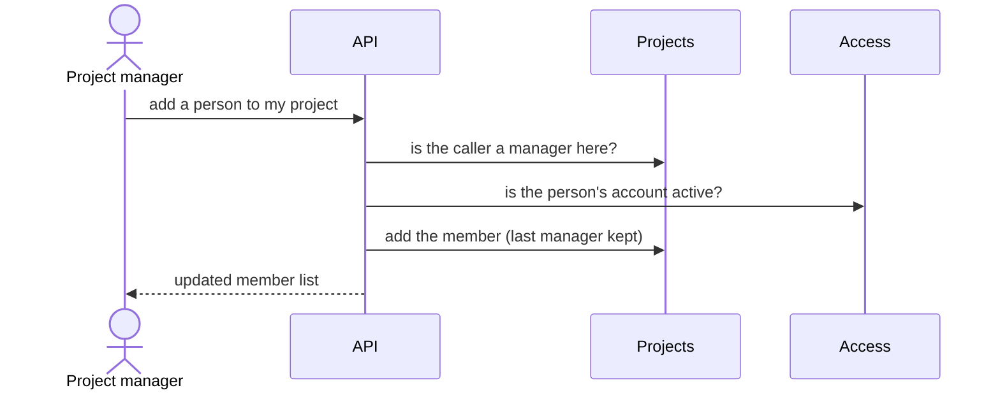

```yaml
id: UC-P4
type: use-case
name: Manage project members
status: draft
actor: project manager (of the project), or administrator for one case
context: BC-PROJECTS
satisfies:
  - id: FR-4
  - id: FR-8
  - id: FR-9
  - id: FR-10
  - id: FR-11
  - id: FR-12
  - id: FR-13
criteria:
  - id: AC-15
  - id: AC-17
  - id: AC-18
  - id: AC-19
  - id: AC-20
  - id: AC-21
  - id: AC-22
  - id: AC-23
  - id: AC-24
  - id: AC-25
  - id: AC-27
  - id: AC-30
  - id: AC-31
parameters:
  - project
  - person (an active account)
  - project role (project manager or engineer)
  - action (add, change role or remove)
objects: [OBJ-P1, OBJ-P2]
rules: [RULE-P1, RULE-P2, RULE-P3, RULE-P4]
effects:
  - the person is, or is no longer, a member of the project, with the given role
  - an audit entry records who changed what
evolved_from: [MK3 UC-A3 (retired, was UC-A3 in Access)]
```

# Manage project members

<!-- vbench-uc:begin mirror (generated from the requirements files, do not edit here: change the row, then run sync) -->

<details>
<summary>The requirements and criteria it runs, copied from docs/requirements (7 requirements, 13 criteria). Do not edit.</summary>

## What this serves

**FR-4**: The system shall let an administrator decide who can use the product: approve a pending account, deactivate an active one with a reason, and reinstate a deactivated one.

**FR-8**: The system shall not give an administrator access to a project's contents by their role.

**FR-9**: The system shall let a project manager add, change the role of and remove members of their project, adding only people with an active account.

**FR-10**: The system shall refuse a removal or demotion that would leave a project with no active project manager.

**FR-11**: The system shall let an administrator add a project manager to a project that has no active project manager, with a reason, and only a person with an active account who is not an administrator.

**FR-12**: The system shall show a project's contents and member list only to its members, and answer anyone else as for a project that does not exist.

**FR-13**: The system shall record an audit entry for every project creation, every change to a project's members, and every refused attempt by an administrator to change them.

## Acceptance criteria it runs

**AC-15** (acceptance, proves FR-8)

- Given an administrator
- When they add themselves to a project, or name themselves its manager
- Then it is refused and they are not a member

**AC-17** (acceptance, proves FR-9)

- Given a manager and an active account
- When the manager adds that person as an engineer
- Then they are a member with that role

**AC-18** (acceptance, proves FR-9)

- Given a manager and an account that is pending, deactivated or unknown
- When the manager adds it
- Then it is refused, with one answer for all three

**AC-19** (acceptance, proves FR-9)

- Given an engineer in a project
- When their manager makes them a manager
- Then they are a manager of the project

**AC-20** (acceptance, proves FR-9)

- Given a member of a project
- When their manager removes them
- Then they are out, and their next request gets the same answer as for a missing project

**AC-21** (unit, proves FR-10)

- Given a project with one active manager
- When anyone removes or demotes that manager
- Then it is refused

**AC-22** (unit, proves FR-9; FR-10)

- Given a project with two active managers
- When one of them removes themselves
- Then it is allowed and the other remains

**AC-23** (acceptance, proves FR-11)

- Given a project with no active manager, and an active person who is not an administrator
- When an administrator adds that person as manager, with a reason
- Then they are a manager

**AC-24** (acceptance, proves FR-11)

- Given a project with no active manager
- When an administrator adds a manager without a reason
- Then it is refused

**AC-25** (acceptance, proves FR-11)

- Given a project
- When an administrator adds a manager although one is active, or adds an administrator or an inactive person
- Then it is refused

**AC-27** (acceptance, proves FR-12)

- Given a project and an id that does not exist
- When a non-member asks about, or changes the members of, either
- Then the answer is the same for both

**AC-30** (acceptance, proves FR-13; FR-11)

- Given a project
- When a member is added, changed or removed, or a manager is restored with a reason
- Then each has an entry saying who, what and whom, and the reason for a restore

**AC-31** (acceptance, proves FR-13)

- Given an administrator
- When their attempt to change a project's members is refused
- Then an audit entry records the attempt

## How it is verified

- acceptance: AC-15, AC-17, AC-18, AC-19, AC-20, AC-23, AC-24, AC-25, AC-27, AC-30, AC-31
- unit: AC-21, AC-22

Each criterion is run by a test tagged `Verifies AC-<n>`.

</details>

<!-- vbench-uc:end mirror -->

> Draft for the first cut. It serves FR-9 to FR-13, and FR-8 and FR-4 where they touch members, and runs the criteria listed above (decisions 25 and 28).
> Replaces the retired UC-A3. Projects owns membership (decision 24). Access is asked for the person's account status.

## Description

A project manager decides who is in their project, and whether each person is a project manager or an engineer. The two roles are names only for now: they do the same things inside the project, except that only a manager changes the members. An administrator is **not** a manager by being an administrator, and cannot add themselves. An administrator who a manager has added as the project's manager has full manager powers in that project. They have one narrow power: if a project has no active manager, an administrator can add a new manager, and nobody else.

## Preconditions

- The person asking is signed in with an active account.

## Main flow

1. A project manager opens a project they manage and its member list. (FR-9)
2. They choose an action: add a person, change a person's role, or remove a person. (FR-9)
3. For an addition, they choose a person and a project role. (FR-9)
4. The system checks that the person asking manages this project. A person who is not in the project gets the same answer as for a project that does not exist. (FR-9, FR-12, AC-27)
5. The system checks that the person being added has an **active** account, and gives one answer if not. (FR-9, AC-18)
6. The system checks that the change does not leave the project without an **active** manager. (FR-10, AC-21)
7. The system applies the change. Adding a person who is already a member changes nothing. (FR-9, AC-17, AC-19, AC-20, AC-22)
8. The system records an audit entry with who, what and who it affected. (FR-13, AC-30)
9. The change takes effect at the affected person's next request, because membership is read on every request. (FR-9)

## Other flows

- An engineer tries to change members: refused.
- A person who is not in the project tries to change members: the same answer as for a project that does not exist. (FR-12, AC-27)
- An administrator who is not a manager of the project tries to add an engineer, change a role or remove anyone: refused, and the attempt is recorded. (FR-8, FR-13, AC-31)
- An administrator tries to add themselves to a project: refused, whatever the role, and the attempt is recorded. (FR-8, FR-13, AC-15, AC-31)
- An administrator adds a project manager to a project that has **no active manager** (every manager's account is deactivated): allowed, with a reason, for a manager and for no one else. The reason is kept in the audit entry. (FR-11, AC-23, AC-24, AC-30)
- An administrator adds an administrator as that manager: refused. (FR-11, AC-25)
- An administrator adds a pending, deactivated or unknown person as that manager: refused. (FR-11, AC-25)
- An administrator adds a manager to a project that already has an active manager: refused. (AC-25)
- The person to add has a pending, deactivated or unknown account: refused, with one answer whichever it is. (FR-9, AC-18)
- The person is already a member: nothing changes. A role is changed by changing the role. (FR-9)
- A person who is not a member is the target of a role change or a removal: refused, and nothing changes. (FR-9)
- The change would remove or demote the **last active manager**: refused. (FR-10, AC-21)
- A manager removes themselves while another active manager remains: allowed. (AC-22)
- A member's account is deactivated: they stay on the project (nothing is deleted), but every request of theirs is refused at the account check. A deactivated manager is not active, so the last-manager rule does not count them. When the account is reinstated they are a member again. (FR-4)

## Postconditions

- The project has the member list the manager asked for, and at least one manager.
- Nothing the person did earlier in the project is deleted.
- An audit entry exists.

## Open questions

For the product owner to decide.

1. Does removing a member need a reason? For now no, only an audit entry.
2. What a removed member's earlier work in the project shows as (their name or "removed member").

## Overview

The high level picture. The detailed sequence is in [UC-P4-manage-project-members-sequence.puml](diagrams/UC-P4-manage-project-members-sequence.puml).



## Slices

1. TSK-P4.1: A manager adds an engineer, only with an active account (AC-17, AC-18)
2. TSK-P4.2: A manager changes a role or removes a member, rules RULE-P1 (AC-19, AC-20, AC-21, AC-22)
3. TSK-P4.3: An administrator restores a manager and does nothing else, rules RULE-P2, RULE-P3 (AC-15, AC-23, AC-24, AC-25)
4. TSK-P4.4: Changes to members are audited (AC-30, AC-31)
5. TSK-P4.5: A non-member gets the same answer as for a missing project, and memberships survive deactivation, rules RULE-P4 (AC-27)
