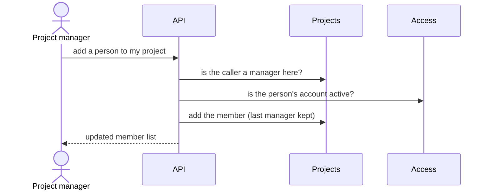

```yaml
id: UC-P4
type: use-case
name: Manage project members
status: draft
actor: project manager (of the project), or administrator for one case
context: BC-PROJECTS
satisfies: []
criteria: []
parameters:
  - project
  - person (an active account)
  - project role (project manager or engineer)
  - action (add, change role or remove)
objects: [Project, Membership]
rules: []
effects:
  - the person is, or is no longer, a member of the project, with the given role
  - an audit entry records who changed what
evolved_from: [MK3 UC-A3 (retired, was UC-A3 in Access)]
```

# Manage project members

> Draft for the first cut. **No requirement row exists for this yet** (see "Proposed requirements").
> Replaces the retired UC-A3. Projects owns membership (decision 24). Access is asked for the person's account status.

## Description

A project manager decides who is in their project, and whether each person is a project manager or an engineer. The two roles are names only for now: they do the same things inside the project, except that only a manager changes the members. An administrator is **not** a manager by being an administrator, and cannot add themselves. They have one narrow power: if a project has no active manager, an administrator can add a new manager, and nobody else.

## Preconditions

- The person asking is signed in with an active account.
- The project exists.

## Main flow

1. A project manager opens a project they manage and its member list.
2. They choose an action: add a person, change a person's role, or remove a person.
3. For an addition, they choose a person and a project role.
4. The system checks that the person asking manages this project.
5. The system checks that the person being added has an **active** account.
6. The system checks that the change does not leave the project without a manager.
7. The system applies the change.
8. The system records an audit entry with who, what and who it affected.
9. The change takes effect at the affected person's next request, because membership is read on every request.

## Other flows

- An engineer, or a person who is not in the project, tries to change members: refused.
- An administrator who is not a manager of the project tries to add an engineer, or remove anyone: refused.
- An administrator tries to add themselves to a project: refused, whatever the role.
- An administrator adds a manager to a project that has **no active manager** (every manager's account is deactivated, or none is left): allowed, for a manager and for no one else.
- An administrator adds a manager to a project that already has an active manager: refused.
- The person to add has a pending, deactivated or unknown account: refused.
- The person is already a member: nothing is added, and their role is changed only if the manager asked for that.
- The change would remove or demote the **last manager**: refused.
- A member's account is deactivated: they stay on the project (nothing is deleted), but every request of theirs is refused at the account check. They count as a manager for the last-manager rule only while they are on the project, so an administrator can add a new manager when none is active.
- Open: does removing a member need a reason? For now no, only an audit entry.
- Open: what a removed member's earlier work in the project shows as (their name or "removed member").

## Postconditions

- The project has the member list the manager asked for, and at least one manager.
- Nothing the person did earlier in the project is deleted.
- An audit entry exists.

## Proposed requirements (for vbench-req, no ids yet)

- The system shall let a project manager add a person with an active account to their project as a project manager or an engineer.
- The system shall let a project manager change a member's role, and remove a member.
- The system shall never remove or demote the last manager of a project.
- The system shall not let an administrator add themselves to a project.
- The system shall let an administrator add a manager to a project that has no active manager, and shall let them do nothing else to its members.
- The system shall give a project member the same abilities whether they are a manager or an engineer, except for managing members.

## Overview

The high level picture. The detailed sequence is in [UC-P4-manage-project-members-sequence.puml](diagrams/UC-P4-manage-project-members-sequence.puml).



## Slices

1. A manager adds an engineer, with the active-account check.
2. A manager changes a role or removes a member, with the last-manager rule.
3. An administrator adds a manager to a project that has none active.
