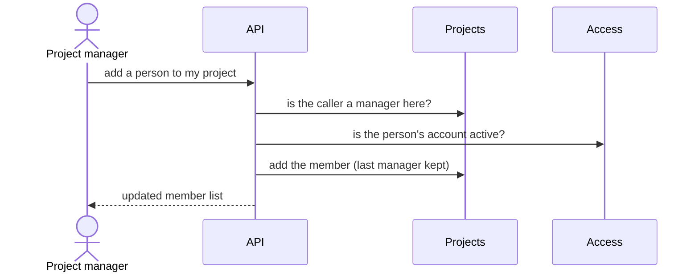

```yaml
id: UC-P4
type: use-case
name: Manage project members
status: draft
actor: project manager (of the project), or administrator for one case
context: BC-PROJECTS
satisfies:
  - id: FR-133
  - id: FR-134
  - id: FR-135
  - id: FR-136
  - id: FR-137
  - id: FR-138
  - id: FR-143
criteria:
  - id: AC-94
  - id: AC-95
  - id: AC-96
  - id: AC-97
  - id: AC-98
  - id: AC-99
  - id: AC-100
  - id: AC-101
  - id: AC-102
  - id: AC-103
  - id: AC-104
  - id: AC-109
  - id: AC-110
parameters:
  - project
  - person (an active account)
  - project role (project manager or engineer)
  - action (add, change role or remove)
objects: [OBJ-P1, OBJ-P2]
rules: [RULE-P1, RULE-P2, RULE-P3]
effects:
  - the person is, or is no longer, a member of the project, with the given role
  - an audit entry records who changed what
evolved_from: [MK3 UC-A3 (retired, was UC-A3 in Access)]
```

# Manage project members

<!-- vbench-uc:begin mirror (generated from the requirements files, do not edit here: change the row, then run sync) -->

## What this serves

**FR-133**: The system shall let a project manager add a person with an active account to their project, as a project manager or an engineer.

**FR-134**: The system shall let a project manager change a member's project role or remove a member from their project.

**FR-135**: The system shall never remove or demote the last project manager of a project.

**FR-136**: The system shall not let an administrator add themselves to a project.

**FR-137**: The system shall let an administrator add a project manager to a project that has no active project manager.

**FR-138**: The system shall not let an administrator change the members of a project in any other way.

**FR-143**: The system shall record an audit entry for every project creation and every change to a project's members.

## Acceptance criteria it runs

**AC-94** (acceptance, proves FR-133)

- Given a project manager and an account that is active
- When the manager adds that person as an engineer
- Then the person is a member of the project with the role engineer

**AC-95** (acceptance, proves FR-133)

- Given a project manager and an account that is pending or deactivated
- When the manager tries to add that person
- Then it is refused and the person is not a member

**AC-96** (acceptance, proves FR-133)

- Given an engineer of a project
- When they try to add a person to it
- Then it is refused

**AC-97** (acceptance, proves FR-134)

- Given a project with an engineer and a manager
- When the manager changes the engineer's role to project manager
- Then the person is a project manager of that project

**AC-98** (acceptance, proves FR-134)

- Given a member of a project
- When its manager removes the member
- Then the person is no longer a member and their next request for the project is refused

**AC-99** (unit, proves FR-135)

- Given a project with one manager
- When anyone tries to remove that manager
- Then it is refused and the person is still its manager

**AC-100** (unit, proves FR-135)

- Given a project with one manager
- When anyone tries to change that manager to an engineer
- Then it is refused and the person is still its manager

**AC-101** (acceptance, proves FR-136)

- Given an administrator and a project that has no active manager
- When the administrator tries to add themselves to the project
- Then it is refused and they are not a member

**AC-102** (acceptance, proves FR-137)

- Given a project whose only manager has a deactivated account
- When an administrator adds another person with an active account as a project manager
- Then that person is a manager of the project

**AC-103** (acceptance, proves FR-137)

- Given a project that has an active manager
- When an administrator tries to add a project manager
- Then it is refused

**AC-104** (acceptance, proves FR-138)

- Given an administrator and a project
- When they try to add an engineer, change a member's role or remove a member
- Then it is refused and the members are unchanged

**AC-109** (acceptance, proves FR-143)

- Given a project
- When it is created and later a member is added
- Then an audit entry exists for each, saying who did it and what it was

**AC-110** (acceptance, proves FR-143)

- Given a project with a member
- When its manager removes the member
- Then an audit entry exists saying who removed whom

## How it is verified

- acceptance: AC-94, AC-95, AC-96, AC-97, AC-98, AC-101, AC-102, AC-103, AC-104, AC-109, AC-110
- unit: AC-99, AC-100

Each criterion is run by a test tagged `Verifies AC-<n>`.

<!-- vbench-uc:end mirror -->

> Draft for the first cut. **No requirement row exists for this yet** (see "Proposed requirements").
> Replaces the retired UC-A3. Projects owns membership (decision 24). Access is asked for the person's account status.

## Description

A project manager decides who is in their project, and whether each person is a project manager or an engineer. The two roles are names only for now: they do the same things inside the project, except that only a manager changes the members. An administrator is **not** a manager by being an administrator, and cannot add themselves. They have one narrow power: if a project has no active manager, an administrator can add a new manager, and nobody else.

## Preconditions

- The person asking is signed in with an active account.
- The project exists.

## Main flow

1. A project manager opens a project they manage and its member list.
2. They choose an action: add a person, change a person's role, or remove a person.
3. For an addition, they choose a person and a project role.
4. The system checks that the person asking manages this project.
5. The system checks that the person being added has an **active** account.
6. The system checks that the change does not leave the project without a manager.
7. The system applies the change.
8. The system records an audit entry with who, what and who it affected.
9. The change takes effect at the affected person's next request, because membership is read on every request.

## Other flows

- An engineer, or a person who is not in the project, tries to change members: refused.
- An administrator who is not a manager of the project tries to add an engineer, or remove anyone: refused.
- An administrator tries to add themselves to a project: refused, whatever the role.
- An administrator adds a manager to a project that has **no active manager** (every manager's account is deactivated, or none is left): allowed, for a manager and for no one else.
- An administrator adds a manager to a project that already has an active manager: refused.
- The person to add has a pending, deactivated or unknown account: refused.
- The person is already a member: nothing is added, and their role is changed only if the manager asked for that.
- The change would remove or demote the **last manager**: refused.
- A member's account is deactivated: they stay on the project (nothing is deleted), but every request of theirs is refused at the account check. They count as a manager for the last-manager rule only while they are on the project, so an administrator can add a new manager when none is active.
- Open: does removing a member need a reason? For now no, only an audit entry.
- Open: what a removed member's earlier work in the project shows as (their name or "removed member").

## Postconditions

- The project has the member list the manager asked for, and at least one manager.
- Nothing the person did earlier in the project is deleted.
- An audit entry exists.

## Proposed requirements (for vbench-req, no ids yet)

- The system shall let a project manager add a person with an active account to their project as a project manager or an engineer.
- The system shall let a project manager change a member's role, and remove a member.
- The system shall never remove or demote the last manager of a project.
- The system shall not let an administrator add themselves to a project.
- The system shall let an administrator add a manager to a project that has no active manager, and shall let them do nothing else to its members.
- The system shall give a project member the same abilities whether they are a manager or an engineer, except for managing members.

## Overview

The high level picture. The detailed sequence is in [UC-P4-manage-project-members-sequence.puml](diagrams/UC-P4-manage-project-members-sequence.puml).



## Slices

1. TSK-P4.1: A manager adds an engineer, only with an active account (AC-94, AC-95, AC-96)
2. TSK-P4.2: A manager changes a role or removes a member, rules RULE-P1 (AC-97, AC-98, AC-99, AC-100)
3. TSK-P4.3: An administrator restores a manager and does nothing else, rules RULE-P2, RULE-P3 (AC-101, AC-102, AC-103, AC-104)
4. TSK-P4.4: Changes to members are audited (AC-109, AC-110)
