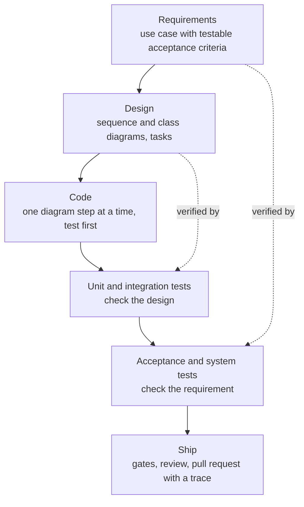
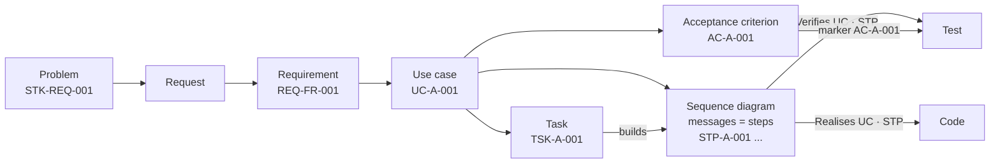
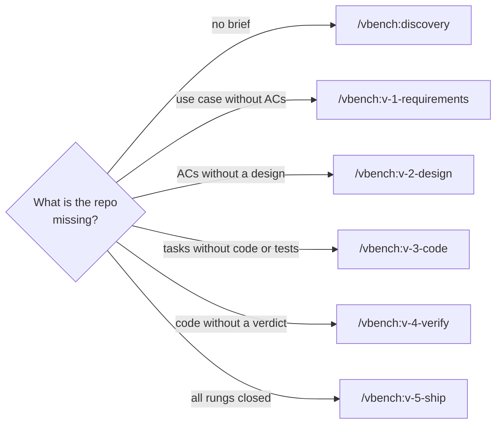
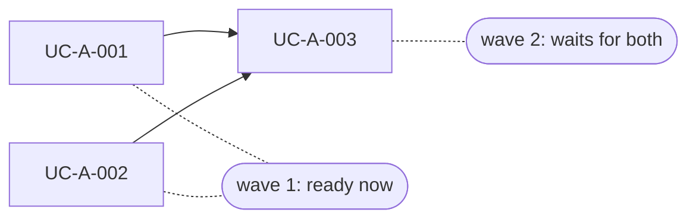
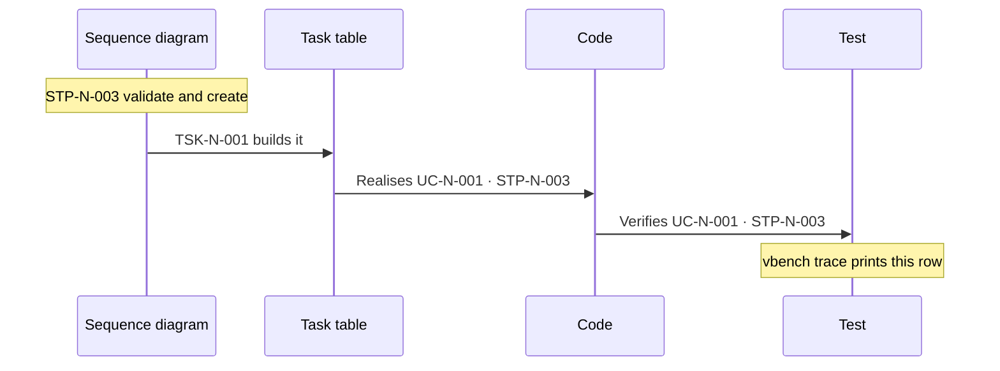
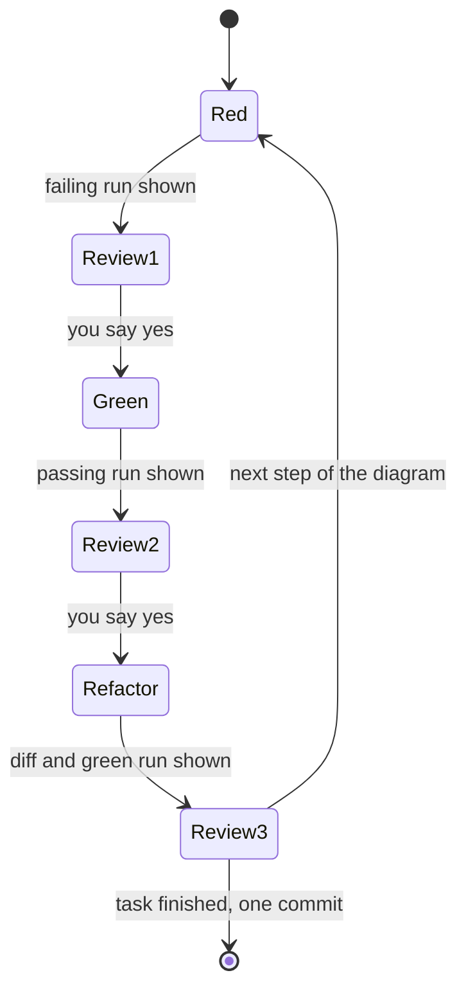
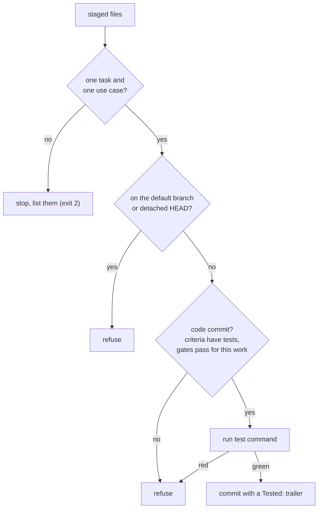
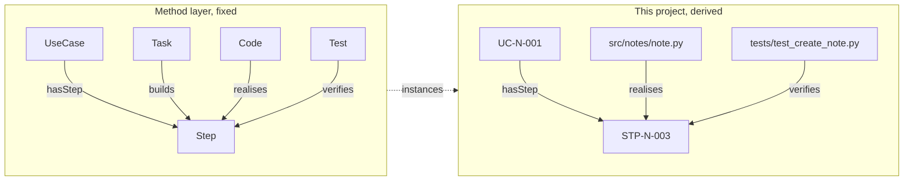
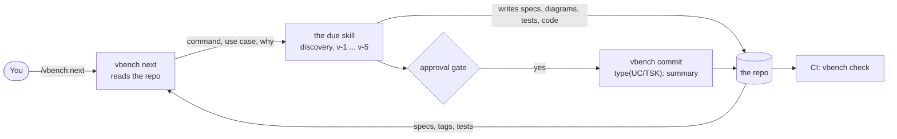
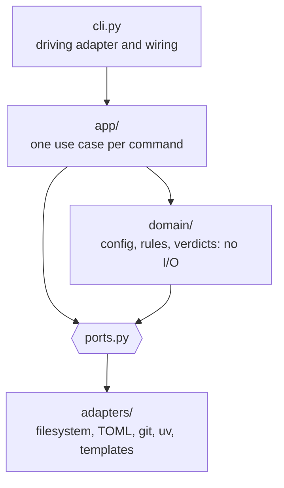

# VBenchAI: a harness for the V-cycle

Keeps AI-assisted teams on a disciplined path from requirement to verified code. The unit of delivery is a **use
case**, and every use case is a small V: it is not done until each rung (requirement, design, code, tests, trace) is
closed with evidence. Code, tests, diagrams and specs carry the same ids, so the project explains itself to anyone who
reads it, and a command can check that the links hold.

The state lives in your repo as plain files. `vbench check` is the gate (deterministic, no LLM in any verdict). Claude
Code skills do the work that needs judgment, and pause for your review at the points that matter.

Extracted from a real project (an AI-governance platform built with DDD × V-model × Agile). The original pitch,
[docs/00-pitch.md](docs/00-pitch.md), is kept for history and is **superseded**: this README states what exists.

> **Quickest start:** `uv tool install "git+<repo-url>@v0.1.0"`, then in your repo `vbench init --stack none` (the harness
> alone; leave out `--stack none` to also scaffold a Python/FastAPI project), `vbench check`, `vbench status`, and
> `/vbench:next` in Claude Code.
>
> **New to this?** Start with the [getting-started guide](src/vbench/templates/docs/00-getting-started.md) (a 15-minute
> walkthrough; `vbench init` also copies it, with a [glossary](src/vbench/templates/docs/00-glossary.md), into every
> project). You only need two things to begin: `/vbench:next` and `vbench status`.

## The idea

Work goes down the left side of the V (say what, then say how), turns at the code, and comes back up the right side
(prove it, rung by rung). Each phase on the left has a test level on the right that checks it.



Three ideas hold it together:

1. **Use case is the deliverable.** Dependencies between use cases give the build order; each one is built and
   proven on its own.
2. **Every message in a sequence diagram has an id** (a *step*). A task builds some steps, the code that does the work
   says which step it realises, and the test that drives it says so too. Build one step at a time, test first.
3. **Humans review the decisions; the tool does the bookkeeping.** The skills stop for a yes after each red, green and
   refactor of a step. Ids, tags, tables, diagrams' staleness, status and commit messages are commands.

## How the pieces connect

Everything is a link between plain files. The links are written once, in the place where the work happens, and the
CLI reads the rest back; nothing is stored twice.



Ids are three parts and append-only (`UC-A-001`, `AC-A-001`, `TSK-A-001`, `STP-A-001`, `REQ-FR-001`, `ADR-DEC-001`).
`vbench new uc` and `vbench id <kind>` skip any number already used, so two people never collide.

## Features

### A next step, always

`vbench next` reads the repo and names the one step to take: the command, the use case and a plain-language reason.
`vbench status` shows progress, waves and blockers. Both are derived from the specs, tags and tests; there is no state
file to keep up to date.



Use-case order is derived from one authored fact, a spec's `Depends on` row. `vbench next --ready` lists every use
case that is unblocked right now, so several people or agents can work in parallel without stepping on each other.



### Step ids and the reading trace

Number the messages of a sequence diagram and the diagram becomes the use case's table of contents. A task names the
steps it builds, the code says which step it realises, and the test says which step it verifies:

```
' UC-N-001-create-note-sequence.puml
User -> Api : STP-N-001 submit title and body
Api  -> Note : STP-N-003 validate and create
```

```python
note = Note.create(title, body)  # Realises UC-N-001 · STP-N-003


def test_blank_title_is_rejected():
    """Verifies UC-N-001 · STP-N-003 · unit rung."""
```

`vbench trace UC-N-001` reads the chain back in diagram order, derived from the tags and never stored:



A diagram opts in by numbering its messages, and `(planned)` in a message exempts one that is not built yet. From then
on the `steps` gate fails if a step has no task, or (once the use case has code) no tag or no real test. Ids are
unique across use cases.

### Test-driven, with review pauses

`/vbench:v-3-code` is double-loop TDD: a failing acceptance test first, then red-green-refactor at the unit rung, then
integration and system tests when a seam appears. It stops for review where a human decision lives, and does the slow
mechanical work (gates, tags, spec sync, commit message) without asking.



Say "run to the end of the task" and the pauses drop until then. A test only counts as red if it fails on the missing
behaviour's assertion, not on an import or fixture error.

### Gates that are the same locally and in CI

`vbench check` runs deterministic checks (regexes and `ast`; no model decides a verdict). Run one with
`vbench check <gate>`.

| Gate | Proves |
|---|---|
| `refs` | every documentation link, `!include` and `docs/….md` path in code resolves |
| `rungs` | every use case tagged `Realises UC-…` in code has a test tagged `Verifies UC-…` |
| `acs` | every `AC-…` row in a spec has a marked test; no marker names an undeclared AC |
| `links` | `Depends on` has no dangling id, self-link or cycle |
| `diagrams` | diagram names, links, `@startuml`/`@enduml`, and the set the rigor tier requires; the generated use-case map is current |
| `steps` | each step is cited by a task, and (once there is code) tagged and driven by a real test |
| `vocabulary` | no diagram name uses a word that a term lists under *Not to be confused with* |
| `ontology` | generated ontology files match a fresh render |
| `docs` | generated blocks in the docs match a fresh render |
| `commits` | commit subjects and the branch name follow the convention, and cite specs and tasks that exist (explicit; needs git) |

In Python, a tag counts only on a real test: a `Verifies` clause needs a docstring with a test function behind it, and
the AC marker must sit on a `test*` function that is not skipped and asserts something that can fail. Other languages
and unparseable files keep the plain text match.

**What the checks prove (and don't):** they prove a link **exists**. They do not judge whether a test is good;
`/vbench:v-4-verify` audits that, and a human reviews it. Treat the checks as a floor, not a quality score.

### Commits and branches that stay readable

```
branch   <type>/<slug>                              feat/uc-a-001-login
commit   <type>(<UC-id>[/<TSK-id>])[!]: <summary>   feat(UC-A-001/TSK-A-002): add login endpoint with lockout
```

`vbench commit -m "add login endpoint" --dry-run` builds the subject from the branch, the staged files and your summary,
so it always passes `check commits`. A commit is **one finished task**, not a phase.



It is [Conventional Commits](https://www.conventionalcommits.org/) with the ids as the scope, so changelog tools work
(`feat` is a minor release, `fix` a patch, `!` or `--breaking` a major). The workflow is trunk-based: short-lived
branches, one pull request per use case, rebase-and-merge, releases as `vX.Y.Z` tags. `vbench doctor` flags a stale or
over-age branch, a behind-base branch and dead worktrees. `CONTRIBUTING.md` (written by `init`) has the rules and the
repository settings.

### Diagrams as the design record

Every use case can carry PlantUML diagrams named after its spec and linked from its `Diagrams` row:

```
docs/usecase-diagrams/UC-N-001-create-note.md
docs/usecase-diagrams/UC-N-001-create-note-sequence.puml    standard and full tiers
docs/usecase-diagrams/UC-N-001-create-note-class.puml       full tier
docs/usecase-diagrams/UC-N-001-create-note-state.puml       any tier, when the spec's Lifecycle row is `yes`
```

A spec's **rigor tier** (light, standard, full) sizes how much design a use case owes. At system level,
`08-usecase-diagrams.puml` is *generated* from the spec headers by `vbench sync`, `09-context-ddd.puml` is the context
map, and `NN-<context>-ddd.puml` is each bounded context's domain model. The generated map is checked for staleness; the
authored ones are the human's design judgment. PlantUML is the format of record; Mermaid is for the explanatory
diagrams inside docs, because GitHub and GitLab render it in place.

### Vocabulary and ontology

The requirements doc's vocabulary table (*Term | Definition | Context | Not to be confused with*) is read as data.
`vbench ontology` derives from it, the specs and the tags a machine-readable model of the project: a fixed **method
layer** (what a use case, step, task, test and context are, and how they relate) plus this project's **individuals**.



It renders as OWL 2 in Turtle (`.ttl`) and RDF/XML (`.owl`), plus JSON-LD and YAML, with no extra library:

```bash
vbench ontology                          # print Turtle
vbench ontology --format jsonld          # ttl, owl (RDF/XML), jsonld or yaml
vbench ontology --write                  # write the four files under docs/ontology
```

The files are generated and never edited by hand: `vbench sync` refreshes the ones that exist and `check ontology`
fails when one is stale. The ontology states facts only; it does not infer.

### Self-documenting docs

Facts that already live in the specs are generated into the authored docs, so nobody maintains them twice. Between
`<!-- vbench:begin NAME -->` and `<!-- vbench:end NAME -->` markers, `vbench sync` rewrites:

| Doc | Block | From |
|---|---|---|
| backlog | `dependencies` | each spec's *Depends on* row (and what it enables) |
| backlog | `waves` | the same links: the build order as a table and a Mermaid graph |
| backlog | `coverage` | the requirements doc's FR rows against each spec's *Realises* row |
| requirements | `fr-map` | each spec's *Realises* row, with a link to the spec |
| docs root | `08-usecase-diagrams.puml` | the spec headers (actor, bounded context, title, dependencies) |

Everything outside the markers is yours. `check docs` fails in CI when a block is stale, so derived views cannot drift.

### Learning on demand

A newcomer needs three things: `/vbench:next`, `vbench status`, and the dashboard. Everything else is introduced when
first needed (Levels 0 to 2 in the getting-started guide). Every skill opens with a one-line *Why this step*,
`vbench next` prints a plain-language reason, and a failing check points to the glossary.

## What you install

| Piece | What it is | Install |
|---|---|---|
| **CLI** `vbench` | Stdlib-only Python. `init`, `check`, `new`, `id`, `commit`, `status`, `next`, `trace`, `ontology`, `doctor`, `sync`, `update` (and `export`, `serve`, `mcp` for the optional extras). `status`, `check`, `next` and `trace` take `--json`. Same verdict locally and in CI. | `uv tool install "git+<repo-url>@v0.1.0"` |
| **Claude Code plugin** | The `/vbench:` skills (discovery, v-1 to v-5, fix, status, commit, next, help) and three read-only subagents: `uc-scaffolder`, `spec-challenger`, `trace-checker`. | `/plugin marketplace add <repo-url>` then `/plugin install vbench` |
| **Scaffold** | `.vbench/config.toml`, a documentation tree (map, methodology, naming, requirements, backlog and build order, ADRs, security, learnings, discovery briefs, design patterns, use-case template), `CONTRIBUTING.md`, CI. | `vbench init` |

`<repo-url>` is any Git URL, GitHub or GitLab. Pin a tag (`@v0.1.0`) in both places. To run once without installing:
`uvx --from "git+<repo-url>@v0.1.0" vbench check`.

To update the CLI: `vbench update` (reinstalls at the newest `vX.Y.Z` tag of the Git URL it came from).
`vbench update --check` only reports; `vbench update --to v0.2.0` picks a tag. Then update the plugin
(`/plugin marketplace update`, `/plugin update vbench`).

| Piece | Scope | Pinned by |
|---|---|---|
| CLI | per developer: `uv tool install` (isolated env, `vbench` on `PATH`; run `uv tool update-shell` once) | `vbench_version` in `.vbench/config.toml` |
| CI | per project: generated by `vbench init` with the same tag | the tag in the workflow / `.gitlab-ci.vbench.yml` |
| Plugin | per project: `vbench init` writes `.claude/settings.json`, so teammates are prompted to install it, and sets the allow-list below | the marketplace ref |

One release tag covers all three. To move a project to a new release: `vbench update`, validate, then bump
`vbench_version` and the CI tag together. If the installed CLI differs from `vbench_version`, every command warns (it
does not fail; CI is pinned, so it stays consistent).

## Quick start

```bash
cd your-project
vbench init --prod src --tests tests      # writes config, docs/, CI for GitHub and GitLab, and the stack skeleton
vbench new uc --area A --title "Log in"   # allocates UC-A-001, never reuses an id
vbench id step --area A --count 5         # step ids for the sequence diagram's messages
vbench check                              # all gates: exits 1 on any gap
vbench status                             # progress, waves and blockers, derived from the repo
vbench next                               # the one next step: command, use case, and why
vbench next --ready                       # every step that can start now, for parallel work
vbench trace UC-A-001                     # a use case's diagram steps, each with its task, code and test
vbench ontology --write                   # the project's ontology as OWL, JSON-LD and YAML under docs/ontology
```

For GitLab, `include: - local: .gitlab-ci.vbench.yml`. For GitHub the workflow is written to
`.github/workflows/vbench.yml`. Pin the vbench version you have validated.

## The workflow (in Claude Code)

vbench has two halves. The **CLI** is plain Python and agent-agnostic: it allocates ids, derives progress and gates the
merge, the same way on a laptop and in CI. The **plugin** is for [Claude Code](https://claude.com/claude-code): it
holds the steps that need judgment (interviewing, writing acceptance criteria, designing, test-first coding).

The skills never start on their own (`disable-model-invocation`): you type each command, review what it did, and
approve before the next. That is the turn-based pace, and it is the main safety control.



Type `/vbench` to list the commands, or run `/vbench:help` for the table and the step that is due. Each step has a long
and a short name that do exactly the same: `v-1-requirements`/`req`, `v-2-design`/`design`, `v-3-code`/`code`,
`v-4-verify`/`verify`, `v-5-ship`/`ship`, `v-fix`/`fix`, `v-status`/`status`. In the terminal, `check`, `status` and `next`
also answer to `c`, `st` and `n`.

```
/vbench:discovery         interview you; save a draft brief (you set Status: approved)
/vbench:v-1-requirements  brief or REQ -> suggest NFRs -> create/update UC with testable ACs               [approval gate]
/vbench:v-2-design        context placement, DDD/hexagonal, diagrams with step ids, tasks cut as thin slices [approval gate]
/vbench:v-3-code          double-loop TDD per task, review pauses per step; tags `Realises` and `Verifies`
/vbench:v-4-verify        independent re-run rung by rung + test-quality audit (read-only)
/vbench:v-5-ship          final gates, clean-context review, PR draft with a traceability table
/vbench:v-fix, /vbench:v-status   small fixes without losing the trace; progress and the next step
```

Skills keep no state: the UC spec, its AC rows and `vbench check` are the state. Each skill ends with a *Connections*
block naming what it reads, writes, calls, and which earlier skill it sends you back to when it finds a gap (design
finds a missing AC → back to requirements).

Only the CLI, the gates, CI, the docs and the spec format are agent-agnostic. The plugin packaging, the `/vbench:`
commands and the subagents are Claude Code specific.

## The stack standard

vbench is opinionated about how a project is built, and agnostic about whether you follow it. `vbench init` scaffolds the
**python-fastapi** stack by default, recorded as accepted decision records so every design is checked against it:

| | |
|---|---|
| Language and packaging | Python 3.13, **uv** (`uv.lock` committed, everything runs through `uv run`) |
| Web | **FastAPI** as a driving adapter only, Pydantic at the boundary, pydantic-settings for configuration |
| Data | **PostgreSQL** with SQLAlchemy 2, psycopg 3 and Alembic migrations |
| Architecture | **Ports and adapters with DDD**: one package per bounded context (`domain`, `application`, `adapters`) |
| Quality | **Ruff** for linting *and* formatting (no separate formatter), mypy strict, pytest with coverage |
| Delivery | Docker and Compose (the API and PostgreSQL), GitHub Actions with a PostgreSQL service, Bandit, pip-audit |
| Frontend (when needed) | Next.js, TypeScript, Tailwind, shadcn/ui |

The architecture is a failing check, not a convention: `vbench new context --name "Notes"` creates the diagram **and** the
code package, and rewrites an import-linter contract (`.importlinter`, run as `uv run lint-imports`, the `boundaries`
gate) that fails when a framework is imported into `domain` or `application`, when a layer points the wrong way, or when
one context reaches into another except through its `public` module.

```bash
vbench init --name "Notes App"          # the harness and the python-fastapi skeleton
vbench init --stack none                # the harness alone (docs, config, CI), for any language
uv sync && uv run pytest                # in the generated project; commit uv.lock
```

`init` never overwrites: if the folder already has a `pyproject.toml` it keeps your code and writes only the harness, the
stack decision records and the CI jobs. The gates themselves do not depend on the stack. The full module table is in the
scaffolded [technology stack](src/vbench/templates/stacks/python-fastapi/docs/04-technology-stack.md).

## Optional extras

The CLI and the skills are the product. Three things sit beside them and are not needed to use it: a read-only
**dashboard** (Docker Compose), a **write path** that edits the requirements from the dashboard (experimental, off by
default), and an **MCP server** (`vbench mcp`, also in the Docker image) so Claude Code can call vbench from a
container. `vbench export`, `serve` and `mcp` are their commands and are left out of `--help`. None of them changes a
verdict. How to run them: [docs/dashboard.md](docs/dashboard.md).

## Configure

`.vbench/config.toml` holds the paths, the id patterns (including `step_pattern`), the AC marker, the ontology location
and the gate commands. Defaults match Python + pytest; change `prod_ext`, `test_ext` and `ac_marker` for another
language. `vbench new` assumes the default id scheme (area letter + number).

### Colour and text styles

In a terminal, `check`, `status`, `next`, `trace` and `doctor` use colour and text styles so the eye lands on what
matters: bold red for a failure, green for a pass, bold cyan for the command to run, cyan ids, underlined file paths,
italic reasons, dim field names and a struck-through `(planned)` step. The words never depend on the style (a failure
still says `FAIL`), so nothing is lost where a terminal ignores an attribute.

Styling is off for pipes, files, CI logs and every `--json` output. `NO_COLOR=1` turns it off, `FORCE_COLOR=1` turns it on,
and `vbench --color always|never|auto <command>` decides explicitly (the flag goes before the command).

## Security and trust

vbench is a harness, not an agent runtime: it does not run agents, so it ships no sandbox. Isolation belongs to
where the agent runs (Claude Code's permission modes and its optional shell sandbox, or a container). What
vbench does touch is worth knowing:

- **Your config is executed.** The gate script (`/vbench:v-3-code`'s `run_gates.py`) runs the strings in
  `[commands]` of `.vbench/config.toml` through a shell, the same trust model as a `Makefile` or `package.json`
  script. Run it only in repos you trust.
- **`vbench update` installs from a Git URL.** Pin a tag (`vbench_version`, the CI tag) and review a release
  before moving to it.
- **Approvals are the control.** Every step stops for your yes, and `v-5-ship` asks before it pushes or opens a
  PR. If you build an unattended "run the whole cycle" mode on top of this, run it in a container.
- **What needs no prompt.** `vbench init` writes a short allow-list into `.claude/settings.json`:
  `vbench check`, `vbench status`, `vbench new uc` and `vbench --version`. Those only read the repo or write a
  spec. `init`, `update` and the gate scripts are deliberately left out, so Claude Code asks first.

## How this repo is built



`tests/test_architecture.py` fails if `domain/` or `app/` imports an adapter or an I/O module. Config drives every
check: `domain/checks.py` takes a `Config` and never hard-codes a path, id shape or marker. The repo ships the CLI
(`src/vbench/`), the plugin (`plugin/`) and the templates `vbench init` copies (`src/vbench/templates/`) under one
version tag. `examples/notes-app` is a worked example whose own gates pass.

## Develop this repo

```bash
uv venv && uv pip install -e ".[dev]" && .venv/bin/python -m pytest
.venv/bin/ruff check . && .venv/bin/ruff format --check .
claude plugin validate .        # marketplace manifest
claude plugin validate ./plugin # plugin
```

## Status and next steps (v0.1.0)

Working: the CLI and its tests, step ids with `trace` and `next --ready`, the ontology export, the plugin skills and
agents, `vbench init` templates and CI templates, the optional dashboard (`docker compose up`; `vbench serve` is its
backend), the write path (`serve --write`, off by default; **experimental**), the optional agents behind it, the MCP
server (`vbench mcp`) and the Docker image.

Known limits: a diagram without step ids is not checked (numbering is opt-in); `trace` shows test files, not
functions; the vocabulary check matches words, not meaning; the ontology has no class-diagram relations yet. Not yet: a
boundary-checker subagent and a design-explore skill; a machine-readable skill graph; stale-after-change detection;
AC → *passing test* evidence from JUnit results; non-Python analysers; a published release and dashboard image.

Validation plan: reproduce the original project's hand-built checks with this tool, then run it on a repo its author
did not shape. The checks have been exercised on the worked example only; use on a real project is the open test.
