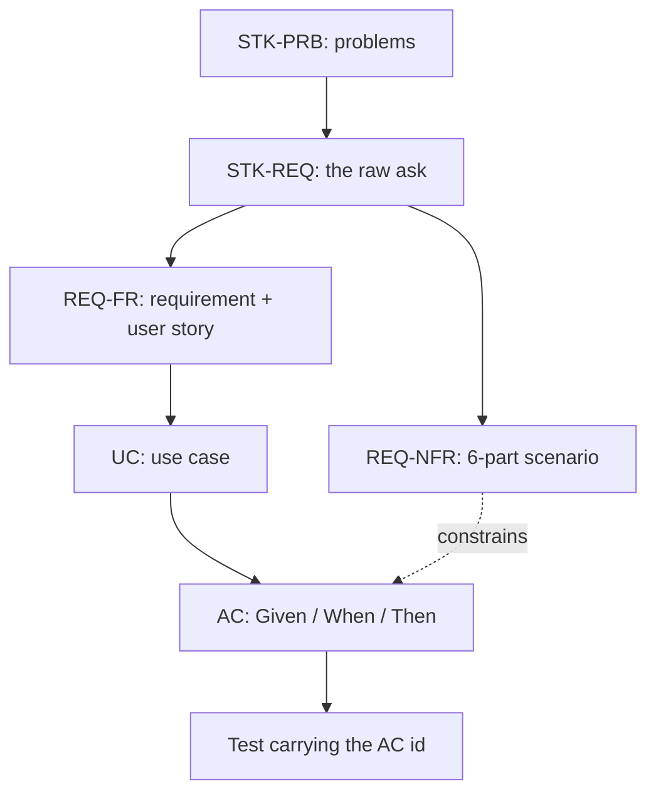

> [!summary] Summary
> A Software Requirements Specification (SRS) states the **problem** first, then what the system does and how well. **Functional requirements (FR)** say *what*: each has a **user story** (the why) and **Given/When/Then acceptance criteria** (the done). **Non-functional requirements (NFR)** say *how well*: each is a **6-part quality attribute scenario** whose last part, the response measure, is a number or a checkable yes/no. vbench keeps exactly this shape, split across the requirements doc and the use-case specs, with a three-part id on everything.

| Concept | Note |
| ------- | ---- |
| **Problem** | What someone struggles with, from their side, with no solution in it, and what leaving it costs. `STK-PRB-nnn`; there can be several. Section 0 of the requirements doc. |
| **Functional Requirement (FR)** | A behaviour the system must perform. `REQ-FR-nnn`, with a user story. |
| **Acceptance Criteria (AC)** | Given/When/Then conditions that define "done" for a requirement. `AC-<area>-<nnn>`, written in the spec of the use case that realises it. |
| **Non-Functional Requirement (NFR)** | A quality or constraint (performance, reliability, ...). `REQ-NFR-nnn`, written as a 6-part scenario. |
| **Quality Attribute Scenario** | Source, stimulus, artifact, environment, response, response measure. |

#### Definition
- **Functional Requirements (FR)**: Statements of what the system does, producing specific outputs from given inputs.
- **Non-Functional Requirements (NFR)**: Quality attributes and constraints on the solution, such as latency, reliability, security and maintainability.
- **Acceptance Criteria (AC)**: Conditions, written as Given/When/Then, that must hold for a requirement to count as done. In vbench a criterion is a plain sentence in a table; it becomes an automated test when a test carries its id (`@pytest.mark.ac("AC-N-001")`). Nothing executes the sentence itself.

#### Note
- **Format of a requirements specification** (shown for a small note-taking app):

**0. Problems** (one row each; a request names the problem it addresses)

| Id | Problem | Who is affected | Cost of leaving it |
| -- | ------- | --------------- | ------------------ |
| `STK-PRB-001` | Thoughts are scattered across unindexed text files. | The note-taker | Ideas are lost. |
| `STK-PRB-002` | Finding an old note means opening every file. | The researcher | Retrieval is slow, so references are not reused. |

**Requests**

| Id | Raised by | Problem | The ask |
| -- | --------- | ------- | ------- |
| `STK-REQ-001` | `STK-PER-001` | `STK-PRB-001` | "I want to organise my notes by topic." |
| `STK-REQ-002` | `STK-PER-002` | `STK-PRB-002` | "I want to find a note by a word in it." |

**Functional requirements**

| Id | Requirement | User story |
| -- | ----------- | ---------- |
| `REQ-FR-001` | The system shall let a note-taker filter saved notes by tag. | As a note-taker, I want to filter my saved notes by custom tags so that I can quickly find ideas belonging to a project. |
| `REQ-FR-002` | The system shall search note titles and bodies by keyword. | As a researcher, I want to search notes by keyword so that I can surface forgotten references. |

**Acceptance criteria** (in the spec of the use case that realises each requirement)

| Id | Given / when / then | Satisfies |
| -- | ------------------- | --------- |
| `AC-N-001` | **Given** notes tagged `architecture` and `testing`, **when** the user filters by `architecture`, **then** only notes tagged `architecture` are listed. | `REQ-FR-001` |
| `AC-N-002` | **Given** a note containing "encapsulation hides internal state", **when** the user searches for "encapsulation", **then** the app returns that note with the matching line highlighted. | `REQ-FR-002` |

**Non-functional requirements** (6-part scenarios)

| Id | Quality | Source | Stimulus | Artifact | Environment | Response | Response measure |
| -- | ------- | ------ | -------- | -------- | ----------- | -------- | ---------------- |
| `REQ-NFR-001` | Performance | End user | Runs a full-text search | Search indexer | Normal operation, 10,000 saved notes | Renders the matching results | Completes in under 150 ms |
| `REQ-NFR-002` | Reliability | Operating system | The process crashes while a note is being written | Storage engine | An active editing session | Restores the unsaved text on restart | Zero words lost that were written more than 3 seconds before the crash |

- **Avoid vague NFRs.** "The search should be fast" cannot fail. The six parts force the missing detail: who, what event, which component, in what state, doing what, measured how. The response measure is the part a test or a measurement checks.
- **Where each part lives in vbench**

| Part of the SRS | Where | Id |
| --------------- | ----- | -- |
| Problems | Requirements doc §0, worked out in a discovery brief | `STK-PRB-nnn` |
| The raw ask, naming its problem | Requirements doc §1.2 | `STK-REQ-nnn` |
| FR and its user story | Requirements doc §4 | `REQ-FR-nnn` |
| Acceptance criteria | The use-case spec's AC table; each names the FR or NFR it satisfies | `AC-<area>-<nnn>` |
| NFR scenario | Requirements doc §8 (§5 is the outline) | `REQ-NFR-nnn` |
| Proof | A test that carries the criterion's id; `vbench check acs` fails when none does | `TST-…-nnn` in the id registry |

#### Related
1. **Executable Specifications**: Turning acceptance criteria into automated tests that document behaviour unambiguously. vbench stops at linking each criterion to a test; it does not run Gherkin.
2. **Architecturally Significant Requirements (ASRs)**: The subset of FRs and NFRs that most shape the architecture; usually the NFRs with demanding response measures.
3. **Quality Attribute Workshop (QAW)**: A session where stakeholders define and rank the NFR scenarios.
4. **Discovery brief**: vbench's pre-requirements analysis, where the problems are settled.

#### References
1. Steve McConnell, *Code Complete*, 2nd Edition (Chapter 3: Measure Twice, Cut Once: Upstream Prerequisites).
2. Len Bass, Paul Clements and Rick Kazman, *Software Architecture in Practice* (the six-part quality attribute scenario).
3. Humberto Cervantes and Rick Kazman, *Designing Software Architectures: A Practical Approach* (architectural drivers and quality attribute scenarios).
4. Robert C. Martin, *The Clean Coder* (Chapter 7: Acceptance Testing).
5. IEEE Computer Society, *Guide to the Software Engineering Body of Knowledge (SWEBOK v3.0)* (Chapter 1: Software Requirements).
