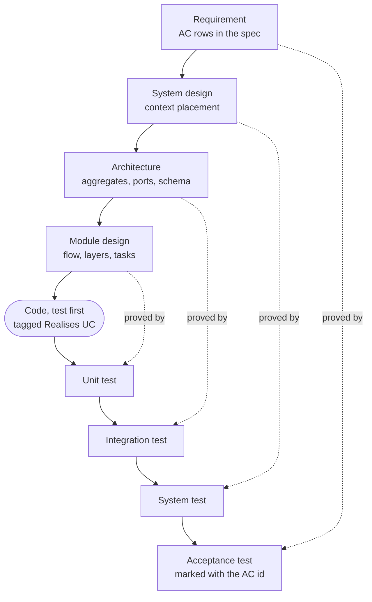

# Engineering Methodology

> The constitution for this repo. The `/vbench:*` skills and `vbench check` read and enforce it. Edit it to
> fit your team, but change it deliberately: it is the contract that AI-assisted work is held to.

## 1. The idea in one paragraph

Three frameworks answer three different questions and do not compete:

- **DDD** (structure): what are the parts, and where are the boundaries?
- **The V-model** (verification): how do we know each part is right? Every specification artifact is
  paired with a proof artifact.
- **Agile** (cadence): in what increments do we build and learn?

They meet at the **use case**, which is the vertical slice. DDD gives it a boundary, the V gives it a
definition of done, and Agile makes it the unit of delivery. Run **many small V's, not one big V**: each use
case is its own V, and it is not done until every rung is closed.

## 2. The V, per use case

| Left arm (specifies) | Right arm (proves) | Artifact |
|---|---|---|
| Requirement | Acceptance test | Use-case spec with `AC-…` rows; tests marked with the AC id |
| System design (context placement) | System test | Context map (`09-context-ddd.puml`); cross-context test |
| Architecture (aggregates, ports) | Integration test | The context's domain model (`NN-<context>-ddd.puml`); class diagram; adapter/boundary tests |
| Module design (flow, layers) | Unit test | Sequence diagram; unit tests |
| Code | (the vertex) | Tagged `Realises UC-…` |

The same V, drawn. Each left-arm artifact is proved by the right-arm test at the same height; the code is the
vertex, written test first.

## 3. The traceability spine

Tags are plain text so they can be grepped and checked without any tool lock-in:

- Production code: a docstring or comment `Realises UC-A-001 · Spec: docs/usecase-diagrams/UC-<id>-<slug>.md`
- Tests: `Verifies UC-A-001 · unit rung.` and a marker per acceptance criterion: `@pytest.mark.ac("AC-A-001")`
- Commits: `feat(UC-A-001/TSK-A-002): …`, `docs(UC-A-001): …` (checked by `vbench check commits`)

`vbench check` proves three things, mechanically: every doc reference resolves (`refs`), every use case
realised in code has a verifying test (`rungs`), and every acceptance criterion has a marked test (`acs`).
It proves a link **exists**, not that the test is good. Test quality is a review concern.

## 4. Human-owned intent

Humans own requirements, acceptance criteria, architecture decisions and sign-off. AI drafts specs, diagrams,
tests and code, and a human approves before work moves down the V. Approval gates are explicit stops in
`/vbench:v-1-requirements` and `/vbench:v-2-design`.

## 5. Code is the source of truth

When a document and the code disagree, record the discrepancy and fix the document. Maturity tags reflect
what the code does today, never what was planned:

| Tag | Meaning |
|---|---|
| ✅ | built, wired end to end, verified |
| 🟡 | partial, mocked, or unverified |
| ⚪ | specified only |

## 6. The rigor dial

Verification and documentation are proportional to stakes. Choose a tier per use case (in the spec's
metadata). Light is the default.

| Tier | When | Produces |
|---|---|---|
| **Light** | Low-stakes, reversible, one context (a filter, a UI tweak, a small fix) | ACs, a few design lines, tests. No new diagrams. |
| **Standard** | A user-facing feature inside one context | + design decisions, verification plan, sequence diagram |
| **Full** | External API, auth/security, schema change, or a new cross-context edge | + class diagram, ADR, integration/system tests, named reviewer |

## 7. Definition of done, per task

A task is done only when every rung it needs is closed:

1. **Requirement.** The use case and its ACs are written and approved by a human.
2. **Structure.** The use case is placed in a bounded context; new aggregates and ports are recorded.
3. **Design.** Diagrams exist as far as the rigor tier requires.
4. **Code.** Implemented behind the context's public interface, tagged `Realises UC-…`.
5. **Tests.** Unit and integration tests pass; each AC has a marked test.
6. **Static.** Lint and type checks clean; the full suite is green.
7. **Trace.** `vbench check` passes, and the docs match the code.

## 8. Decisions

A decision that is expensive to reverse gets an ADR in `docs/02-architecture-decision-record.md`.
ADRs are append-only: reverse one by adding a new ADR that supersedes it.
