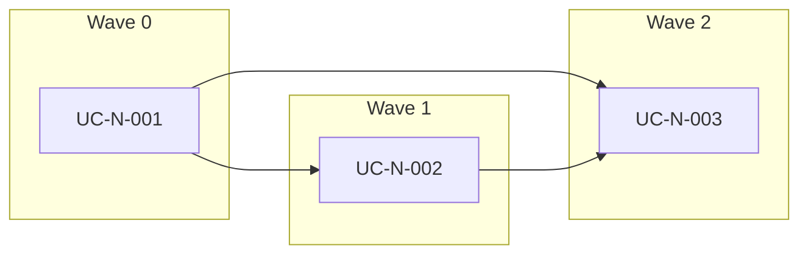

# 01 - Backlog: Epics and Use Cases

> **What this is.** How the requirements are cut into deliverable work, and in what order to build it.
> Use-case ids come from `vbench new uc` (never by hand). Delete the guidance lines as you fill each section.

## 1. How the units relate

```
Stakeholder STK-REQ-nnn     the raw ask                         (requirements doc §1)
   └─ Epic            a large slice of user value         (§3 here)
        └─ Use Case   one actor goal, fully specified,    (§3 here, then the spec file)
           │          and a demoable slice
           └─ Task    a commit-sized technical step       (the spec's Delivery tasks table)

REQ-FR-nnn / REQ-NFR-nnn = the statements a use case must satisfy; its acceptance criteria cite them.
```

| Unit | Answers | Good when it is |
|---|---|---|
| **Epic** | What outcome are we pursuing? | outcome-oriented and vertical, not a layer or a team |
| **Use case** | How does one actor reach one goal, end to end? | complete (every alternate and exception flow) and independently demoable |
| **Task** | What engineering step builds it? | small, technical, ends in a passing test |

## 2. Epic catalogue

| Epic | Outcome | Stakeholder | Use cases |
|---|---|---|---|
| **EPC-N-001** Keep notes | The author can write a note, read it back and correct it. | STK-PER-001 | UC-N-001, UC-N-002, UC-N-003 |

## 3. Use cases per epic

### EPC-N-001: Keep notes

| Use case | Actor goal | Realises | Status |
|---|---|---|---|
| **UC-N-001** Create note | The author saves a new note. | REQ-FR-001 | ✅ |
| **UC-N-002** Read note | The author opens a saved note. | REQ-FR-002 | ⚪ |
| **UC-N-003** Edit note | The author changes a saved note. | REQ-FR-003 | ⚪ |

## 4. Use-case dependencies and build order

> *B depends on A* means A must be built first for B to work or be demoable. Dependencies form a partial
> order: anything not linked can be built in parallel. Record the same links in each spec's header.

### 4.1 Per-use-case dependencies

> Generated from each spec's *Depends on* row, which is the only place a dependency is written. To change one,
> edit the spec header and run `vbench sync`; edits inside the markers are overwritten and `vbench check docs`
> fails on a stale block.

<!-- vbench:begin dependencies -->
| Use case | Depends on | Enables |
|---|---|---|
| **UC-N-001** Create note | - | UC-N-002, UC-N-003 |
| **UC-N-002** Read note | UC-N-001 | UC-N-003 |
| **UC-N-003** Edit note | UC-N-001, UC-N-002 | - |
<!-- vbench:end dependencies -->

### 4.2 Build order (waves)

> Generated: a wave is one more than the deepest thing it depends on. Each wave starts once the previous
> wave's prerequisites are met; within a wave, use cases are independent. An arrow means "must be built first".

<!-- vbench:begin waves -->
| Wave | Use cases |
|---|---|
| **0** | UC-N-001 |
| **1** | UC-N-002 |
| **2** | UC-N-003 |


<!-- vbench:end waves -->

### 4.3 Walking skeleton

> The thinnest end-to-end path, one use case per layer, built before thickening any epic. It is the first
> demoable thing.

```
UC-N-001 (create) → UC-N-002 (read) → UC-N-003 (edit)
```

## 5. Coverage

> Generated from the requirements doc and each spec's *Realises* row. A requirement shown as **none** has no
> use case yet; a use case should satisfy at least one requirement.

<!-- vbench:begin coverage -->
| Requirement | Realised by |
|---|---|
| REQ-FR-001 | UC-N-001 |
| REQ-FR-002 | UC-N-002 |
| REQ-FR-003 | UC-N-003 |
<!-- vbench:end coverage -->
